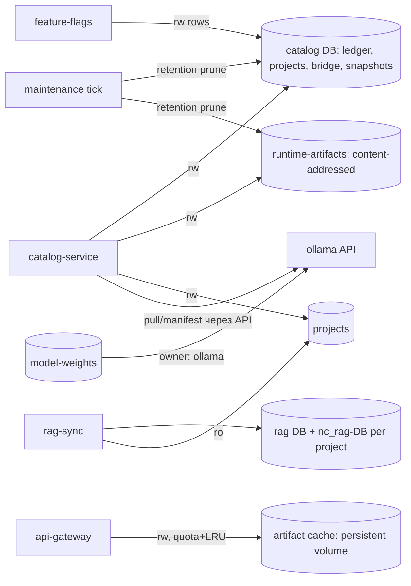

# Architecture Spine — Neurocenter: data layer — schema, storage, retention, квоты

## Design Paradigm

**Данные как контракт.** (1) Схема: три миграционные системы (catalog numeric 0…53, RAG named+structural, feature-flags v1) — **осознанный выбор** (разные lifecycle'ы), но с единым протоколом ledger и явными лок-границами. (2) Хранилище: каноническая карта «volume → кто пишет → mode»; **один владелец записи на volume** — двойные писатели либо устраняются, либо получают API-границу. (3) Retention: каждая растущая сущность — в единой retention-таблице; «никогда не удаляется» — только с зафиксированной причиной. (4) Квоты: quota-поле без enforcement-точки = фэйл — или работает, или не существует в API. (5) Crash consistency: четыре канонических паттерна durable-записи; новый store не изобретает свой.

Решения пользователя (2026-11-05): (1) `projects.quota` — **enforce** (проверка при записи, не декларация); (2) `model-weights` — **ollama = owner**, catalog-хидратация через ollama API (не прямой FS-запись).



## Invariants & Rules

### AD-D1 — Schema versioning (миграционные системы)

- **Binds:** ledger'ы `catalog_schema_migrations` / `feature_flags_schema_migrations` / `neurocenter_rag_migrations` + `neurocenter_rag_schema_versions`, advisory-локи, `access-schema.ts` (catalog), `feature-flags-schema.ts` (ff)
- **Prevents:** скрытая связка через общий advisory-лок (feature-flags **делит** лок `neurocenter:catalog:migrations` с catalog — миграция ff блокирует catalog и наоборот); DDL `security_events` дублируется двумя сервисами — целостность только через ручную идентичность DDL
- **Rule:** три миграционные системы — **ратификация как осознанный выбор** (разные lifecycle'ы: catalog numeric 0…52, RAG named + structural, ff v1). Единый протокол ledger: `(version, name, checksum sha256)`, monotonic, **no-rollback**, история неизменяема (ratify текущий механизм; checksum SQL-текста). Лок-границы явные: **feature-flags получает собственный advisory-лок** `neurocenter:feature-flags:migrations` (не делит с catalog — fix); RAG-локи (`neurocenter:rag:migrations` + 2 structural) — ратификация. `security_events` — **DDL-owner = catalog** (единый источник DDL; feature-flags перестаёт создавать таблицу — удалить DDL из `feature-flags-schema.ts`, запись строк сохраняется); целостность общей таблицы (колонки/индексы) — invariant-тест. Ghost DB `skills` в dev (создаётся init, не используется никем) — **удалить** из dev-init.

### AD-D2 — Storage invariants (volumes и писатели)

- **Binds:** compose volumes (`projects`, `runtime-artifacts`, `model-weights`, `skills`, `backups`, `capacity`), gateway artifact cache, capacity-collector
- **Prevents:** двойные писатели без протокола (`model-weights`: ollama `/root/.ollama` + catalog-хидратация; `projects`: catalog rw + rag-sync rw); кэш артефактов gateway в **tmpdir контейнера без квоты и eviction** (AD-1 runtime-trust заявлены — в коде отсутствуют; при рестарте теряется); volume вне мониторинга (`model-weights` не в capacity-ресурсах — переполнение не видно)
- **Rule:** каноническая карта volume→service→mode — часть данных окружения (drift-тест — стык с AD-OP-1 operational spine). **Один владелец записи на volume:** (1) `model-weights` — **owner = ollama**; catalog-хидратация — **только через ollama API** (pull/manifest), прямой FS-запись из catalog запрещён (решение 2026-11-05); (2) `projects` — write-owner = catalog, rag-sync — **read-only** (fix: текущий rw-маунт → ro); (3) gateway artifact cache — **персистентный volume + LRU-eviction под per-project квотой** (реализация AD-1 runtime-trust; **механизм: per-project used-bytes accounting (общий с AD-D4) + eviction по oldest-access при переполнении квоты**; volume — часть модели AD-OP-1, env-локация (`NEUROCENTER_MCP_HOST_DIR`) — часть config-схемы gateway, стык с AD-9 runtime-trust; кэш живёт между рестартами); (4) `runtime-artifacts`/`skills`/`backups`/`capacity` — одиночные писатели (ратификация). Content-addressing — инвариант `runtime-artifacts` (sha256, immutable, `.`-partial tmp+rename — ратификация; AD-D5). **`model-weights` добавляется в capacity-ресурсы** (7-й ресурс) с **schemaVersion-gate**: в период смешанного rollout'а новый ресурс **факультативен** для старых ридеров (`validateSnapshot` hard-fail'ит на отсутствующем ключе — иначе одна сторона без ключа = массовый CAPACITY_UNAVAILABLE), обязательный — после полного rollout'а; стык с AD-18 runtime-trust.

### AD-D3 — Retention (TTL / rolling / ручной)

- **Binds:** `maintenance.mjs` tick, prune-джобы, project-deletion, retired-rag.service.ts, S3 snapshot GC
- **Prevents:** ~12 unbounded-таблиц/файлов без retention (линейный рост с трафиком: `security_events`, `operations`/`operation_action_requests`, `bridge_jobs`, `bridge_runtime_artifacts`+tar.gz, `ai_plugin_versions`, `model_usage_calls`, skill-versions, `rag_quota_events`, chat-таблицы, `maintenance_runs`, `retired_rag_previews`, `bridge_local_change_plans`); `DELETING`-blobs в S3 накапливаются вечно, если verifier не здоров; backup lock file освобождается **вручную** после краха; **удаление проекта не удаляет данные** (локальная папка, S3-blobs, dump, per-project RAG-DB каскадом не затрагиваются)
- **Rule:** единая retention-таблица (данные): ресурс → режим — **TTL** / **rolling N** / **ручной** / **project-scoped** / **none (с причиной)**; значения TTL фиксируются в таблице одним решением (не по одной таблице в разном месте). **Single source: `deploy/production/retention.json`** (ресурс → {mode, ttl|rollingN, reason, cascadeRef, prune-location, owner-service}); значения не дублируются в коде/документе — идентичность значений в коде (bridge_pairs, chat-activity, token bridge_devices) и полнота инвентаря (0 накопителей вне таблицы; `none` — только с причиной) проверяет `scripts/test/retention-inventory.test.mjs`. Prune — в **maintenance-tick** (существующий механизм, ратификация; реализация — story 8); project-scoped — каскад удаления проекта (story 11). Новые/фиксы: (1) TTL для unbounded-таблиц (см. список Prevents) — prune в tick; (2) **in-process GC-fallback для S3 snapshot-blobs**: `DELETING` старше фиксированного возраста без живого verifier'а — reclaim (idempotent; существующий 2-фазный GC с refcount ратифицируется как основной путь); (3) **backup lock file — TTL + auto-release по heartbeat** (fix; механизм — AD-OP-4 operational spine); (4) **project deletion = полный каскад с receipt**: локальная папка + S3-объекты (snapshots, chat-оригиналы) + per-location dump + **per-project RAG-DB** — через референс-паттерн `retired-rag.service.ts` (preview→purge→receipt, freeze+DROP): **ручной purge остаётся ручным** (`automaticPurge:false` — ратификация); **автоматическое retirement — только как триггер подтверждённого удаления проекта** (отдельный путь, не флаг); freeze-протокол при активных сессиях: freeze останавливает записи (существующий механизм), активные сессии истекают по TTL (задокументировать); (5) skill-versions — **rolling N (N=2)** — новое retention-правило (server-side prune сейчас отсутствует вообще; значение выбрано по аналогии с cleanup-политикой bridge-клиента — не ратификация).

### AD-D4 — Quota enforcement

- **Binds:** `projects.quota` (JSONB), RAG per-project budget, snapshot-бюджеты, `reserveCapacity`, gateway artifact cache
- **Prevents:** «quota-поле без enforcement-точки» — пользователь видит лимит, который не работает (`projects.quota`: `currentBytesLimit`/`retentionBytesLimit`/`stagingBytesLimit` — **ноль** кода, читающего/принуждающего); дрейф заявленного и фактического
- **Rule:** **правило: любое quota-поле в API/DB обязано иметь enforcement-точку (файл) и тест; иначе поле удаляется из API.** (1) `projects.quota` — **enforce** (решение 2026-11-05): проверка **до записи** в проект (files/retention/staging). **Механизм — новый (не ратификация)**: персистентный **per-project used-bytes accounting** + сравнение с лимитом до записи; глобальный `reserveCapacity` (существует) покрывает только общие ресурсы и **не заменяет** per-project (одной глобальной проверки недостаточно — один проект выжигает общий том). Единый путь project-записей — через accounting (обход = фэйл-тест); (2) RAG per-project byte budget (default 1GiB / max 16GiB, deferred-constraint triggers + write-lock — ратификация, enforced в DB); (3) snapshots per-project 64GiB / total 256GiB + free-space check (ратификация); (4) gateway artifact cache — per-project квота + LRU-eviction (AD-D2; реализация AD-1 runtime-trust); (5) GGUF (лимиты в `model_gguf_uploads.limits` + pending-сумма — ратификация); (6) chat-вложения 10MiB / text 128KiB (ратификация; потолок — AD-1 runtime-trust).

### AD-D5 — Crash consistency (durable writes)

- **Binds:** runtime-artifact writes, snapshot blob-writes, uploads, bridge jobs, backup lock
- **Prevents:** partial-write без recover-паттерна; новый store «изобретает» свой способ; получатель артефакта не может проверить целостность
- **Rule:** четыре канонических паттерна — **все уже в коде, ратифицируются как единственный выбор** для любого нового durable-store: (1) **tmp+rename+fsync** (runtime-artifacts `.`-partial — ратификация); (2) **2-фазные writes + recover-таблица** (snapshot `blob_writes` — ратификация); (3) **lease-токены с recheck** (upload-leases 500ms, bridge job leases — ратификация); (4) **idempotency через unique-индексы + row-lock** (`bridge_job_requests` UNIQUE(email,request_key) + `FOR UPDATE` при enqueue — ратификация; против double-booking). Новый store без зафиксированного паттерна = фэйл. **`forwardRuntimeArtifact` (gateway-стрим): SHA-256 в response-header + client-верификация** (сейчас: стрим по длине 256MiB-чека, верификации у получателя нет — fix; sha256 уже несётся в дескрипторе — стык с AD-2 runtime-trust).

**Ратификация (entry 5.12, main @ 273b9118): таблица «операция → паттерн» — единый источник.**

| Операция | Паттерн | Реализация (file:line) |
|---|---|---|
| Импорт одобренного runtime-архива (каталог) | 1: tmp+link+fsync | `services/catalog-service/src/runtime-artifacts/runtime-artifacts.ts:61-135` — `.`-partial :68, SHA при копировании :74-94, `output.sync()` :98, `fs.link` (не перезаписывает) :105, dirsync :112-122 |
| Повторное чтение runtime-архива | 1 (+ SHA recheck) | `runtime-artifacts.ts:159-203` — `open()`: SHA-256 файла + inode/mtime-стабильность до стрима (источник достоверен) |
| Source upload | 1 | `services/catalog-service/src/source-upload/source-upload.files.ts:67-108` — `.partial` :67, `file.sync()` :99, `fs.rename` :105, dirsync :108 |
| GGUF import | 1 | `services/catalog-service/src/models/gguf-import/gguf-import.files.ts:61-99` — `.partial` :61, `handle.sync()` :91, `fs.rename` :96, dirsync :99 |
| Backup (pg_dump) | 1 | `services/catalog-service/src/catalog/backup.ts:173-186` — `.partial` :176-177, публикация `link`-без-перезаписи :183-185 |
| Snapshot blob-writes | 2: 2-фазные + recover | `services/catalog-service/src/snapshots/snapshot-storage.ts:418` — `recoverWrite()`, `project_snapshot_blob_writes` :221-332 |
| Snapshot GC (blob-удаление) | 2 | `services/catalog-service/src/snapshots/snapshot-gc.ts:7-150` — 2-фазный `DELETING` + security event :140 |
| Bridge job lease | 3: lease-токен + recheck | `services/catalog-service/src/devices/device-jobs.ts:638-641` — выдача lease + `lease_until` 3 min; `:782` — recheck `lease + lease_until>now()` в каждом authorize |
| GGUF runtime (Ollama) | 3 | `services/catalog-service/src/models/gguf-runtime/gguf-runtime.service.ts:208-214` — `pg_try_advisory_lock` на dedicated lease-соединении; `:196-206` — recheck/abort при потере аренды; unlock :306-314 |
| Upload lease (recheck при копировании) | 3 | `services/catalog-service/src/source-upload/source-upload.files.ts:83` — digest-recheck каждые 500 ms |
| Gateway artifact stream (lease-перехват) | 3 | `services/api-gateway/src/proxy/runtime-artifact-stream.ts:27` — `x-neurocenter-job-lease` форвардится каталогу; gateway не хранит состояние задания |
| Device job request (idempotency) | 4: unique + row-lock | `services/catalog-service/src/devices/device-job-requests.ts:23-41` — `findDeviceJobRequest` (сверка receipt); `:47-61` — `saveDeviceJobRequest`, UNIQUE(email,request_key) + `ON CONFLICT DO NOTHING` :55 |

**SHA-фикс `forwardRuntimeArtifact` (entry 5.12, решение OQ-3 = б — client-верификация):** gateway-стрим не буферизуется и **SHA не считает** — SHA известна клиенту из одобренного дескриптора/URL `:sha256` (`device.controller.ts:236-254` валидирует `/^[a-f0-9]{64}$/`), поэтому «SHA-256 в response-header» трактуется как «SHA доступна клиенту + клиент верифицирует»: (1) клиент считает SHA-256 принятого потока и сравнивает с одобренным до публикации — `mcp/neurocenter-asset-sync/src/features/runtime-artifacts/cache.ts:470-501` (mismatch → `RuntimeArtifactIntegrityError`, файл не активируется); (2) gateway сохраняет length-чеки (256MiB-бюджет route-policy, `received>length` — `runtime-artifact-stream.ts:38,52`) и `content-length` (протокольный инвариант клиентского budget-check, `runtime-artifact-download.ts:73`) — trailer не используется (требует chunked без content-length = смена device-протокола); (3) OQ-4: device докладывает mismatch в квитанции подготовки (`runtime-preparation-intent.ts` — `artifactIntegrity{expected,computed}`, код `runtime-artifact-sha-mismatch`), catalog атомарно пишет `security_events` (action `installation.artifact.integrity`) в транзакции завершения задания (`device-completion.ts`); повторный ACK — без повторного события; (4) backward-compat (OQ-2): старым клиентам ничего не требуется — сервер не добавил обязательных элементов, верификация — опция нового клиента на переходный период.

**Инвариант (OQ-5 = review-чеклист, не grep):** новый durable-store (любая запись в shared volume) принимается на review только если зафиксированы: (1) соответствие операции одному из 4 паттернов таблицы выше — иначе фэйл; (2) file:line конкретного механизма (tmp/recover/lease/unique); (3) тест crash/recovery-пути (SIGKILL / обрыв / повторный ACK).

## Known Defects (вне AD — фиксируются для реализации)

- **`projects.quota` декларативна** — ноль enforcement (fix AD-D4).
- **Gateway artifact cache в tmpdir, без квоты/eviction** (artifact-cache.ts) — fix AD-D2.
- **Project deletion = только FK-cascade по БД** (project-deletion.ts) — fix AD-D3 (каскад с receipt).
- **`security_events` двойной DDL + общий миграционный лок** — fix AD-D1.
- **Backup lock file — ручное освобождение после краха** — fix AD-D3 (TTL/heartbeat).
- **Ghost DB `skills` в dev** — fix AD-D1 (удаление).
- **`bridge_devices.report->bindings` — client-reported JSONB** — устройство само заявляет bindings; при компрометации токена может заявить чужие. Mitigation = trust-модель (token = owner-зона bridge — AD-4 runtime-trust); аудит device.bind/revoke (AD-O7).

## Consistency Conventions

| Concern | Convention |
| --- | --- |
| Ledger | version+name+checksum, monotonic, no-rollback, история неизменяема |
| Локи | явная граница: каждая миграционная система — свой advisory-лок |
| Volumes | один write-owner; карта = данные (drift-тест) |
| Content-addressing | sha256, immutable (runtime-artifacts, snapshot blobs, skill-versions) |
| Retention | всё растущее — в retention-таблице; none только с причиной |
| Quota | quota-поле без enforcement-точки = фэйл |
| Durable writes | только 4 паттерна; новый store выбирает зафиксированный |
| Project deletion | полный каскад (БД + файлы + S3 + RAG-DB) с receipt |

## Stack

| Name | Version |
| --- | --- |
| PostgreSQL | pgvector/pgvector:pg16 (digest-pinned — production) |
| node-postgres (pg.Pool) | raw SQL, без ORM (ратификация) |
| LanceDB (per-project RAG) | embedded; биндинги собраны в образ rag-sync |
| S3 (snapshots/chat/external backup) | HTTPS-DNS endpoint, SigV4, readback-верификация |

## Structural Seed

```text
catalog DB
  catalog_schema_migrations / feature_flags_schema_migrations / neurocenter_rag_migrations
  security_events          # DDL-owner = catalog (AD-D1)
  error_events              # AD-O5 observability spine (retention — AD-D3)
RAG DB (nc_rag_template + nc_rag_<sha256> per project)
  rag_storage_settings/budget/events, neurocenter_database_* (lifecycle, purge receipts)
volumes
  projects        (write-owner: catalog; rag-sync ro — AD-D2)
  runtime-artifacts (owner: catalog; content-addressed, immutable — AD-D2)
  model-weights   (owner: ollama; catalog через API — AD-D2)
  skills          (owner: skills-service; rolling 2 — AD-D3)
  backups         (owner: catalog+maintenance; keep 5 per location — ратификация)
  capacity        (owner: capacity-collector; + model-weights ресурс — AD-D2)
  artifact-cache  (НОВЫЙ: gateway, quota+LRU — AD-D2)
scripts/production/maintenance.mjs   # tick: backup policy + retention prune (AD-D3)
services/catalog-service/src/retired-rag/retired-rag.service.ts  # референс: preview→purge→receipt
```

## Capability → Architecture Map

| Capability / Area | Lives in | Governed by |
| --- | --- | --- |
| D1 schema versioning | 3 миграционные системы + ledger'ы | AD-D1 |
| D2 storage invariants | volumes + писатели + cache | AD-D2 |
| D3 retention | retention-таблица + maintenance tick | AD-D3 |
| D4 quota enforcement | projects.quota + RAG/snapshots/cache | AD-D4 |
| D5 crash consistency | 4 паттерна + artifact SHA | AD-D5 |

## Deferred

- **Физическая квота/изоляция per-project PG-БД** (postgres mem 1g на все проектные БД) — revisit: при росте числа проектов (стык с AD-OP-6 operational spine).
- **pgvector вместо `double precision[]` для эмбеддингов** (search_vectors сегодня — plain arrays) — revisit: при росте объёма векторного поиска.
- **WAL streaming / replica (RPO ниже полного бэкапа)** — revisit: при требовании; owner — operational spine (AD-OP-4).
- **Множество PG-инстансов / sharding** — revisit: при выходе за single-host.
- **Dev PG на 127.0.0.1:5432 без пароля-разграничения** (recon-data L11) — dev-only, приемлемо (revisit: при унификации dev-конфигов с production-моделью).
