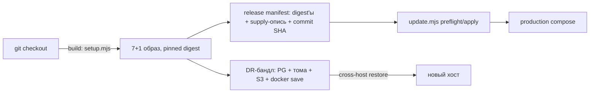

# Architecture Spine — Neurocenter: deployment, поставка релизов, DR и окружения

## Design Paradigm

**Декларативное окружение + неизменяемый релиз.** Окружение (сервисы, образы, лимиты, секреты, порты) — **данные**, из которых compose-файлы сверяются drift-тестом; ручная правка compose в обход модели не допускается. Релиз — **манифест**: pinned digest'ы всех образов + supply-опись (все артефакты bridge-dist, опись миграций) + commit SHA; production работает только с манифестом. DR — **бандл, достаточный для восстановления на другом хосте**: данные + тома + S3-объекты + **сами образы релиза**.

Решения пользователя (2026-11-05): (1) поставка — **ручная сборка + DR-включает образы** (registry/CI/подпись — Deferred); (2) **staging отсутствует осознанно** — буфер = rehearsal на копии данных + cross-host DR-restore; (3) **стек и мониторинг живы под supervision** (systemd).



## Invariants & Rules

### AD-OP-1 — Deployment как данные

- **Binds:** compose.production.yml, docker-compose.yml, overlay'и, `setup.mjs`/`update.mjs`
- **Prevents:** мёртвые env-переменные (`BRIDGE_DIST` не читается нигде), расхождения dev↔prod, лимиты, существующие только в одном compose
- **Rule:** единственная машино-читаемая модель окружения (сервисы → образ+digest, сети, mem/cpus/pids, read_only/cap/seccomp, секреты, публикуемые порты, volumes) живёт в репо как данные; compose-файлы (dev/prod/overlay'и) сверяются с моделью **drift-тестом в двух направлениях**: compose→code (env в compose без чтения в коде = **dead-env фэйл**; стык с AD-9 runtime-trust: config schema = источник имён) и code→compose (**required** env из config schema, не заданный в compose = фэйл). Модель расширяется другими spine'ами инициативы (prometheus/alertmanager — AD-O6, volume artifact-cache — AD-D2). pids_limit — в якорь `x-service` (все сервисы получают baseline) + per-service overrides. Известный дефект H5 (production bridge-endpoints 404: `BRIDGE_TEMPLATES_DIR` не задан, fallback `bridge.controller.ts:18` → `/bridge-dist` вместо `/app/bridge-dist`) закрывается **обратным направлением** drift-теста (required env отсутствует в compose) + явным `BRIDGE_TEMPLATES_DIR=/app/bridge-dist` в модели + регресс-тестом резолва шаблонов из собранного образа.

### AD-OP-2 — Модель поставки релиза (ручная сборка, supply-манифест, образы в DR)

- **Binds:** `setup.mjs build`, `update.mjs`, Dockerfiles, `bridge-dist/`, DR-бандл
- **Prevents:** «pinned digest» из той же локальной сборки без описи содержимого; stale `bridge-dist/runtime|opencode` (~750 MB, `.dockerignore` не исключает) в образе; гибель хоста → потеря образов вместе с данными (H6)
- **Rule:** сборка — с **чистого git-checkout** (commit SHA в манифесте; локальные незакоммиченные изменения = фэйл сборки). Манифест релиза `neurocenter-release-v1`: pinned sha256 digest всех 7 app-образов + postgresImage + **supply-опись** (перечень + SHA всех архивов `bridge-dist/runtime|opencode`, шаблонов installers, версии vendor-контракта) + опись миграций (из pinned-образа — механизм уже есть). Preflight update верифицирует **весь** манифест (сейчас — digest'ы образов + опись миграций из pinned-образа + квитанция репетиции; **supply-опись — новое**). **DR-бандл включает `docker save` всех pinned-образов релиза** — бандл достаточен для restore на другом хосте без registry. `--pull never` ратифицируется (внешних registry нет). Deferred (revisit: при выходе на второй хост/построителя): внутренний docker registry, cosign-подпись, CI-сборка.

### AD-OP-3 — Upgrade-модель (ратификация `neurocenter-update-v1` + критерии готовности)

- **Binds:** `update.mjs`, `schema-migrations.mjs`, `docs/production-update.md`
- **Prevents:** update без rehearsal; in-place rollback (отсутствует осознанно); supply образов постфактум
- **Rule:** план `neurocenter-update-v1` — эталон: pinned digest'ы, rehearsal на копии данных (квитанция `rehearsalSha256`: passed/copyOfData/settingsPreserved/repeatSafe/restoreVerified), история миграций = точный префикс, rollback = **только restore-new-project** (in-place rollback не существует — зафиксировано). Дополнения: (1) **supply целевых образов на хост до update** — preflight требует их наличия с валидным supply-манифестом (AD-OP-2); (2) смена топологии (число/роль сервисов) — только через restore-new-project; (3) `maxPauseMs` — SLO-параметр (60 с…24 ч — валидация update-плана; у maintenance policy отдельное поле `maxPauseMinutes`). **Критерии готовности релиза** (решение «нет staging»): rehearsal на копии данных пройден + cross-host DR-restore пройден (AD-OP-4) + **нет деградации против baseline корневого сьюта** (Δ: нет новых failures/skips; абсолютные числа смещаются с ростом сьюта — конвенция runtime-trust). Staging-окружение — осознанно отсутствует; revisit: при росте частоты update.

### AD-OP-4 — DR-модель

- **Binds:** `recovery.mjs`, `external-backup.mjs`, `maintenance.mjs`, `web-restore-runner.mjs`, systemd
- **Prevents:** «бэкап есть, восстановить нельзя»: образы вне бандла, секреты вне бандла без механизма, RPO/RTO ненамеренные
- **Rule:** scope бандла: все PG-БД (pg_dump custom), 4 тома (skills/projects/backups/runtime-artifacts), S3-объекты (snapshots, chat-оригиналы), **pinned-образы релиза (docker save — AD-OP-2)**. Вне бандла: capacity (производный), model-weights (осознанно — **задокументированный residual: веса не входят в release-манифест, они не часть supply релиза — AD-D2; DR-restore требует доступ к model-registry (ollama pull) или ручную повторную загрузку GGUF**), **production-конфиг/секреты — обязательное независимое хранилище** (не на том же хосте; runbook). RPO/RTO — **измеримые цели**: первая измеренная репетиция = baseline, дальше политика в `maintenance_settings`. **Критерии готовности** (сейчас «ещё не выполнены»): (1) приёмка на независимом S3; (2) **cross-host restore на другом физическом хосте**; (3) supply образов из бандла. Backup lock file: **TTL + auto-release по heartbeat** (сейчас — ручное освобождение после краха; сервисы могут остаться остановленными). Ротация секретов (internal_token, metrics_token, sso_client_secret, model_credential_key, postgres_password) — **DR-компонент**: runbook на каждый + запись последствий (internal_token → гашение всех билетов, стык AD-4 runtime-trust). Local backup-root: проверка «отдельный физический диск» валидатором, не только в доках.

### AD-OP-5 — Environments и config-матрица

- **Binds:** dev.mjs, compose.production.yml, `NEUROCENTER_CONFIG_DIR`, `.env.example`
- **Prevents:** dev-дефолты обходов в production-конфиге; расхождение окружений, не описанное ни в одном документе
- **Rule:** матрица dev/production (staging отсутствует — решение 2026-11-05): **разрешено отличаться** — env_file vs 0700-конфиг-каталог, `SSO_DISABLE`/`RAG_AUTH_DISABLED` (dev-only), публикуемые порты (dev — 127.0.0.1, prod — 80/443), build-on-fly vs метка-релиза; **запрещено** — dev-дефолты обходов в production-конфиге: `configure` **не пишет** их в production `.env` (их нет в модели); отклонение конфига, содержащего их = **`validateProduction` на старте сервиса** (существующий механизм) + drift-тест AD-OP-1 (модель запрещает эти ключи в production); production-конфиг как приватный каталог 0700 с file-secrets — ратификация текущего механизма; `latest`-теги запрещены (ратификация).

### AD-OP-6 — Resource limits и hardening как контракт

- **Binds:** все Dockerfiles, compose.production.yml, `x-service` anchor
- **Prevents:** root во всех 7 контейнерах (H3); fork-бomba → OOM хоста (9 из 12 сервисов без pids_limit); setup-контейнеры без лимитов
- **Rule:** (1) **non-root `USER` во всех 7 app-образах** (+ audit capabilities; nginx-фронтенд — worker уже non-root); (2) `pids_limit` — в якорь `x-service` (baseline) + per-service overrides (model 512, capacity 32, ff 128 — ратификация); database-init/bootstrap-admin получают mem/pids-лимиты; (3) таблица mem/cpus/pids/read_only/cap/seccomp на сервис — часть модели AD-OP-1 (drift-тест); postgres: mem 1g на все проектные БД — ревью при росте (Deferred, data spine: физическая квота/изоляция проектных БД); (4) pids_limit/non-root для **child-MCP** — AD-4 runtime-trust (не дублируется: контейнерный уровень ≠ процесс child-MCP).

### AD-OP-7 — TLS/CA lifecycle (операционная часть)

- **Binds:** Dockerfiles, compose, `docker/build-ca/`, installers, nginx edge
- **Prevents:** MITM production-outbound (H2); истёкший edge-сертификат без алерта (M2); MITM bootstrap-установки (M1)
- **Rule:** целевое состояние (internal CA, scoped trust) — **AD-15 runtime-trust**; операционные решения: (1) runtime `NODE_TLS_REJECT_UNAUTHORIZED=0` в production gateway — **запрещено** (compose ENV + Dockerfile ENV удаляются; корпоративный CA — через `NODE_EXTRA_CA_CERTS`, механизм уже в Dockerfile'ах); (2) build-этапы (npm ci, apt `Verify-Peer=false`, `curl --insecure` для PGDG-ключа, `strict-ssl=false` в .npmrc) — **interim с переходным планом**: корпоративный CA в build-окружении + strict-ssl; (3) edge-сертификат: **runbook ротации** (замена + пересоздание frontend) + **алерт на days-to-expiry** (в alerting AD-O6); (4) bootstrap-установщики (`curl --insecure`, `-SkipCertificateCheck`): interim — задокументированный residual (SHA выдаёт тот же gateway — integrity ограничен доверием к первому контакту); целевое — SPKI-pinning/CA-бандл в установщиках (Deferred); (5) межсервисный plain HTTP в backend-сети — **задокументированный residual** (closed network, нет pids-изоляции между сервисами — AD-OP-6); revisit: при появлении внешнего доступа к backend-сети. 13 корпоративных CA в `docker/build-ca/` — sha256-pin на сборку (ратификация); ротация корп. CA = изменение репо + пересборка (зафиксировано).

### AD-OP-8 — Supervision & monitoring-матрица

- **Binds:** systemd units, `deploy/production/monitoring/`, compose
- **Prevents:** «кто контролирует, что стек и мониторинг живы» — не определено (M7); алерты существуют, но не могут сработать
- **Rule:** на хосте (systemd, `User=neurocenter-operator`): maintenance timer (есть — ратификация) + **stack-watchdog** (новый unit: периодическая проверка health всех compose-сервисов + самого мониторинга; сбой = алерт + attempt-restart по политике compose) + node_exporter (host-level); prometheus/alertmanager — **compose-сервисы** (AD-O6 observability spine, не systemd — единая топология). Матрица алертов = 9 базовых (`neurocenter-alerts.yml`) + cert-expiry (AD-OP-7) + stack-down + **каждый сервис в scrape targets** (completeness-тест; fix: feature-flags-service:4400 отсутствует) — механизм алертинга: AD-O6 observability spine.

### AD-OP-9 — npm-поставка: ссылка на AD-15 + interim-ратификация

- **Binds:** Dockerfiles (npm-сборка), host-сборки, `.npmrc`
- **Prevents:** наследование machine-`.npmrc` в сборки (скрытый drift источников)
- **Rule:** целевое состояние (локальные registry, align 249, решение по 44 missing) — **AD-15 runtime-trust spine** (не дублируется). Operational-факты: (1) текущая изоляция — `NPM_CONFIG_REGISTRY=npmjs.org` + `USERCONFIG=/dev/null` + пустой GLOBALCONFIG (machine-конфиг никогда не участвует) — **ратифицируется как interim**: воспроизводимость важнее источника до перехода; (2) `strict-ssl=false` в build-этапах — interim, переходный план AD-OP-7(2); (3) private-пакеты через `file:`-зависимости (`@neurocenter/ollama-runtime`, `@neurocenter/asset-contract`) — ратификация (vendor в дереве = часть producer-closure, AD-17 runtime-trust).

## Known Defects (вне AD — фиксируются для реализации)

- **H5:** production bridge-endpoints 404 — `BRIDGE_TEMPLATES_DIR` не задан в compose.production.yml, `BRIDGE_DIST` мёртвая переменная. Фикс: явный `BRIDGE_TEMPLATES_DIR` в модели (обратное направление drift-теста AD-OP-1: required env ⊆ compose) + регресс-тест резолва шаблонов из собранного образа.
- **H6-приёмки:** DR-приёмки (независимый S3, cross-host restore) ещё не выполнены — критерии готовности AD-OP-3/AD-OP-4.

## Consistency Conventions

| Concern | Convention |
| --- | --- |
| Release manifest | генерируется тулингом; ручная правка запрещена; `latest`-теги запрещены |
| Сборка | только с чистого git-checkout; commit SHA в манифесте |
| DR | бандл = достаточное состояние для restore на другом хосте (данные + тома + S3 + образы) |
| Секреты | runbook ротации + запись последствий на каждый секрет (AD-OP-4) |
| Окружения | dev-обходы (`SSO_DISABLE`, `RAG_AUTH_DISABLED`) в production-конфиге = фэйл |
| Лимиты | baseline pids в якоря compose; non-root USER во всех app-образах |
| TLS | runtime-TLS-off в production запрещён; build-TLS-off — interim с планом |
| Monitoring | каждый сервис в scrape targets; watchdog на стек и на мониторинг |

## Stack

| Name | Version |
| --- | --- |
| Node.js | 24 (node:24.22.0-bookworm-slim, digest-pinned) |
| PostgreSQL | pgvector/pgvector:pg16 (digest-pinned — production) |
| Ollama | ollama/ollama:0.35.1 (digest-pinned) |
| nginx (frontend) | 1.30.6-alpine (digest-pinned) |
| systemd | maintenance timer + watchdog + monitoring units |
| Prometheus/Alertmanager | config в `deploy/production/monitoring/` (deploy — AD-O6) |
| S3 (chat/snapshots/external backup) | HTTPS-DNS endpoint, SigV4, readback-верификация |

## Structural Seed

```text
scripts/production/
  setup.mjs          # configure|check|build|seed|up|status
  update.mjs         # preflight|apply (neurocenter-update-v1)
  recovery.mjs       # backupOperation / previewRestoreProduction / restoreProduction
  external-backup.mjs# S3-транспорт (SigV4, readback)
  maintenance.mjs    # tick: backup policy, purge (AD-D3 data spine)
deploy/
  maintenance/neurocenter-maintenance.{service,timer}
  production/monitoring/{prometheus.yml, neurocenter-alerts.yml}
  # новые: stack-watchdog.service, prometheus.service, alertmanager.service, node_exporter.service
docker/build-ca/     # 13 корп. CA (sha256-pin на сборку)
```

## Capability → Architecture Map

| Capability / Area | Lives in | Governed by |
| --- | --- | --- |
| O1 окружение как данные | compose + setup.mjs | AD-OP-1 |
| O2 поставка релиза | setup.mjs build + update.mjs + DR | AD-OP-2 |
| O3 upgrade | update.mjs + migrations | AD-OP-3 |
| O4 DR | recovery.mjs + external-backup + restore | AD-OP-4 |
| O5 environments | dev.mjs + config-каталог | AD-OP-5 |
| O6 limits/hardening | Dockerfiles + compose | AD-OP-6 |
| O7 TLS/CA lifecycle | Dockerfiles + nginx + installers | AD-OP-7 |
| O8 supervision | systemd + monitoring | AD-OP-8 |
| O9 npm-поставка | Dockerfiles + .npmrc | AD-OP-9 → AD-15 runtime-trust |

## Deferred

- **Внутренний docker registry + cosign-подпись + CI** (H1/M4) — revisit: при выходе на второй хост/построителя или разделении build/production-контура.
- **Staging-окружение** — revisit: при росте частоты update, когда rehearsal на копии данных перестанет быть буфером.
- **SPKI-pinning/CA-бандл в bootstrap-установщиках** (M1) — revisit: при появлении внешнего (не closed) канала установки.
- **Межсервисный TLS в backend-сети** — residual зафиксирован (AD-OP-7(5)); revisit: при внешнем доступе к backend-сети.
- **WAL streaming / replica (RPO < период бэкапа)** — revisit: при требовании RPO ниже полного бэкапа.
- **Физическая квота/изоляция проектных PG-БД** (postgres mem 1g, M5) — revisit: при росте числа проектов; owner — data spine (AD-D2).
