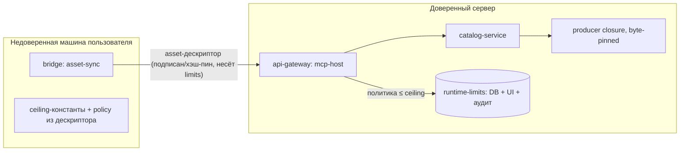
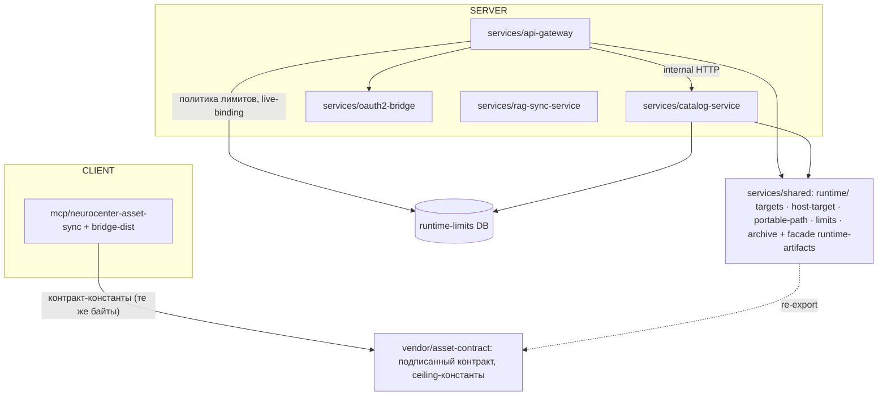

# Architecture Spine — Neurocenter: trust-границы, модель лимитов и целостность поставки

## Design Paradigm

**Signed-contract pipeline.** Между недоверенной машиной пользователя (client bridge) и доверенным сервером ходят только **подписанные/хэш-закреплённые артефакты**; каждая сторона применяет к ним свою силу доверия:

- **Клиент** применяет **контракт-константы** (ceiling) + значения политики, доставленные внутри верифицированного дескриптора. Ничего, что зависит от env машины пользователя, не входит в security-логику клиента.
- **Сервер** применяет **админ-настраиваемую политику** (DB + UI + аудит), ограниченную тем же ceiling.
- **Ceiling** — константа компиляции, администратором не поднимается; это DoS-страховка, а не настройка.



## Invariants & Rules

### AD-1 — Двухуровневая модель лимитов (контракт / политика)

- **Binds:** все storage/machine-секции runtime-limits: runtime-artifacts (compressedBytes, unpackedBytes, filesCount, cacheBytes — новая секция), runtime-cache, rag-quota, snapshot, backup, gguf-disk; существующие секции textKnowledge и ggufImport уже живут в этой модели — AD-1 её ратифицирует и расширяет
- **Prevents:** ослабление client-side guard окружением пользователя; безграничный admin-knob; расхождение клиентских и серверных значений; модель, покрывающая 15% реальных лимитов
- **Rule:** модель покрывает **все storage/machine-секции** runtime-limits: каждая секция имеет **ceiling** (константа в shared, общая для клиента и сервера, админом не меняется) и **политику** (значение, настраиваемое админом в UI, всегда `default ≤ policy ≤ ceiling`, хранится в runtime-limits DB). Протокольные константы (package 5 MiB, discussion 16k, skill-лимиты и т.п.) **вне модели** — замороженные константы с drift-тестом (client ⇔ server ⇔ frontend совпадают). Interim ceiling артефакт-секции (единственный, до финализации): **1 GiB / 4 GiB / 100000 / 8 GiB cache**; default-политика — 256 MiB / 1 GiB / 20000 / 2 GiB cache (не ломаются миграцией). Клиент применяет `min(политика из дескриптора, ceiling)`; **env-лимитов у клиента нет вообще (AD-2)**. Env-переменные сервера — только bootstrap значения политики до первого чтения из DB и **никогда выше дефолта: env-значение > default = fail-fast на старте**. **Владелец валидации лимитов из env — ровно один: config-модуль сервиса (AD-9)**; shared-модули лимиты **не читают из env сами** — принимают значения параметром (инжекция), vendor-контракт — константы, не env. Размер source-архива (server-side admission) — одна константа с compressedBytes (не две дублирующиеся). Server-side кэш артефактов (cacheBytes) живёт под per-project квотой с eviction (обязательный механизм, сейчас отсутствует). **Инвариант: `ceiling > default` в каждой секции** — ceiling, равный default, вырожденный (drift-флаг в сьюте); текущие вырожденные значения (GGUF ceiling 8/32 TiB при default 64 GiB/256 GiB, `textKnowledge.fileBytes` ceiling = default = 128 KiB) — поправить при финализации значений (Deferred). **Client-only лимиты явно вне модели**: installation-limits клиента (ledger 4 MiB, journal 64 MiB, recovery 1 GiB) сервер не валидирует и не знает — это замороженные клиентские константы с client-внутренним drift-тестом (bridge ⇔ frontend), а не секции runtime-limits.

### AD-2 — Доставка политики клиенту — только через верифицированный дескриптор

- **Binds:** asset-контракт (vendor), bridge download/cache
- **Prevents:** новый неверифицируемый канал доставки безопасности; «сервер разрешил, клиент молча отклоняет»
- **Rule:** клиент узнаёт действующие серверные лимиты только из поля `limits` верифицированного asset-дескриптора (контракт расширяется: `limits = {compressedBytes, unpackedBytes, filesCount, cacheBytes}`; значения вне `[1..ceiling]` — fail-closed). `limits` — **обязательное** поле дескриптора: отсутствует или некорректно = invalid descriptor, bridge не устанавливает (fail-closed — «нет limits → env/ceiling» запрещено). Env-лимиты клиента полностью удаляются в миграционном коммите: параллельный env-путь не существует даже на переход. Отдельный endpoint/env для лимитов клиента не создаётся. Hosted-билет несёт **server-issued `descriptorSha256`** — клиент сверяет descriptor-текст именно с ним (self-referential hash из самого пакета — запрещён). Любой delivery-пакет (включая offline) имеет top-level манифест: offline-пакет — `offline-manifest.json` (**index.sha256 + contractVersion** + набор blobs + generatedAt), валидируется при offline-старте (per-blob sha256 недостаточны против смешанного/частичного кэша). **Пин версии при установке**: hosted-путь всегда выдаёт дескриптор/билет с **явной версией** (head резолвится сервером в момент issuance и фиксируется в дескрипторе и claim); `version=undefined` (head) в прямом каталожном пути запрещён — 404 после смещения head = actionable «перезапроси дескриптор», а не тихий повтор со старым дескриптором (race recon v2 MED).

### AD-3 — Verify билета — против ceiling и связки claim↔descriptor, не против текущей политики

- **Binds:** mcp-host ticket issue/verify
- **Prevents:** понижение политики, ломающее выданные билеты до TTL; принятие сверхконтрактных claim'ов
- **Rule:** `verifyHostedMcpTicket` = HMAC + exp + форма + `claim ≤ ceiling` + связка `claim.artifactSha256` с дескриптором. Проверка «версия не retired» (механизм — AD-16) — **не в stateless HMAC verify, а в live re-check** `authorize-session` (AD-4: на соединение и на каждую операцию): билет не переживает ретайр/репин версии (окно — до следующего re-check, ≤ TTL кэша). Текущая админ-политика в verify не участвует: лимиты — admission-контроль при публикации, а не runtime-контроль.

### AD-4 — Отзыв билетов: live-binding по device

- **Binds:** mcp-host канал `m/:ticket`
- **Prevents:** «revocable device» как декларация; бессрочное действие билета после выхода устройства из проекта
- **Rule:** **TTL билета = 24h** (было 30d); bridge ре-выпускает билет при reconnect (connect — лёгкий, ре-подпись HMAC) и **сам обновляет свой OpenCode-конфиг** (билет в URL канала — собственная зона ответственности bridge; «клиент меняет конфиг вручную» не предполагается). Билет остаётся stateless (HMAC + exp), но при соединении на канале gateway проверяет привязку device↔project и активность устройства (lookup с кэшем ≤ 60s; **кэш обязателен**: без него каждая операция = полная DB-транзакция в catalog — нагрузочный DoS; **единый кэш** для connect-lookup и per-op `authorize-session`; **lookup error/timeout → 503, соединение отклоняется — fail-closed, stale-while-error запрещён**). Отзыв = отвязка или деактивация устройства; **окно отзыва ≤ TTL кэша (60s)**; per-ticket denylist не вводится. Глобальный пул хостов (default 4) ограничен **per-project/per-device квотами**; cap активных каналов на hostKey; child-MCP-процесс — `pids_limit` + non-root (сейчас у gateway ни того ни другого — обязательный hardening; форк-бомба в «одобренном» артефакте не должна ронять gateway). Live re-check (`authorize-session`) выполняется на соединение **и на каждую операцию** (ListTools/CallTool) — включает привязку, активность, пин, артефакт и **status не-retired (AD-16)**. Принятые residual: (1) ротация `NEUROCENTER_MCP_HOST_SECRET` гасит все активные билеты (осознанное следствие stateless-модели); (2) mid-session gap — между операциями канал живёт (периодический re-check long-lived каналов — Deferred, revisit).

### AD-5 — Independent secrets, без fallback

- **Binds:** mcp-host, internal-сервисный канал
- **Prevents:** утечка internal-токена ⇒ подделка хост-билетов
- **Rule:** `NEUROCENTER_MCP_HOST_SECRET` обязателен для mcp-host; fallback на `NEUROCENTER_INTERNAL_TOKEN` отсутствует (в production fallback **активен** — compose/setup не генерируют host-секрет); отсутствие секрета = **fail-fast на старте** (не deferred-проверка на каждый issue/verify), минимальная длина ≥ 32 байт. Production setup генерирует оба секрета независимо; разные trust-domain — разные значения, всегда. Билет — секретный материал: access-логи proxy (nginx `$uri`) **маскируют** `m/:ticket` (сейчас 30-дневные билеты пишутся в json-file логи при каждом запросе).

### AD-6 — Политика роутов и таймингов — декларативные данные

- **Binds:** api-gateway proxy, tool-import дедлайны
- **Prevents:** бюджеты upstream, закодированные в диспетчерской логике прокси; ручная пересборка лестницы 480/540/550
- **Rule:** gateway владеет таблицей роут-политики (данные: route → `{timeoutMs, maxBodyBytes, maxResponseBytes, allowed, rateLimit?}`), прокси — чистый механизм, её применяющий. Таблица покрывает **все** маршруты gateway (18 специфичных + default-маршрут): **default-маршрут имеет explicit бюджеты — `maxResponseBytes: ∞` (сейчас `maxContentLength: -1`, вся память) запрещён**; completeness-тест: любой роут без строки политики = фэйл (default-deny на уровне конфигурации). Лестница дедлайнов включает **nginx-кромку**: outermost не рвёт раньше innermost (сейчас сломано: nginx `/api/` 600s рвёт маршруты, не покрытые специфичными location'ами — например model-chat `attachments` при gateway 910s; location `turns` 915s не покрывает все model-chat-маршруты); margin > 0 обязателен для каждой пары (embedding 115s==115s — race). Body-бюджеты не растут к центру: `nginx ≤ gateway ≤ upstream` (сейчас 50m → 35mb catalog: 40MB запрос умирает глубоко внутри). Все лестницы (tool-import 480/540/550, model-chat 900/910/915/920, embedding) выводятся из `base + margins`; порядок и margin зафиксированы invariant-тестами. Rate-limit счётчики (pairing, login) — **в shared storage (PG)**: in-memory per-replica запрещён (multi-replica = N раз слабее). OAuth2-bridge token-exchange имеет rate-limit.

### AD-7 — Shared-слой: сплит по ответственностям + фасад + канон платформы

- **Binds:** services/shared runtime-модули, все 56 потребителей, 15+ локаций platform-детекции
- **Prevents:** правка одного файла, расходящаяся на весь fan-in; 15+ расходящихся копий platform-детекции (3 поведения, 4 пространства имён); тихая установка musl-артефакта на bionic Linux
- **Rule:** сплит в **подпапку** `services/shared/runtime/`: `targets.cjs` (канон TARGETS, 8 целей — единственный список; `opencode-cli-install.cjs` свой TARGETS отменяется), `host-target.cjs` (единственный `getHostTarget()`: injectable report, glibc по `glibcVersionRuntime`, musl по `sharedObjects`, поведение throw/unknown — параметр), `portable-path.cjs`, `limits.cjs` (**ленивый** `getLimits()`, никакого env-снимка при импорте, `Object.freeze`), `archive.cjs` (USTAR-парсер, лимиты — параметр). `runtime-artifacts.cjs` остаётся фасадом на **плоском пути** (56 call-site, bridge flat-copy 25 файлов, frontend относительные импорты — путь не меняется): identity-реэкспорт, смена семantics лимитов **одним коммитом** вместе со switch — две семантики в одном бинарии не допускаются. Канон заменяет **все** 15+ локаций детекции, включая слабые копии bridge-скриптов (`!glibc⇒musl` — тихая установка чужого артефакта запрещена; без try/catch — падение). Единое пространство имён целей (`win32-*`/`windows-*` — явные маппинги, не regex-срез). Shared **не пишет в process.env и не валидирует при импорте** (загрузка секретов — config-модуль сервиса, AD-9). Новые shared-модули регистрируются в `PREPARED_SOURCE_INPUTS` (cap 168/170 осознанно повышается — задокументировано).

### AD-8 — Drift-guard деклараций CJS↔TS

- **Binds:** services/shared/*.cjs + *.d.cts
- **Prevents:** тихое рассогласование ручной `.d.cts`-копии и реального `.cjs`
- **Rule:** тест сверяет каждую декларацию `.d.cts` с фактическими экспортами `.cjs` (наличие имён и базовая форма); рассогласование = фэйл сьюты. Guard имеет явные allowlist'ы: worker-скрипты без экспорта (`chat-document-worker.cjs`), declaration-only модули (`gguf-import.d.ts`), дублирующие пары деклараций (`skill-source.d.cts`/`.d.mts`); `.cjs` без декларации = флаг с allowlist-исключениями (реальный drift уже есть: `capacity.cjs` 4 имени, `github-release-source.cjs` 1). Отдельный check: равенство списков TARGETS (защита от гниения канона AD-7). Полная TS-миграция shared-слоя — Deferred.

### AD-9 — Central config-модуль на сервис

- **Binds:** все сервисы, читающие NEUROCENTER_*
- **Prevents:** ad-hoc `process.env` в feature-коде с разнородной валидацией; тайная конфигурация
- **Rule:** каждый сервис читает окружение только через свой config-модуль: typed schema всех переменных, единая валидация, fail-fast с агрегированным отчётом на старте (в **всех** режимах, не только production — сейчас dev = ноль валидаций), документация каждой переменной. **Все числовые env — validated positive safe-integer на старте: NaN/invalid = fail-fast** (реальная дыра: `MCP_HOST_MAX=abc` → `Math.max(1, NaN)` → неограниченный пул MCP-хостов; `SNAPSHOT_*`-NaN сейчас падает throw'ом в runtime — fail-closed, но ломает доступность вместо чистой ошибки конфигурации). Config schema = единственный источник имён env-переменных: переменная в compose/env, которой нет в schema = **dead-env тест фэйл** (сейчас `AUTH_GUARD_ENABLED` задан в 3+ конфигах и не читается нигде в коде). Internal-токен сравнивается только timing-safe assert (единая реализация; `!==` в middlewares запрещено). **Значения секретов в отчёте/логах всегда маскируются** (название переменных — да, значения — нет). Admin-настраиваемые политики живут в runtime-limits (DB), env — bootstrap.

### AD-10 — Freshness-guard сборок для тестов

- **Binds:** корневой test-plan, сервисы с `dist/`
- **Prevents:** «проходит у меня, падает в CI» из-за устаревшего `dist/`
- **Rule:** test-plan проверяет актуальность `dist/` против `src/` (stamps/hash) **на старте** прогона тестов, читающих `dist/` — включая случай `check --step test` без предшествующего build (сейчас 10+ тестов импортируют `dist/*` напрямую, guard отсутствует); устаревание = явная ошибка «run nest build», а не загадочный фэйл. Миграция тестов на src — Deferred.

### AD-11 — Capability-advisor для лимитов

- **Binds:** UI настройки лимитов, системные роли
- **Prevents:** админ вынужден подбирать значения вручную без связи с реальной машиной
- **Rule:** одна из системных ролей предлагает в UI machine-aware пресеты лимитов, вычисленные из фактических ресурсов **хоста** (машина, на которой работает Neurocenter-сервер: disk/RAM/CPU); все пресеты внутри ceiling; рекомендация advisory — решение за администратором. Входные данные — capacity-snapshot: disk уже собирается (statfs), **RAM/CPU — AD-18** (без них advisor не реализуем). Целевой набор пресетов: storage/machine-секции AD-1 (runtime-cache, rag-quota, snapshot/backup, gguf-disk).

### AD-12 — Единый источник ceiling

- **Binds:** services/shared, asset-контракт (vendor), bridge
- **Prevents:** два расходящихся значения ceiling в двух бинариях (уже есть в коде: connect принимает ≤2 GiB, verify — ≤256 MiB из env)
- **Rule:** ceiling-константы существуют ровно в одном месте — в pinned asset-контракте (`@neurocenter/asset-contract`); shared и все сервисы импортируют их re-export'ом из shared-модуля, сшитого с контрактом (не локальные константы). Identity-тест: значения, видимые bridge-клиентом и server-verify, обязаны совпадать (один модуль, один набор байтов). Любое изменение ceiling = новый релиз контракта + re-pin + bump-тест.

### AD-13 — Ceiling-version handshake

- **Binds:** mcp-host ticket issue/verify, bridge, asset-контракт
- **Prevents:** тихий limit-error, когда bridge и сервер на разных версиях контракта (один ceiling-набор vs другой)
- **Rule:** контракт (bump) получает `contractVersion` (semver, обязательное поле) в AssetBase и в index-entry; capability клиента (канал — device-handshake `protocolVersion`, уже несёт runtimeArtifactTarget) несёт `maxContractVersion` + `maxPackageFormat`. Дескриптор, ticket claim и **offline-manifest (AD-2)** несут версию контракта. `asset.contractVersion > client.maxContractVersion` (или packageFormat вне [min,max]) → **graceful** actionable-ошибка «обнови bridge/контракт до X» (не throw, не generic limit-error). `packageFormat`/`bridgeProtocol` расширяются с floor (`===5`) до диапазона [min,max]. **Forward-совместимость capability**: новые capability-поля факультативны — server игнорирует неизвестные поля device-report (новый bridge + старый сервер работает); client требует только известный минимум (старый bridge + новый сервер → actionable-ошибка обновления, а не reject).

### AD-14 — Explicit routes не тенятся catch-all

- **Binds:** api-gateway: порядок регистрации контроллеров ProxyModule (mcp-host, bridge, system-role-mcp, research-mcp — ВСЕ явные контроллеры), роут-таблица AD-6
- **Prevents:** catch-all прокси (первый в списке контроллеров) молча поглощает явные роуты — mcp-host `connect`/`m/:ticket` мёртвый код в production (CRIT recon v2: подтверждено живым прогоном); жертвы shadowing — все контроллеры ProxyModule после ProxyController (включая `/api/bridge/*`)
- **Rule:** порядок регистрации не является семантическим: catch-all `{*path}` регистрируется **после** всех явных роутов (или явные роуты явно имеют приоритет). Shadowing-тест = регрессионный тест: каждый явный роут каждого контроллера ProxyModule достижим через **собранный** app (не per-controller изолированно); роут, поглощённый catch-all = фэйл сьюты. Completeness-тест роут-таблицы (AD-6) и shadowing-тест — **разные** тесты, оба обязательны (таблица без dispatch-теста не ловит регрессию порядка регистрации).

### AD-15 — Scoped TLS trust; поставка из локальных registry

- **Binds:** api-gateway (все исходящие вызовы), Docker-сборки, `.npmrc`, npm lifecycle
- **Prevents:** MITM на backend-сети (глобальный `NODE_TLS_REJECT_UNAUTHORIZED=0` зашит в Dockerfile, `.npmrc` `strict-ssl=false`, даже preload в api-gateway `.npmrc`); неконтролируемая поставка из внешнего npmjs
- **Rule:** глобальное отключение TLS-верификации **запрещено** (ни `NODE_TLS_REJECT_UNAUTHORIZED=0`, ни `strict-ssl=false`, ни preload-отключение). Internal-сервисные каналы: верификация внутреннего CA (целевое состояние) либо scoped trust по explicit allowlist адресов (interim; «доверять всем адресам» запрещено). **Поставка зависимостей — только из локальных registry** (Artifactory `ppod-npm-trusted`/`ppod-npm-virtual`, Nexus `ppod-npm-virtual`): lockfile аллайнится с версиями, существующими локально (берём локальную версию); пакеты, отсутствующие локально, удаляются или вендорятся. Аудит (dep-registry-audit.md): 694/987 пакетов полностью доступны, 249 — версии не совпадают с локальными (align или provisioning registry), 44 — отсутствуют (2 local file:dep, 17 native-бинарей платформ, 1 private `@neurocenter`, 24 npm — в т.ч. AI-SDK клиентские). **lockfile — часть producer-closure**: любой align-срез = обязательный re-pin `catalog-source/producer.json` → `manifest.json` → `bundled-catalog.lock.json` (каскад 4 звеньев; конвенция «правка → пересчёт пина» действует и на lockfile). npmjs.org — не источник поставки.

### AD-16 — Retirement версий (отзыв конкретной версии)

- **Binds:** asset-контракт (index-entry/версия), catalog, mcp-host
- **Prevents:** невозможность отозвать багованную/RCE-версию (контракт запрещает удаление опубликованных версий; `archived_at` — asset целиком, не версию; legacy-retirement — fixed-scope демо)
- **Rule:** контракт (bump) получает `status: 'active'|'retired'` на index-entry/версию (retired — необратимо). Server-гейт: retired версия не разрешается для новых назначений, не стартует в mcp-host (`artifact open()` + `authorize-session`), не проходит ticket-verify (AD-3). Уже запущенные сессии гаснут при следующем re-check (AD-4).

### AD-17 — Authenticity producer-closure: задокументированный residual

- **Binds:** producer-closure (vendor + catalog-source пины)
- **Prevents:** молчаливое принятие риска, что скомпрометированный CI/мэйнтейнер легитимно перепинит всё
- **Rule:** threat-model явно зафиксирован и принимается: «push в git = полный компромисс поставки» — sha256-пины верифицируют согласованность, не подлинность. Подпись closure ключом мэйнтейнера (публичный ключ вне дерева) — Deferred, revisit: при выходе поставки за self-hosted контур или при разделении trust-модели мэйнтейнеров.

### AD-18 — Machine-metrics (RAM/CPU) в capacity-snapshot

- **Binds:** shared/capacity-collector, capacity-snapshot schema
- **Prevents:** advisor (AD-11) предлагает кэш-пресеты без связи с RAM/CPU машины (сейчас snapshot = только disk/statfs, schemaVersion 1)
- **Rule:** capacity-snapshot (schema bump) расширяется на RAM хоста (total/free) и CPU (count, load average). **Источники зафиксированы: метрики хоста** (не cgroup контейнера — для machine-aware пресетов «возможности машины»; в контейнеризованном деплое — host-level сбор). **Schema bump backward-совместим**: новые поля факультативны, старые ридеры обязаны терпеть их отсутствие (advisor деградирует до disk-only, `reserveCapacity` НЕ fail-closes на незнакомом/старом снапшоте); чтение снапшотов другой версии = явная диагностика, а не молчаливый 503. Сбор — тем же collector'ом, что disk; лимит размера снапшота (32 KiB) сохраняется.

### AD-19 — Error-body policy

- **Binds:** все сервисы (external API)
- **Prevents:** утечка внутренней структуры через сообщения об ошибках (~16 мест `error.message`-passthrough; axios errors с внутренними hostname:port)
- **Rule:** body внешних ошибок = фиксированный набор сообщений (code + user-safe текст); passthrough `error.message` запрещён (исключение: validated domain-ошибки с явным allowlist). **Proxy нормализует upstream-ошибки**: внутренний hostname/порт/маршрут в body клиенту не уходит (сейчас axios error с `https://internal-host:port/...` транслируется). Shadowing-инцидент (AD-14) должен давать **actionable** диагностику (какой роут, какой роут-паттерн его поглотил) — не generic «не разрешил подключение». Детали — в server-логи (там секреты маскированы, AD-9). SDK-сообщения об ошибках (spawn ENOENT и т.п.) — не транслируются клиенту.

## Consistency Conventions

| Concern | Convention |
| --- | --- |
| Config naming | `NEUROCENTER_*`; чтение только через config-модуль сервиса (AD-9) |
| Секреты | один secret на trust-domain, без fallback-цепочек, fail-fast (AD-5); значения никогда не печатаются — в логах/отчётах только маски (AD-9) |
| Политики | секция в runtime-limits: default + ceiling + DB + `/internal/runtime-limits` + UI + аудит |
| Ошибки конфигурации | fail-fast на старте, агрегированный отчёт; неизвестная платформа — throw, не гадание |
| Pinned-артефакты | vendor: SHA256SUMS + SOURCE.json; producer-closure: `catalog-source/producer.json`; любая правка → пересчёт пина официальным тулингом |
| Тесты безопасности | каждый security-механизм (ceiling, binding, secrets, freshness) имеет прямой тест |
| Регрессионный эталон | корневой сьют: 287 файлов, 3693 pass / 0 fail / 38 skipped; любой срез (включая AD-7 сплит) не деградирует эталон |
| Access-логи | proxy-логи (nginx) не содержат билетов/секретов: маскирование чувствительных путей (`m/:ticket`) — AD-5 |
| Target-пространства | единое пространство целей + явные маппинги (`win32-*`⇄`windows-*`); второй TARGETS-список запрещён — AD-7 |
| Error bodies | фиксированные сообщения, no `error.message` passthrough (allowlist domain-ошибок) — AD-19 |
| Поставка npm | только локальные registry (Artifactory/Nexus), lockfile алайн с локальными версиями — AD-15 |
| Тестовые моки | импортируют production-валидацию, reimplement запрещён (рассинхронизация = тихий дефект) |
| Git-хуки | сбой или timeout = фатальная ошибка (non-zero exit); частичное состояние не продолжает работу |

## Stack

| Name | Version |
| --- | --- |
| Node.js | 24 (vendor-контракт: `>=24`) |
| NestJS | 11.2.7 |
| PostgreSQL | (серверное хранилище политик, привязок, каталога) |
| @neurocenter/asset-contract | 1.2.1 (byte-pinned vendor; interim — AD-2/AD-13/AD-16 требуют bump: поля `limits` + `contractVersion` + `status`, re-pin всех артефактов) |
| npm supply | Artifactory `ppod-npm-trusted`/`ppod-npm-virtual`, Nexus `ppod-npm-virtual` (локальные registry; npmjs не источник поставки — AD-15) |

## Structural Seed



```text
services/shared/
  runtime/
    targets.cjs          # канон TARGETS (8 целей, единственный список)
    host-target.cjs      # единственный getHostTarget() (injectable report)
    portable-path.cjs    # portablePath
    limits.cjs           # ленивый getLimits() (без env-снимка при импорте)
    archive.cjs          # USTAR-парсер (лимиты как параметр)
  runtime-artifacts.cjs  # фасад-реэкспорт на плоском пути (56 call-site)
  runtime-limits.cjs     # политики: default/ceiling/DB (секции AD-1)
```

## Capability → Architecture Map

| Capability / Area | Lives in | Governed by |
| --- | --- | --- |
| A1 client/server trust | bridge + gateway + shared | AD-1, AD-2 |
| A2 единая модель лимитов | runtime-limits + UI | AD-1, AD-9 |
| A3 pinned vs runtime-config | vendor + descriptor | AD-2, AD-1 |
| A4 fat-proxy | api-gateway proxy | AD-6 |
| A5 revocation | mcp-host channel | AD-4 |
| C1 god-модуль | services/shared | AD-7 |
| C2 .d.cts зеркала | services/shared | AD-8 |
| C3 тройная platform-детекция | shared + 3 call-site | AD-7 |
| C4 лестница дедлайнов | tool-import-deadline + proxy | AD-6 |
| C5 secret fallback | mcp-host ticket | AD-5 |
| C6 тесты vs dist | test-plan | AD-10 |
| C7 config sprawl | все сервисы | AD-9 |
| capability-advisor | системная роль + UI лимитов | AD-11 |
| Единый источник ceiling | pinned контракт + shared re-export | AD-12 |
| Ceiling-version handshake | mcp-host + bridge + контракт | AD-13 |
| Route shadowing (mcp-host мёртв в prod) | api-gateway proxy | AD-14 |
| TLS/supply chain | gateway + Docker + .npmrc | AD-15 |
| Retirement версий | контракт + catalog + mcp-host | AD-16 |
| Authenticity closure (residual) | producer-closure | AD-17 |
| Machine-metrics RAM/CPU | capacity-collector | AD-18 |
| Error bodies | все сервисы | AD-19 |

## Deferred

- **TS-миграция shared-слоя** (полное решение C2) — revisit: после стабилизации фасад-сплита.
- **Миграция тестов на src** (tsx/vitest вместо dist) — revisit: при следующем крупном tooling-срезе.
- **Per-ticket denylist** (отзыв конкретного билета, не device) — revisit: если появится сценарий «перевыпустить устройство, не трогая другие».
- **Финальные значения ceiling** — interim 1 GiB / 4 GiB / 100000 / 8 GiB действует (AD-1); подтвердить/зафиксировать при реализации (определяется максимально допустимым артефактом).
- **Механизм capability-advisor** — какая именно системная роль, набор метрик хоста, формат пресетов; revisit: при реализации AD-11.
- **Размер кэша live-binding lookup** — рабочее значение 30–60s; revisit: при реализации AD-4.
- **Операционный контур** (deployment, environments, infra/provider, operations) — вне scope этого spine (altitude: trust/limity/pusk); revisit: отдельный operational-документ инициативы.
- **Периодический re-check long-lived каналов** (AD-4 mid-session gap) — revisit: при оценке риска удержания подключённого устройства после отзыва.
- **Динамическая route-политика из каталога** (endpoint/OpenAPI вместо таблицы в gateway) — revisit: если бюджеты каталога начнут меняться чаще релизов.
- **Хрупкость `process.report`** (не стабильный публичный API; канон AD-7 опирается на `glibcVersionRuntime`/`sharedObjects`) — revisit: при изменении полей в новых версиях Node (abstraction/fallback).
- **ETag/freshness/conditional-GET** (каталог и артефакты сейчас полностью no-store, 0 ETag/304) — revisit: performance-срез (не security).
- **Подпись producer-closure (ed25519, публичный ключ вне дерева)** — revisit: при выходе поставки за self-hosted контур (AD-17 residual).
- **Лимиты вне runtime-поставки** (`TOOL_SOURCE_MAX_BYTES`, `QUIRKS_LIMITS` и др. ad-hoc константы) — замороженные протокольные константы под drift-тест (AD-1); revisit: если потребуется сделать admin-настраиваемыми.
- **Align 249 пакетов lockfile с локальными registry + provisioning 24 npm-пакетов** (dep-registry-audit.md) — revisit: при срезе AD-15 (registry-side provisioning vs downgrade lockfile — решение на реализации).
