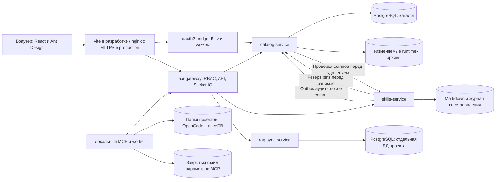

# Текущая реализация Нейроцентра

Текущая версия исходников моста — **0.9.5**; версию уже подключённого компьютера проверяйте по его heartbeat. [Предыдущий darwin-arm64 архив 0.9.4](bridge-release-0.9.4-2026-10-19.md) прошёл 6 native installer и 5 runtime/SDK checks; выполнено реальное локальное обновление с 0.9.0 с сохранением устройства и настроек. Это не полный P0-чеклист; остальные семь native-целей не приняты. Production-допуск — **NO-GO**. [Сценарии и границы проверки](publication-scenarios.md), [незавершённые работы и критерии допуска](implementation-readiness.md).

Последний проход базы знаний: frontend **1099/1099**, catalog **1062/1062**, RAG **99/99** (7 настоящих PostgreSQL-проверок), мост **683 passed / 11 skipped**, сборщик каталога **130/130**. TypeScript, сборки frontend/Nest/моста и Docker-образ RAG прошли. На macOS arm64 через настоящий OpenCode и локальную `qwen3-embedding:4b` проверены обновление плагина до `2.4.4-plugin.pack.4`, автоматическая переиндексация, отправка 6 фрагментов в PostgreSQL с полным seal, восстановление через UI в другую папку и поиск в скачанном индексе при выключенной автоиндексации. Настройки сохранены, пути перебазированы. Тестовые папки архивированы, пользовательские проекты и ключ подключения сохранены. Автономные мосты macOS arm64/Linux x64 пересобраны; установленный локальный мост обновлён. Все 7 архивов плагина проверены по SHA и составу; нативная приёмка остальных ОС этим не подтверждается. [Контракт и границы](rag-index-contract.md).

Предыдущий проход: [настройки проектов и первый запуск](project-settings-audit-2026-10-19.md), catalog **1031/1031**, frontend **976/976**, без пропусков. TypeScript/build, 109 прежних integration, 29 новых settings HTTP/PG, 10 access, 11 size и 3 свежих старта скомпилированного AppModule; 4 UI проверки с явным fixture события и настоящие GET после применения. Неизменённые gateway/skills/auth полностью в текущем проходе не повторялись; прежние свидетельства сохраняют свои границы. Мост0.9.4 online, внешние P0 открыты.

Разделы интерфейса и полная очередь операций загружаются по запросу, внутри проверки доступа. Начальный граф JavaScript: 1 529 866 → 832 378 байт (−45,59%), gzip 490 131 → 277 275; общий размер всех JS не уменьшился. Есть именованный статус загрузки, отказ и перезагрузка с сохранением адреса. Подтверждённые пустые права дают 403, кэш истории изолирован по аккаунту/роли/политикам.

Настройки проекта обновляются общим транзакционным репозиторием: общий PATCH, отдельные retention и quotas читают свежие роли/назначения для ID или имени; сохранение и `project.settings.update` фиксируются вместе. Точный повтор не меняет `updated_at` и не дублирует событие. Отдельный retention принимает ровно `{retention: целое 1..100}` — число снимков; purge/внешняя политика хранения этим не реализуются. В UI событие называется «Настройки проекта»; старый тип frontend API исправлен. На пустой БД общий журнал создаётся под транзакционной schema-блокировкой, устраняющей конфликт параллельных lifecycle. [Проверки E20](project-settings-audit-2026-10-19.md).

Дата сверки описания: 19 октября 2026 года. Документ описывает реализацию; состояние проверок каждого уровня фиксируется отдельно в отчёте кандидата. [Архитектурный проект](architecture.md) содержит также будущие механизмы; наличие механизма в схемах не означает, что он уже реализован.

## Состав системы

| Компонент | Фактическая ответственность | Данные и ограничения |
| --- | --- | --- |
| `frontend` | Начало работы, проекты и привязки, каталог инструментов, знания, обслуживание, аудит, доступ; панель операций в шапке | React 18, TypeScript, Vite, Ant Design 4, Redux Toolkit, Less. Функциональные модули собираются в один frontend. Отдельной загрузки микрофронтов, Zustand и Styled Components сейчас нет |
| `oauth2-bridge` | Вход через Blitz, серверная сессия, текущий пользователь, выбор назначенной роли, выход | Сессии и незавершённые входы находятся в памяти одного процесса. Перезапуск завершает его сессии; несколько реплик требуют общего хранилища |
| `api-gateway` | Проверка сессии/ключа MCP и свежих назначений, фильтрация ресурсов, проксирование, выдача установщиков, Socket.IO | Внутренние заголовки формируются шлюзом; клиентские заголовки не дают права. Микросервисы требуют внутренний секрет |
| `catalog-service` | Проекты, участники, доступ по почте, карточки и версии, очередь упаковки, артефакты, устройства, задания, операции, копии, политика обслуживания и аудит | PostgreSQL: таблицы и JSONB для конфигураций/пакетов/результатов. Каталог обслуживает несколько доменов внутри одного NestJS-сервиса; сборщик работает дочерним процессом |
| `skills-service` | CRUD Markdown, метаданные, списки, пакетная синхронизация и outbox аудита | POSIX-каталог; в подготовленном production-стеке это Docker volume. Prepared откатывается; committed доставляет события без повторной записи файлов. Подключённого CephFS нет |
| `rag-sync-service` | Манифест, дельта upsert/delete, страницы знаний, лимит логических байтов, выбор отдельной БД и перенос старого общего индекса | PostgreSQL 16 + pgvector. Имя БД — `nc_rag_` и хэш постоянного ID проекта. Это отдельные логические БД в одном кластере |
| `neurocenter-asset-sync` | MCP-инструменты OpenCode и worker: экземпляры папок, установка/удаление, поиск/принятие, сверка, восстановление выбранного локального варианта, диагностика запуска и передача знаний | Работает на компьютере пользователя. Конфигурация OpenCode, исходники/diff, локальные копии, квитанции и LanceDB остаются на этом компьютере |

Внешний S3-транспорт полных резервных копий реализован операторским CLI; подключение независимого хранилища и cross-host restore ещё не приняты. Это не объектное хранилище продуктовых снимков LanceDB: большие immutable-образы, дедупликация, общий CAS публикации и release-profile пока не реализованы. Серверная очередь упаковки уже есть внутри каталога; отдельного build-микросервиса нет и для текущего контракта он не требуется.

## Упаковка и публикация инструментов

Главный администратор выбирает «Каталог инструментов → Упаковать инструмент». Поддержаны npm, публичный GitHub по HTTPS, отдельный файл, папка, ZIP, TAR, TAR.GZ и TGZ. Версия npm и полный commit репозитория закрепляются до сборки. JS/TS упаковываются из исходников; для Python, Java, .NET, Go, Rust и native требуется декларация `neurocenter.tool.json` либо операторский recipe с подготовленными app/runtime assets. Произвольные исходники этих языков автоматически не компилируются. Приватные репозитории, SSH и другие Git-хостинги не входят в текущий контракт.

Браузер и CLI используют один `buildRecipe`. Очередь PostgreSQL допускает до десяти ожидающих/выполняемых сборок и одного исполнителя. QUEUED переживает перезапуск; прерванный RUNNING получает явный отказ, а не фиктивный успех. UUID запроса позволяет найти исходное задание после reload без повторной отправки. Прогресс сохраняется в БД и виден в мастере и «Операциях»; карточка и успешная операция публикуются одной транзакцией.

Архивы исходников ограничены 8 МиБ, 100 текстовыми UTF-8 файлами, 1 МиБ на файл и 5 МиБ распакованного содержимого. Ссылки, опасные и повторяющиеся пути, шифрованные и повреждённые архивы отклоняются. `POST /api/tool-builds/archive` только проверяет архив; код не запускается и архив не сохраняется. Результат передаётся обычным источником `files` в `POST /api/tool-builds`. Runtime/release-поставки используют отдельный контракт закреплённых SHA и целевых платформ, а не эти ограничения текстовых исходников.

Точный контракт, лимиты и команды — [инструкция общего сборщика](../scripts/catalog-plugins/README.md). [Восемь способов добавления и девять реальных сценариев](add-methods-playtest-2026-10-18.md) прошли публикацию/установку на собственных QA-данных; [восемь runtime/release-вариантов](add-methods-runtime-playtest-2026-10-18.md) проверены нативно на macOS arm64 либо в Linux arm64 контейнере, как указано в каждом случае. Публичная HTTPS-доставка готовых runtime/release assets не покрыта тем прогоном. Эти результаты не означают поддержку любого репозитория, всех функций расширения или всех восьми ОС.

Ручная публикация MCP допускает remote URL либо закреплённые JS-файлы с entrypoint. Внешняя команда без files/runtimeArtifacts отклоняется до сохранения, включая исторический snapshot зависимости. npm/репозиторий/архив открываются из этой формы существующей кнопкой упаковки. Точный no-op старой карточки не создаёт версию или аудит; changed metadata/config требуют исправить недоставляемый пакет. [Проверки F01](edge-case-audit-2026-10-19.md).

## Права и вход

Четыре роли: **Наблюдатель / Разработчик / Админ проекта / Главный админ**. Учётная запись хранится по нормализованной почте. Главный администратор имеет платформенные права; проектные назначения действуют внутри соответствующих проектов. Переключатель в шапке предлагает только назначенные роли. Выбор менее привилегированной роли ограничивает и интерфейс, и API.

Сохранение MCP/плагина проверяет точные версии, типы и SHA зависимостей под общей блокировкой графа PostgreSQL. Удаление отклоняется, если инструмент используется в проектном каталоге либо в текущей или исторической версии другого MCP/плагина. Назначение в проект и удаление одной карточки согласованы блокировками строк. Файловые скиллы до публикации регистрируют точные pins в постоянном реестре PostgreSQL под той же блокировкой графа. Удаление также запрашивает полную проверку старых файлов, всех поколений снимков и журналов; отказ проверки даёт 503. Снятие pins с текущего файла не освобождает историю. Резерв может остаться после неуспешной файловой записи; автоматического TTL/снятия нет. Структурно корректные старые pins с недоступной версией или неверным SHA можно очистить/заменить обычным сохранением: прочитанный исходный raw резервируется режимом preserve и сохраняется в истории. Новая версия и копия исторического текста всегда проходят строгую проверку publish. При первом сохранении недоступных исторических ссылок создаётся служебная квитанция сохранения зависимостей; сама файловая мутация имеет отдельное событие аудита. Exact noop не пишет историю. Штатная очистка истории и консервативных резервов ещё требуется.

Общий каталог доступен проектным и главным администраторам. Администратор добавляет необходимые инструменты в каталог своего проекта. Его видят участники проекта; установка требует права разработчика, собственного подключённого компьютера и действующей привязки папки. Разработчик одного проекта не получает административных прав в другом проекте.

Если назначенный скилл отсутствует или удалён, проект показывает недоступную ссылку и её ID. Администратор может явно убрать назначение; это не удаляет локальные файлы. SQL-связь и POSIX-файл не образуют атомарный реестр, поэтому восстановление видимости и удаления ссылки проверено отдельно. Формы платформенных пользователей и копий проекта также проверяют владельца после каждого await: старый ответ не закрывает и не обновляет новую сессию.

Пользователи добавляются администратором по почте. Отправки приглашений по электронной почте нет: запись разрешает вход соответствующей корпоративной учётной записи. Назначения перечитываются при запросах, поэтому отзыв доступа не ждёт следующего входа. Последнего активного главного администратора нельзя отключить.

Production-вход использует авторизационный код Blitz: `/blitz/oauth/ae` → `/blitz/oauth/te` → `/blitz/oauth/me`. В запросе используется PKCE S256; клиент аутентифицируется через `client_secret_basic`. Одноразовая серверная транзакция связывает cookie state, verifier и допустимую страницу возврата. Она действует десять минут и удаляется до обмена кода. Профиль сам по себе не назначает права — роли берутся из каталога. Access token не передаётся браузеру.

Cookie сессии: HttpOnly, SameSite=Lax, Secure при HTTPS; серверный срок по умолчанию восемь часов. Небезопасные cookie-запросы требуют собственного заголовка интерфейса и допустимого Origin. Выход сначала отзывает серверную сессию, затем направляет браузер на `/blitz/oauth/logout` с `client_id` и зарегистрированным `post_logout_redirect_uri`. Back-channel logout и проверка `id_token` сейчас не реализованы; вход использует профиль через защищённый userinfo endpoint.

Первый production-администратор создаётся операторской CLI-командой в пустом каталоге пользователей. Повтор с той же действующей записью идемпотентен; смена адреса или отзыв исходных прав не допускают повторной выдачи. Публичного bootstrap endpoint нет. Bootstrap, изменения платформенных пользователей, проектных прав и политики обслуживания фиксируются транзакционно в `security_events`. `/audit` объединяет эти события с операциями. Create/update/activate/delete MCP и плагинов имеют транзакционный аудит, включая исполнителя и отпечаток удалённой версии. Добавление/удаление инструментов в проектном каталоге записывается вместе с изменением связи, с доверенным исполнителем; повторы не создают событие.

Создание, изменение и удаление файлов скиллов через редактор и sync фиксируют outbox вместе с файловым commit. В каталог передаются только доверенный email, действие, путь, источник, поколение, версия и SHA; квитанция UUID и security-событие сохраняются одной SQL-транзакцией. Подготовленная операция откатывается без события; завершённая повторяет доставку, включая после потери ACK. При отказе каталога файл уже сохранён: API возвращает `audit: {state:'pending'}`, интерфейс предупреждает, а `/ready` скиллов отвечает 503 до подтверждения. Быстрый ACK ожидается до 250 мс, длинная доставка продолжается в фоне; это не SLA всей файловой операции. Outbox повторяется при старте и каждые две секунды; видимая история перечитывается также каждые десять секунд. Exact noop не создаёт события. Старые изменения до внедрения и ручные записи мимо сервиса не покрыты; immutable/SIEM и coherent restore FS/PG ещё не приняты. [Протокол и свидетельства](skill-file-audit-2026-10-18.md).

Создание папок через API скиллов имеет отдельное событие `skill.directory.create` без выдуманной версии файла. Prepared-журнал хранит созданные родители для безопасного отката только пустых папок; committed повторяет доставку UUID через outbox без повторного mkdir. Существующая папка — noop; недоступный ACK — pending. Если directory-fsync не доказывает устойчивость уже видимого commit, API возвращает `503/SKILL_DURABILITY_UNCERTAIN`; общий root gate блокирует чтения, записи и готовность. Repair подтверждает fsync до доставки аудита, сохраняет UUID и согласует неоднозначный rename без повторной мутации. Failed prepared rollback удерживает gate до доказанного отката и очистки. [P1-DUR принят локальными EIO/restart/retry и независимым review](scenario-audit-2026-10-19.md); потеря питания, network FS и нагрузка не приняты.

Frontend привязывает списки и открытые формы к текущим аккаунту и правам: смена владельца очищает чужие черновики, поздние callbacks не меняют новый экран, многошаговая выдача доступа прекращает следующие записи. HTTP 401 старого владельца не завершает новую сессию, актуальный 401 завершает её. Отказы доступа очищают прежние личные сведения; временные ошибки сохраняют известные данные с предупреждением. [Свидетельства UI и fixture-границы](deep-ui-playtest-2026-10-18.md).

Авторизация и фильтрация ответов используют общую канонизацию пути: завершающий слеш и одиночное URL-кодирование не отключают ограничение списков. Upstream получает исходный URL. Массовое назначение в каталоги, создание проекта и чтение сотрудников защищены от поздних ответов прежней auth scope; выполняемая пачка блокирует повторное подтверждение и закрытие своего окна. [Проверки отказов и гонок](gap-audit-2026-10-18.md).

## Установка и локальные проекты

1. OpenCode устанавливается с площадки через `install_opencode.sh` или `install_opencode.ps1`. Команда глобальной установки `npm install -g opencode-ai` не нужна. Подготовленная раздача содержит восемь вариантов OpenCode и SHA-256.
2. `install.sh` / `install.ps1` устанавливает мост и регистрирует его в существующем JSON/JSONC OpenCode. Установщик пытается открыть страницу подключения автоматически; ручной код остаётся запасным способом.
3. Пользователь проверяет имя и отпечаток компьютера, подтверждает подключение и дожидается heartbeat. Установка файлов и разрешение компьютеру работать с аккаунтом — разные состояния.
4. Через MCP открывается системный выбор папки на выбранном компьютере. Затем локальный подкаталог связывается с серверным ID проекта. Названия общей папки и подкаталога могут различаться у разных людей.
5. Кнопка в проектном каталоге ставит задание в очередь. Worker проверяет права, привязку и хэши, применяет пакет и возвращает сохраняемый результат.

Текущий выпуск моста — **0.9.5**. Формат поставки — готовый архив со встроенным Node.js 24.22.0 и зависимостями. Пользовательский установщик скачивает его с площадки, проверяет SHA256, ОС/архитектуру, сохраняет прежний клиент и регистрирует существующий JSON/JSONC. Системные Node/npm и обращение к npm-реестру пользователю не требуются. [Проверки точного архива 0.9.4](bridge-release-0.9.4-2026-10-19.md) не переносят исторические матрицы на новый выпуск. [Полный P0-чеклист платформ](p0-external-acceptance.md) остаётся открытым. Отсутствующий архив даёт понятный отказ до замены клиента. Linux-диалог выбора папки требует графической сессии и zenity/kdialog, его ожидание ограничено двумя минутами. У текущей LanceDB нет нативного macOS x64-пакета: базовая работа моста отделена от загрузки RAG, а неподдерживаемая локальная RAG явно блокируется.

Для 0.9.5 собраны автономные darwin-arm64 и Linux x64 архивы. Точный macOS arm64 пакет прошёл 8 native installer и 5 runtime/SDK проверок с временным профилем; Linux x64 прошёл 5 runtime/SDK проверок в Docker linux/amd64 на Apple Silicon. Это не проверка Linux desktop и не нативная приёмка остальных клиентских платформ. Предыдущие пользовательские профили не менялись.

Обновление сериализовано install-lock. До замены файлов staged CLI ставит очередь на паузу, ждёт завершения заданий и проверяет владельца/PID/путь worker. Пауза удерживается до завершения регистрации или снимается при отказе; новый worker ждёт освобождения install-lock. Упаковка проверяет SHA и версию исходного и скопированного dist, установщик сверяет внутренние manifest/build/runtime. После SIGKILL остаётся операторская очистка блокировки; TTL серверной паузы — 1 минута. Ошибка регистрации не обещает работающий прежний worker: требуется повтор или перезапуск OpenCode. [Границы и проверки](bridge-release-0.9.4-2026-10-19.md).

Поддерживаются скиллы с текстовыми и бинарными ресурсами, локальный Node.js MCP, удалённый MCP и JavaScript-плагины через `file:`. Формат 5 добавляет заранее собранные платформенные комплекты локальных MCP/плагинов и локальный мастер параметров MCP; скиллы используют закреплённые зависимости. Сервер хранит точные архивы в отдельном томе, мост проверяет SHA и реальные файлы перед установкой и запуском. Автоматических npm/pip/Bun установок на компьютере нет. [Контракт, лимиты и импорт](runtime-artifacts-0.9.md).

Git хранит рецепты, адаптеры и [манифест поставки встроенного каталога](../scripts/catalog-plugins/catalog-release.json). Его девять инструментов закреплены по ревизиям и SHA-256; готовые архивы опубликованы в [GitHub Release `catalog-2026-10-19.2`](https://github.com/ghost-raven1/neurocenter/releases/tag/catalog-2026-10-19.2). После `git pull` запуск `scripts/dev.sh up` собирает текущий CLI и пытается синхронизировать каталог до остановки старых процессов: конфликтующие карточки сохраняются, принятая часть обновляется, а ошибка поставки выводится предупреждением и не блокирует локальный запуск. Это не означает, что все инструменты готовы. Отдельная строгая нативная команда — `npm run tools:sync`; она учитывает URL или secret-файл подключения по приоритету `.env` → `.env.local` → процесс и запрещает dev-подключение по умолчанию при `NODE_ENV=production`. Режим `npm run tools:sync -- --production --directory <конфиг> --project-name <стек>` использует существующий production-wrapper, образ, секреты и тома выбранного Docker-стека без сборки catalog-service на хосте. Production setup/up выполняет тот же импорт; штатное обновление предзагружает архивы до паузы и применяет каталог после проверенной копии. Сам `git pull` без запуска процедуры обновления ничего в БД не меняет, а импорт из прежнего образа использует прежний манифест.

OpenCodeRAG `2.4.4-mcp.pack.5` регистрирует включённую команду `opencode-rag.mjs mcp`. После фиксации установки мост выполняет initialize/listTools/close без индексации или запроса к embedding; отказ этой диагностики не отменяет установленный комплект. Это не проверка модели: readiness остаётся `unverified`. Уже открытый OpenCode нужно перезапустить, чтобы он перечитал конфигурацию и создал свой stdio-сеанс.

Во вкладке «База знаний» появилась кнопка открытия OpenCodeRAG отдельным окном браузера на компьютере моста. Доступны MCP и native plugin `pack.5`; выбор основан на закреплённом `localUi` descriptor, квитанции, SHA, текущих binding/instance и одобрении версии. Нужны мост 0.9.5+, графическая сессия и поддерживаемый браузер. Повтор использует один локальный UI-сервер и открывает новое окно; прежний requestKey после сетевой неопределённости не создаёт второе задание. Сервер получает только `{opened,reused,note}`, без локального URL, порта, пути или токена. Старт UI сохраняет конфигурацию и не требует работающей модели. Плагин сохраняет свои hooks без дублирующего MCP. [Блокировки индекса и восстановление](rag-index-contract.md).

Проверки OpenCodeRAG pack.5: frontend 1273, catalog 1304, bridge 737 passed / 12 skipped; 149 проверок рецептов/упаковки, 4 проверки UI-файла в настоящем TAR и 54 проверки поставки моста. Сборки проходят. На отдельном проекте установка через очередь сама выполнила MCP handshake; установленный launcher отдал 5 инструментов, построил 2 фрагмента через локальную qwen3-embedding:4b и синхронизировал подтверждённую серверную копию. Кнопка передала системе запрос отдельного окна. Восстановление той же серверной копии закрыло собственный UI и завершилось успешно; вышедший PID больше не ожидается до закрытия унаследованных потоков. Настоящий upstream UI отрисован в фоновом браузере без ошибок консоли. Визуальная проверка нативного окна рабочего стола не выполнена: macOS заблокирован. Другие семь платформ нативно этим не приняты.

Опубликованные карточки и их история остаются в PostgreSQL, архивы — в исключённом из Git `data/runtime-artifacts`. Квитанции `builtin_catalog_receipts` закрепляют управляемые карточки; последующий ручной конфликт останавливает строгую синхронизацию, а при локальном старте пропускает только эту карточку. Известная старая команда `npx` заменяется готовой поставкой только при подтверждённом источнике и отсутствии собственных параметров. Неизвестный готовый комплект с тем же именем автоматически не присваивается. ID, история, проектные связи, описания, теги и точные зависимости сохраняются; изменения карточек, аудит и квитанции выпуска фиксируются одной транзакцией. Повтор не создаёт версии. Пользовательские инструменты вне манифеста не переносятся через Git: им нужны отдельная публикация или согласованная копия БД и архивов.

Проверено локально 19.10.2026: 1173 теста frontend, 1130 catalog-service и 42 проверки запуска/поставки/production update; TypeScript и сборки frontend/catalog проходят. На отдельной PostgreSQL-базе старая карточка Memory обновлена с сохранением ID, истории, пользовательских описания/тегов и проектной ссылки. Отказ второй квитанции откатывает весь выпуск; повтор не меняет карточки, версии, аудит и квитанции. Собранный Docker-образ содержит манифест, CLI проверяет его без сети; публичное скачивание архива Memory и SHA подтверждены. GitHub подтвердил SHA-256 всех 23 файлов поставки. Обновление конкретного удалённого сервера и его длительность этим не подтверждены.

Каталог загружается полностью по страницам со стабильным порядком; неполный или повреждённый ответ не становится списком недоступных инструментов. Старые короткие ссылки на общие скиллы сопоставляются только с единственным каноническим путём; точный корневой путь имеет приоритет, неоднозначность и приватный скилл другого проекта не расширяют доступ. Запись новых назначений сохраняет канонический путь. При недоступности внутреннего индекса проверка закрывает доступ. Кнопка «Проверить снова» обновляет карточки и назначения без удаления ссылок. В отдельном локальном проекте под ролью разработчика воспроизведено исчезновение `rag-index-monitor`; после исправления карточка и инструкция доступны, предупреждение содержит только две намеренно отсутствующие ссылки. План моста для старой ссылки изменился с HTTP 403 на 201; установка и привязка папки этим не проверены. Временный проект очищен после проверки, исходные проекты не менялись.

Отказ `PACKAGE_NOT_INSTALLABLE` сохраняется в отдельном окне с точным инструментом, версией, причиной и цепочкой зависимостей. Из него доступны текущая карточка и, главному администратору, мастер упаковки. Повтор проверяет ту же версию; публикация нового комплекта требует явного выбора версии и обновления зависимостей. Внешняя команда без закреплённых файлов или платформенного архива по-прежнему не запускается.

Мастер MCP вводит значения только на `127.0.0.1` и сохраняет их отдельным закрытым файлом на компьютере. Сервер знает лишь готовность, недостающие поля и ревизию. Каждое сохранение требует свежего разрешения; потеря доступа после открытия блокирует запись. Проектный config содержит launcher, без значений. Согласие на диагностику закрепляет ревизии всех настроенных MCP графа; изменение параметров делает прежний результат устаревшим. Порядок статусов определяется серверным временем начала задания, поэтому поздний ACK и изменённые часы компьютера не возвращают старую готовность. [Полные границы](reliable-installation-0.9-2026-10-18.md).

Исторические версии скилла сохраняют весь состав перед обновлением; доставка запрашивает точную версию через `?version=N`. Пакеты с артефактами или схемой локальных параметров используют детерминированный формат 5 и capability `package-v5`; для остальных сохраняется формат 4. Чтение форматов 2/3/4 сохранено. Файлы сравниваются и журналируются по исходным байтам. Каталог проекта и очередь не разрешают ссылку на приватный скилл другого проекта. Установка требует одобренного плана с точной версией, SHA и ревизией: snapshot хранится в PostgreSQL, отзыв и повторное одобрение не возобновляют старые задания. Собственные проектные скиллы также проходят одобрение.

Точные зависимости MCP/плагинов задаются ID, версией и SHA. Сервер фиксирует замкнутый граф в JSONB-плане и показывает все файлы до общего одобрения. Мост с `install-set-v1` записывает комплект одной транзакцией и учитывает владельцев общих и транзитивных зависимостей. Удаление корня оставляет зависимости для явного удаления; используемая версия защищена от смены и удаления. Ограничения — 20 инструментов, 200 файлов, 16 МиБ на комплект; зависимости скриптов npm/pip автоматически не устанавливаются.

Create/update/activate проверяют весь закреплённый граф до сохранения: цикл, разные pins одной зависимости и превышение общего бюджета отклоняются; совместимый ромб учитывает общий leaf один раз. Для файлового скилла общий бюджет его собственных файлов и замыкания зависимостей до записи пока не гарантируется атомарно. Standalone RAG restore/sync моста 0.9.4 проверяют project/instance/binding и реальную границу vector store до HTTP/чтения и каждого изменения; rebind или подмена пути останавливают продолжение. Текущая передача дополнительно проверяет профиль и полный SHA снимка; частичная копия не объявляется готовой. Исправления доставлены в локальный мост 0.9.4; прежние версии архивов сохранены.

История различает устройство, серверный проект, привязку папки, тип и ID инструмента. Для удаления, `inspect-installation` и восстановления передаётся ожидаемый binding, поэтому одинаковый SHA в другой папке не перенаправляет действие. Наблюдатель вправе сверить известную установку своего проекта; сервер передаёт исходный пакет из истории, а сканер только читает файлы, квитанцию, реестр и конфигурацию. Сохраняются фиксированные статусы `synced/modified/missing/unknown`, дата и `readiness: unverified`; выполнение инструмента и OAuth этим не проверяются. Последняя подходящая сверка не теряется за последними 100 операциями. Прежние и неизвестные привязки видны в сворачиваемой истории без действий изменения.

### Экземпляр папки и мастер привязки

Marker `.opencode/neurocenter.json` версии 2 содержит `instanceId`. Приватный реестр в `stateDir` дополнительно закрепляет `realpath`, физические `dev`/`ino`, время создания каталога и случайную привязку. Копия marker, клон по прежнему пути, потеря marker или неизвестные управляемые данные не принимаются как свежий доверенный экземпляр. Обычное чтение и heartbeat не усыновляют v1 и копии.

| Действие мастера | Реализованное поведение |
| --- | --- |
| Новая папка (`new`) | Создаёт новый экземпляр. Повтор для действующей текущей папки сохраняет её идентичность |
| Старая привязка (`adopt-legacy`) | Явно проверяет marker v1 и закреплённые установки, создаёт новый экземпляр; историческое происхождение сохраняется |
| Отдельная копия (`new-copy`) | Проверяет доступный зарегистрированный оригинал и целевые файлы; копия получает новый `instanceId` и новый binding |
| Перенос (`transfer`) | На том же компьютере проверяет оригинальный физический каталог и замороженные пакеты, сохраняет `instanceId`, меняет binding и управляемые абсолютные подключения. Переименование допустимо, если целевая папка — тот же физический каталог, а прежний путь не подменён |
| Ранее подключённая папка (`resume`) | Возвращает A после выбора B: проверяет зарегистрированный экземпляр A и его файлы, сохраняет `instanceId` A, выдаёт новую привязку |

Мастер разделяет `prepare-bind-project` и `bind-project`; подтверждение закрепляет job ID и SHA подготовки. Preview действует 15 минут. Для `resume` источник берётся из неизменяемой подготовки, а не из текущего binding B. Копия с другого компьютера без локального приватного происхождения не становится подтверждённым переносом. Исторические задания не переписываются; изменения экземпляров сохраняются отдельными событиями.

### Папка → установка → настройка → диагностика

1. **Папка:** подключите компьютер на странице «Начало работы», затем выберите общую папку и действие мастера на странице «Проекты». Проверьте preview и подтвердите выбранную папку.
2. **Установка:** администратор одобряет точные версии, SHA и состав зависимостей; разработчик устанавливает одобренный комплект из каталога одним нажатием.
3. **Сверка:** в блоке «На этом компьютере» нажмите «Проверить файлы». Надпись «Файлы сверены» подтверждает сверку, а не запуск.
4. **Настройка MCP:** откройте «Настроить MCP» или «Локальная настройка», заполните форму на выбранном компьютере и нажмите «Проверить готовность настройки». Площадка не получает значения.
5. **Диагностика:** после сверки и готовой настройки выберите «Проверить запуск» или «Ещё → Проверить запуск в OpenCode», просмотрите точный комплект и дайте отдельное согласие на выполнение. Изменение параметров потребует нового согласия.

### Ручные изменения и восстановление

Откройте «Ещё → Сравнить и восстановить файлы». `prepare-local-change` закрепляет установленный root SHA, полный одобренный набор, binding, instance и снимок файлов. Предложенные замены ещё не применяются. Браузер показывает добавления/замены/удаления, размеры и SHA до/после. Кнопка «Открыть полный diff на компьютере» открывает приватный HTML локально; исходники, ручные байты, секреты и полный diff серверу не передаются.

После отдельного подтверждения «Сохранить локальный вариант и восстановить» `apply-local-change` повторно проверяет план, digest, ревизию, права и снимок, затем выполняет одну файловую транзакцию. Ручной вариант остаётся в закрытом журнале восстановления. Чужие настройки и JSONC-комментарии сохраняются, где принадлежность изменения доказана; неоднозначное подключение останавливает запись. План действует 15 минут; последующая правка, смена версии/папки или отзыв одобрения требуют новой подготовки. После восстановления повторите сверку и при необходимости диагностику: старые успешные статусы становятся устаревшими.

«Открыть резервные копии на компьютере» доступно и после ошибки квоты или успешного восстановления. Действие требует права разработчика, online MCP и текущую привязку, не требует нового одобрения инструмента и ничего не удаляет.

Чтения ограничены по типу и объёму: FIFO, ссылки и подмена снимка отклоняются. До мутации `statfs` проверяет бюджет записи/отката и оставляет **128 МиБ** на файловых системах проекта и приватного MCP; при общем диске расходы складываются. Суммарные локальные pending/history копии ограничены **1 ГиБ**, приватные JSON/HTML планы — отдельным **1 ГиБ**. Старые копии и просроченные планы автоматически не удаляются; при переполнении новая запись отклоняется. Эти локальные бюджеты не заменяют серверные PostgreSQL/RAG/HTTP-backup квоты.

### Область runtime-диагностики

`probe-runtime` требует разработчика, собственного online MCP, текущей папки, актуального одобрения установленной версии и отдельного `consentManifest`: SHA всего комплекта либо SHA одиночного пакета. Используется закреплённый OpenCode **1.14.48** со сверкой SHA и временным изолированным профилем. Личный OpenCode из PATH не подменяет движок; отсутствие подготовленного движка даёт `unsupported`.

- Скиллы: проверка структуры, без исполнения скриптов.
- MCP: подключение/handshake и списки tools, resources, prompts. Инструменты не вызываются; удалённый MCP может получить эти запросы по одобренному URL.
- Плагины: загрузка и поддерживаемая серверная инициализация. Произвольные hooks и TUI не регистрируются и не проверяются.

Диагностика не инициирует установку npm/pip/Bun-пакетов, OAuth и обращения к модели. Неразрешённые placeholders и недостающие зависимости дают `needs_configuration`/`unsupported`. Изоляция профиля не является песочницей ОС для одобренного исполняемого кода. Рабочий deadline — 59 секунд, завершаются только созданные диагностикой группы процессов. Публичный результат содержит фиксированные статус/код, дату, версию/SHA движка и счётчики; stdout/stderr и содержимое файлов серверу не отправляются. Успешный init не подтверждает все hooks и пользовательские сценарии. Для Windows реализован собственный Job Objects helper; диагностике нужен включённый в архив PE helper с проверяемым SHA. Без него возвращается `unsupported`. Нативная Windows-приёмка ещё не выполнена.

### Поиск и принятие инструментов в проекте

Во вкладке «Найдено в проекте» наблюдатель явно запускает `scan-project-inventory` только для собственного online-компьютера и подтверждённого binding/instance. Поиск ограничен выбранной папкой и её конфигурациями, не читает личный глобальный профиль, не исполняет код и возвращает не более 200 относительных записей с состоянием и фиксированными причинами. Неполный поиск обозначается явно и блокирует принятие.

Разработчик выбирает конкретные ID и версию из проектного каталога с действующим одобрением полного графа. `prepare-adopt-installation` закрепляет inventory job, scan/candidate UUID, digest и одобренный SHA набора. После отдельного подтверждения `apply-adopt-installation` пишет только квитанции и ledger: файлы пакетов и подключения OpenCode не меняются. Неоднозначное владение и неканоническое расположение дают отказ, без переноса. Старый scan аннулируется после изменения проекта.

### Выбор сохранённого локального варианта

«Ещё → Сохранённые локальные варианты» показывает наблюдателю до 100 метаданных копий точной текущей установки. Восстановление требует разработчика, того же подтверждённого физического instance, текущих квитанций/владения путями, одобренной версии и точных root/SET SHA/refs. Старые недоказанные копии, другой instance/версия, пересечение с чужими файлами и изменение используемой общей зависимости не принимаются автоматически.

`prepare-local-restore` сначала показывает полное сравнение. Пользователь выбирает файлы галочками и явно подготавливает новый preview с `restorePaths`; первоначальный полный список остаётся для возвращения исключённых файлов. Пустой набор не отправляется. Применение и старый diff блокируются, пока план не соответствует точному выбору; новая подготовка сбрасывает согласие. Смена варианта, tuple, устройства/прав/instance или известного текущего состояния сбрасывает выбор.

`apply-local-restore` сохраняет нынешние байты перед возвратом выбранных ручных изменений. Метаданные управления не восстанавливаются, JSONC редактируется только в собственных элементах инструмента; полный старый config не заменяет текущий. Ручной вариант не становится одобренным и не меняет версию каталога. Новая сверка обязательна; автоматического runtime-запуска нет. Полные diff/backup bytes остаются локально.

### Каталог моделей и хостинг

Во вкладке «Модели» общего и проектного каталога доступны закреплённые Qwen3 Embedding 4B (2560 измерений) и Qwen3 VL 2B Instruct. Главный администратор создаёт карточки других моделей Ollama с явным тегом, меняет описание с expectedRevision и управляет общим хостингом. Администратор проекта добавляет и исключает модели; разработчик и наблюдатель видят назначенные модели. Inference требует рабочую роль именно в проекте, которому модель назначена. Права проверяются заново на каждом запросе.

Карточки JSONB и назначения хранятся отдельно в model_catalog/project_models; мост и типы его установщика не меняются. Назначение модели не скачивает веса, не меняет настройки OpenCode и не перестраивает существующий RAG-индекс. Удаление назначенной модели запрещено; встроенные карточки сохраняются. Изменения карточек и назначений записываются в аудит той же транзакцией.

Обе встроенные модели поставляются настоящими файлами: 9 файлов, **4 427 274 223 байта**, в `data/embedding/models/` при native dev и в томе `model-weights` при production. В Git находятся [опись поставки](../scripts/models/bundle-release.json), lock-файлы, [Apache License 2.0](../scripts/models/LICENSE-APACHE-2.0.txt) и [атрибуция](../scripts/models/THIRD-PARTY-NOTICES.txt). Опись закрепляет 10 транспортных частей из [release `models-2026-10-19.1`](https://github.com/ghost-raven1/neurocenter/releases/tag/models-2026-10-19.1); части и собранные blobs проверяются по размеру и SHA-256. Манифесты моделей публикуются после подготовки всех blobs, существующие финальные файлы не перезаписываются. Ключи Ollama, история, служебные квитанции и посторонние модели в поставку не входят.

«Запустить» использует уже подготовленную встроенную модель, проверяет digest закреплённого манифеста, возможности и содержательный ответ. Для добавленных вручную моделей возможна загрузка из реестра Ollama. «Проверить модель» выполняет embedding-запрос либо текстовую/синтетическую графическую пробу. «Выгрузить из памяти» сохраняет веса и общий контейнер. UI-статус загруженной модели отделён от времени последней успешной проверки. `npm run models:prepare` готовит файлы без inference, `npm run models:verify` проверяет полный комплект без скачивания. Пользовательские теги без manifestSha256 используют текущую локальную версию; автоматического обновления тегов нет.

Управление асинхронно: прогресс и итог хранятся в PostgreSQL, отображаются в карточке и общих «Операциях». Общая advisory-блокировка исключает параллельные управляющие действия; повтор того же активного действия возвращает его состояние. Перезапуск завершает незаконченные операции ошибкой с возможностью повтора, без удаления частично загруженных весов. Shutdown, потеря управляющего соединения и отзыв платформенных прав отменяют активный запрос runtime.

Адрес Ollama задаётся сервером, карточка не содержит произвольного URL. Native `scripts/dev.sh up` автоматически готовит встроенные веса до остановки прежних приложений и поднимает общий Compose runtime на loopback 11435. Ошибка подготовки файлов останавливает запуск с сохранением прежних сервисов. Dev/production Docker используют внутренний model-runtime без опубликованного порта и Docker socket; production `model-volume-init` готовит том до старта runtime. Каталог монтирует `model-weights` только для чтения сведений о месте. Штатное обновление сначала скачивает поставку в кеш без активации до паузы, затем активирует проверенные файлы после согласованной копии. Подготовка сохраняет резерв 1 ГиБ; пользовательская загрузка ограничена 16 ГиБ по умолчанию.

При полном проверенном комплекте подготовка весов не требует сети. Перенос всего каталога `models/` с последующей `models:verify` позволяет обойти повторное скачивание; образ runtime переносится отдельно. Воспроизводимый кеш весов не входит в полный резервный комплект: карточки и назначения входят в дамп каталога, встроенные веса восстанавливаются из закреплённой поставки. Пользовательские модели, которых нет в описи, требуют собственной копии файлов и сведений об источнике. Старые standalone-команды `embedding:up`/`vision:up` используют прежний путь подготовки выбранной модели и не вызывают bundle автоматически.

Защищённые API текущей сессии: /api/models/:id/ollama/api/embed и /chat; OpenAI-совместимые /api/models/:id/ollama/v1/embeddings и /chat/completions. Возвращается полный ответ; stream:true отклоняется явно. Изображения принимаются только как PNG/JPEG в теле запроса; сетевые URL и подмена выбранной модели не пересылаются. Независимый API-ключ для сторонних клиентов и автоматическое подключение OpenCodeRAG здесь не добавляются.

Локальная приёмка интерфейса и API 19.10.2026: 1204 теста frontend, 1266 catalog-service и 155 Node-проверок запуска, runtime, CLI, live/access и production update прошли до добавления поставки весов. TypeScript и сборки frontend/catalog/gateway проходят; Compose-конфигурации проверены без запуска production. Через интерфейс создана тестовая карточка, назначена проекту, запущена на сохранённых весах и выгружена из памяти; обе операции завершены в PostgreSQL. Защищённый OpenAI endpoint вернул два вектора по 2560 измерений. Подмена имени модели не меняет выбранную карточку; stale-сохранение и удаление назначенной модели дают 409, чужая модель и отзыв назначения без повторного входа — 403. Desktop и ширина 390 px проверены, горизонтального переполнения нет. Тестовые карточка и проект удалены, исходные проекты и веса сохранены.

Отдельная приёмка поставки весов: 117 Node-проверок прошли без пропусков; Docker-образ собран. Проверены все 10 частей и 9 итоговых файлов, холодный импорт 4,43 ГБ в пустой каталог и повторная подготовка без сетевых запросов. Новый runtime запущен из перенесённых файлов с `--network none`: embedding вернул два ненулевых вектора по 2560 измерений, vision распознал число `42` и красный квадрат. Обе модели затем выгружены, тестовые контейнеры удалены. Штатный native helper подтвердил подготовку весов и готовность хостинга. GitHub подтвердил размер и SHA-256 всех 13 файлов опубликованного release; скачивание части без авторизации проверено. Это локальная приёмка, удалённое production-развёртывание не выполнялось.

### Флаги функций

`feature-flags-service` — отдельный NestJS-процесс с внутренним портом 4400. Он хранит JSONB-настройки в таблице `feature_flags` каталожной PostgreSQL; транзакционный аудит использует существующий `security_events`. Флаги и их история входят в дамп `catalog`, дополнительная БД или файловый том не нужны. Первый запуск создаёт три зарегистрированных флага: `model_hosting`, `tool_builds`, `rag_sync`, все включены. Повторный запуск сохраняет пользовательские значения. Таргетинг по пользователям, процентное включение и произвольные ключи не добавлены.

Панель «Функции платформы» находится в «Обслуживании». `GET /api/feature-flags` и `PATCH /api/feature-flags/:key` доступны только активному главному администратору. PATCH принимает `{enabled,expectedRevision}`; устаревшая ревизия возвращает 409. Повтор уже сохранённого значения не создаёт новую ревизию или запись аудита. Права перечитываются из каталога при каждом запросе и после ожидания блокировки сохранения: отзыв действует без повторного входа. `GET /api/feature-flags/evaluated` возвращает только вычисленные значения любой действующей роли; внутренний аналог требует служебный секрет. Клиентские identity-заголовки шлюз заменяет подтверждённой сессией.

Шлюз проверяет флаг после RBAC и без кеша перед новым тяжёлым запросом. `model_hosting` ограничивает запуск, содержательную проверку и inference моделей; `tool_builds` — подготовку npm/Git/архивов и создание сборки; `rag_sync` — запись дельты индекса и постановку нового `sync-rag` задания. Общая серверная точка постановки заданий проверяет флаг также при повторе старого задания. Отключение даёт 403 с причиной, недоступность или повреждённый ответ сервиса — 503. Чтение каталога, результатов и состояния, выгрузка модели из памяти и управление самими флагами не зависят от их значений. Выполняющиеся HTTP-запросы не прерываются; дальнейшие запросы многошагового задания проверяются заново. Изменение рассылает только инвалидацию экранов через Socket.io; данные перечитываются через авторизованный API.

Панель показывает только подтверждённые сервером значения, блокирует повторное сохранение строки и игнорирует ответы от прежней роли или сессии. После 409 перечитывает значение и требует явного принятия актуального состояния перед следующей правкой. `/health` показывает liveness, `/ready` — доступность PostgreSQL; readiness шлюза включает новый сервис. Native dev и production управляют семью приложениями. Переход с прежней топологии из шести приложений требует отдельной репетиции; строгий same-topology update и старые recovery-комплекты не превращаются автоматически в новый стек.

Локальная приёмка 19.10.2026: 1230 frontend, 1275 catalog-service, 47 feature-flags-service и 239 Node-проверок прошли без пропусков. TypeScript и сборки четырёх изменённых приложений проходят; Docker-образ сервиса флагов собран. На отдельной PostgreSQL-БД подтверждены конкурентное сохранение (один успех и один 409), отсутствие лишнего аудита при no-op, откат значения при сбое аудита, отказ отозванных прав и сохранность значения после повторной подготовки; тестовая БД удалена. Через интерфейс функция отключена и включена обратно, настоящий шлюз вернул 403 для отключённой сборки и 409 для stale-сохранения, общий аудит показывает прежнее и новое значения. Desktop и ширина 390 px проверены без горизонтального переполнения. Все три функции оставлены включёнными, native readiness — 7/7. Production-миграция топологии и удалённый deploy этим не приняты.

### Capabilities и миграция каталога

Этап 0.8 добавил `project-inventory-v1`, `adopt-installation-v1`, `local-recovery-v1` к возможностям 0.7: `durable-completions`, `managed-installations`, `package-v3`, `package-v4`, `install-set-v1`, `installation-inspection-v1`, `workspace-instance-v1`, `local-change-plan-v1`, `runtime-probe-v1`. В 0.9 добавлены `package-v5`, `runtime-artifacts-v1`, `local-mcp-config-v1`; форматы 2–4 читаются, протокол очереди **2** сохраняется. Текущие RAG-задания дополнительно требуют `project-rag-sync-v1`. Gates проверяют возможности, а не только строку версии. Выбор общей папки и RAG не требуют inventory/adopt/recovery capabilities; запись RAG требует подтверждённого экземпляра, явный `projectKey` не обходит эту проверку.

Таблицы `bridge_local_change_plans` и `bridge_instance_events` вводятся миграцией каталога **1 — `reliable-local-installation`**. `catalog_schema_migrations` хранит имя и SHA SQL; применение последовательно, транзакционно и под advisory lock. Изменённая история и несовместимая старая схема останавливают старт. Это не автоматический rollback всего приложения и не замена проверки обновления на копии данных.

Миграция **2 — `project-inventory-local-variants`** добавляет `purpose` (`repair`, `adopt`, `restore-local`) и `source_id` для локальных планов. Прежние строки остаются ремонтными; kind задания и назначение плана сверяются вместе. Знание plan ID/digest не позволяет применить восстановление вместо принятия или ремонта.

Миграция **3** создаёт реестр runtime-артефактов. Полная серверная копия v2 включает четвёртый том с архивами; исторический v1 восстанавливается с пустым новым томом. Локальные параметры пользователей в эти копии не входят.

Задание фиксирует пакет/версию/хэш, ключ идемпотентности и отпечаток привязки папки. Повтор из двух вкладок объединяет одинаковое ожидающее действие; конфликтующая версия или удаление получает 409. Список собственных заданий учитывает свежие назначения до лимита; прежний actor не сохраняет доступ после отзыва проекта. Повтор отмены доступного CANCELLED идемпотентен. Перед новым заданием под блокировкой устройства отменяются только queued с доказанно утраченным доступом по сохранённой роли задания и текущей роли устройства; отмена, аудит и новое задание фиксируются одной транзакцией. Running/reconciling и ошибки проверки прав не считаются основаниями такой отмены. Очередь ограничена 100 незавершёнными действиями на устройство, ожидание более суток отменяется, активные записи не скрываются за последними 100 завершёнными. Выдача сериализована на устройстве; обновление worker приостанавливает новые задания и ждёт завершения активного.

Протокол 2 сохраняет локальный результат до отправки серверу; подтверждение идемпотентно и записывает статус с операцией одной транзакцией. Потерянный запрос/ответ повторяет подтверждение без записи файлов. Истечение аренды начатого задания означает `reconciling`, а не доказанный отказ: известный журнал восстанавливается, квитанция завершает сверку. Подтверждение сверяется с исходными пакетом, арендой и папкой; отменённое задание не становится успешным. Поздний отчёт старой установки не вытесняет более новую из истории.

Журнал идентичности также сохраняет результат до серверного подтверждения. Прерывание подготовленной привязки откатывает запись и завершает задание фиксированным отказом; зафиксированная привязка восстанавливается вперёд с исходным успешным результатом. Потеря ACK не требует повторного изменения marker или реестра.

Перед локальной записью доступ проверяется ещё раз. Файловые границы и квитанции защищают чужие файлы, симлинки и ручные изменения. Удаление использует исходную квитанцию. Старые обходные команды `install_asset`/`install_plugin_bundle` удалены; установка/удаление требуют `install-set-v1` даже для одиночного пакета. Выбор папки и RAG используют отдельную проверку протокола 2. Переподключение по прежнему ключу с подтверждением того же владельца сохраняет ID и историю; новый секрет генерируется локально и в базе хранится его хэш. При потере ключа/отзыве подключения автоматического присвоения старой истории нет. См. [детальный контракт MCP](local-mcp.md) и [результаты доработки](installation-hardening-2026-10-17.md).

При файловом sync пропуск скилла с последними правками редактора даёт 409 до изменений; автоматическое удаление отсутствующих карточек сохраняется для последнего автора `mcp-sync`. Чтение головы, точной версии, проверки наличия и метаданных коллекции ждёт commit/rollback. Исчезнувший элемент перечня пропускается только при ENOENT; повреждение и отказ доступа остаются ошибками. Единого snapshot нескольких коллекций нет. Журнал проверяет коллекцию и соответствие имени до восстановления.

Успешный ACK выбора корня/проекта/RAG проверяется на соответствие исходному заданию и при действующей lease. Пустой/чужой результат не завершает задание; повтор уже подтверждённого результата остаётся идемпотентным. [Проверки F02](edge-case-audit-2026-10-19.md).

## Знания и синхронизация

База знаний получает семантический индекс OpenCodeRAG из связанной локальной папки **того же постоянного ID проекта**. Установка плагина, доступность модели, завершение индексирования и получение серверной копии — отдельные проверки. Вкладка знаний всегда предлагает установку плагина и настройку модели; число серверных строк не подтверждает готовность локального поиска.

Контракт V1 сохраняет прежний SHA текста и добавляет полный SHA фрагмента, включая метаданные и float32-вектор, а также профиль `provider/model/dimension`. Изменение вектора при неизменном тексте передаётся повторно. Адрес модели и API-ключ в серверный профиль не входят. Существующий профиль нельзя молча заменить другим, даже при совпадении размерности. Старые строки без полного SHA требуют повторной передачи.

Мост проверяет происхождение векторов, завершённый успешный проход OpenCodeRAG и отсутствие активной записи. Пустой или неполный индекс не разрешает удаление серверной базы. Чтение фиксирует одну версию LanceDB; пути передаются относительно корня проекта. Задание закреплено за исходной привязкой папки, проверяет права перед каждой порцией и передаёт изменения порциями по 500. Возможность `project-rag-sync-v1` требуется только для новых RAG-заданий; прежний мост получает предложение обновиться.

Любое изменение снимает готовность серверной копии. Отдельный завершающий запрос проверяет под общей блокировкой профиль, количество строк, ненулевые векторы и SHA всего снимка. Только после этого сервер показывает проверенную копию. Прерванная передача допускает повтор оставшейся дельты, сохраняя явно незавершённое состояние.

Временный отказ `RagDb.setup()` больше не закрепляется в пуле до restart: параллельная попытка общая, ошибка допускает повтор, успех запоминается. `/api/rag/size` возвращает 503 при ошибке SQL/сети; отсутствие таблицы по-прежнему допускает 0. P1-SIZE закрыт локально: GET list/detail возвращает неизвестный размер как `null` с причиной, включая вложенные счётчики quota. Подтверждается точный неотрицательный safe integer от нужного проекта; общий HTTP-дедлайн 5 секунд и тело до 16 КиБ. UI показывает «Недоступно», read-only повтор и честный «0 Б» после успеха. Файловый подсчёт пропускает ссылки и ограничен 10000 элементами, глубиной32 и 1 секундой; неполный замер — `null`. Это оценка, не проверенная внешняя копия. [Новые проверки](project-size-audit-2026-10-19.md). [Настоящие SQL/HTTP проверки](edge-case-audit-2026-10-19.md).

Сервер допускает до 1000 upsert и 10000 delete в запросе, ограничивает размер JSON и длины идентификаторов. Одновременно обслуживаются восемь обращений к проектным БД, ещё шестнадцать ждут; дальнейшие запросы получают 503. Пулы простаивающих проектов закрываются. Это ограничения ресурсов, а не подтверждение нагрузки нагрузка целевой площадки.

В каждой используемой RAG-базе действует отдельный лимит **логических байтов** текстов, описательных метаданных и векторов. PostgreSQL считает изменение объёма триггерами и проверяет итог транзакции. Превышение возвращает 413 `RAG_QUOTA_EXCEEDED` и откатывает весь HTTP-пакет, включая удаления. Повторы одинаковых строк не расходуют место дважды; удаление и сокращение освобождают лимит. Прямой DML с действующими триггерами также учитывается. Это не ограничение физического диска PostgreSQL, индексов/WAL, скиллов, локальной LanceDB или копий.

`GET /api/rag/quota?projectKey=<id>` доступен участнику проекта; `PATCH /api/rag/quota` — администратору проекта/главному администратору с подходящей активной ролью. Изменение передаёт `limitBytes` и `expectedRevision`; устаревший черновик получает 409. Повтор того же уже установленного значения безопасен при потере ответа. Изменение лимита и автор из доверенной сессии записываются в `rag_quota_events` одной транзакцией. Это отдельный журнал политики знаний, не полный журнал безопасности площадки.

Новые бюджеты по умолчанию — 1 ГиБ, операторский максимум новых значений — 16 ГиБ; оба параметра задаются production-конфигом. Миграция `001-rag-storage-budget` хранит SHA256 SQL в `neurocenter_rag_migrations`. Старый объём больше нового значения по умолчанию сохраняется с лимитом не ниже уже занятых байтов. Перенос общей базы учитывает длину нового ID и не отменяет лимит, изменённый администратором. Новые RAG- и catalog-миграции версионированы отдельно; прежний startup DDL ещё не полностью переведён на миграции. Общий процесс обновления/rollback требует проверки на копии данных.

Карточка проекта показывает действующий расход/остаток. Форма «Квоты» сохраняет черновик при ошибке и обновлении через WebSocket; при конфликте пользователь явно обновляет сведения перед повтором. После смены роли недоступная вкладка заменяется обзором. Неисполняемые общие квоты и число immutable-снимков больше не предлагаются при создании проекта. При остановке многопакетной отправки MCP сообщает число ранее подтверждённых фрагментов; повтор вычисляет оставшуюся дельту.

Восстановление требует закрыть OpenCode и принимает только завершённый снимок с совместимым профилем. Мост загружает страницы в отдельный staging, проверяет полный SHA фактически записанной LanceDB, перебазирует пути в целевую папку и заменяет индекс после повторной проверки привязки и источника. Эксклюзивная блокировка исключает одновременную индексацию. Ошибка до замены сохраняет исходный индекс. Локальные параметры подключения сохраняются; служебные поисковые индексы OpenCode пересоздаёт при запуске.

Передача пока не является версионированной атомарной публикацией всей серверной базы: изменения применяются порциями, а seal подтверждает только согласованный итог. Активация версии, rollback снимка и release-profile отвечают 501. Синхронизируются семантические строки; отдельный исходный `quirks.jsonl` и прочие вспомогательные файлы не входят в этот контракт резервирования. Смена модели уже привязанной серверной копии требует отдельной согласованной миграции.

Удаление серверного проекта сейчас не удаляет его отдельную PostgreSQL-базу. Такие базы сохраняются; автоматический жизненный цикл с retention/безопасной очисткой ещё нужен.

## Живые статусы

Socket.IO подключается через шлюз после проверки пользователя или устройства. Браузер и MCP получают личные комнаты. `bridge:work` будит worker, `bridge:changed` обновляет личные задания, `section:changed` инвалидирует разделы, `auth:changed` перечитывает назначения. События не заменяют RBAC API: интерфейс запрашивает актуальные данные с сервера.

Состояние очереди и операций хранится в PostgreSQL; закрытая вкладка его не теряет. Соединение проверяется повторно, а при восстановлении фронт перечитывает данные. Статус компьютера основан на heartbeat и может отставать до сорока секунд. Перезапуск одного gateway разрывает сокеты; клиент должен переподключиться. Между несколькими gateway нет распределённого Socket.IO adapter.

Список и подробности операций ограничены одинаковым SQL scope по свежим назначениям. Проектные операции недоступны после отзыва проекта даже прежнему исполнителю; личный мост без проекта доступен владельцу, платформенные операции — действующему главному админу. Progress принимает только running/heartbeat; terminal результат передаётся через проверяемый completion.

## Копии, обслуживание и аудит

Проектная копия — настоящий `pg_dump -Fc` отдельной БД, с метаданными в каталоге и скачиванием в области проекта. Сначала создаётся закрытый `.dump.partial`; после успешного процесса, проверки заголовка и fsync файл публикуется без перезаписи существующего имени. Пять последних файлов на лейбл сохраняются только после подтверждения новой копии каталогом; удаляются соответствующие записи списка. Новая копия защищена от удаления при переводе часов назад. Реальное восстановление проектного дампа проверено в отдельной временной БД.

Системные и проектные HTTP-копии используют один файловый mutex и общий бюджет `BACKUP_DIR`: 64 ГиБ суммарно, 16 ГиБ на файл и резерв свободного диска 1 ГиБ по умолчанию. Учитываются также неучтённые файлы и partial; лимит проверяется перед записью очередной порции. Занятая блокировка даёт 409, переполнение/ENOSPC — 507. При отказе старые файлы не очищаются. Если файл сохранён, но подтверждение метаданных потеряно, он остаётся для проверки вместе со всеми прежними копиями; ответ 503 не означает, что файла нет. Настройки и разбор аварийной блокировки описаны в [runbook](production-recovery.md).

На основную HTTP-операцию установлен deadline 20 секунд; поиск БД проекта ограничен пятью секундами, завершение процесса/cleanup могут занять дополнительное время. Большие базы копируются операторским CLI. SIGTERM отменяет активный поток и только собственный PG-процесс до закрытия каталога; зависший после аварии хоста mutex автоматически не снимается. Это ограничивает записи приложения в каталог копий одного хоста, а не весь физический диск и не независимое внешнее хранилище.

Вкладка копий сохраняет последний список при временном отказе чтения, показывает недоступность при первой ошибке и предлагает повтор без перезагрузки. При 403/404 старые сведения и ссылки скачивания очищаются. Backend пропускает отсутствующий файл, но возвращает 503 при ошибке доступа/I/O вместо ложного пустого списка. Создание требует корректного ответа сервера, двойное нажатие защищено, предупреждения очистки отделены от ошибки создания. Дата включает время до секунд. [Проверки отказов, скачивания и восстановления чтения](ui-followup-playtest-2026-10-18.md).

Gateway передаёт файл копии потоком с backpressure после свежей проверки доступа. Отмена во время RBAC не открывает файл, отмена во время передачи прекращает соответствующее чтение upstream. HEAD/206/Range и известный Content-Length сохранены; ошибки ограничены, без чтения полного тела. Точные ограничения и loopback-свидетельства — [F03](edge-case-audit-2026-10-19.md). Подтверждение удаления проекта привязано к экрану и текущему владельцу: уход уничтожает окно, поздний ответ не перенаправляет новую сессию, отказ сохраняет подтверждение для повтора.

Системная кнопка backup копирует каталог; опция `BACKUP_INCLUDE_RAG` добавляет старую общую RAG-базу. Для **полного восстановления площадки** есть отдельный [операторский CLI](production-recovery.md): каталог, RAG-реестр, все проектные БД, включая оставшиеся после удаления проекта, и четыре тома — скиллы, серверные проекты, копии и runtime-артефакты. Приложения приостанавливаются, каждый файл проверяется SHA256. Restore разрешён только в новый стек без существующих контейнеров/томов, с теми же образами, после проверки всего комплекта. Он работает с новыми PG-паролями, очищает одноразовые коды и online, не переносит сессии и не вызывает повторный seed. Веб-команда restore пока отвечает 501: операторский CLI и веб-восстановление — разные сценарии. Закрытые production-конфиги, TLS/SSO-секреты и точные образы хранятся независимо; локальные данные сотрудников резервируются отдельно. PITR не реализован.

В `/maintenance` главный администратор меняет расписание полной копии, IANA timezone, допустимые окна, максимальную паузу, локальный retention, цель внешнего retention и RPO/RTO. `PATCH /api/maintenance/policy` принимает `{expectedRevision,policy}`; CAS и аудит выполняются в одной транзакции. Панель показывает следующий запуск, внешнюю проверку и причины отказов. [Runner](maintenance-schedule.md) запускается операторским таймером, создаёт полный комплект и повторяет неудачную доставку без новой паузы. [S3-транспорт](external-backups.md) использует HTTPS/SigV4, условную запись, SHA readback и ограниченный повтор. Локальная копия не становится внешней. Политика retention bucket, включение таймера и независимый cross-host restore требуют внешней приёмки; сохранённые цели RPO/RTO не являются измерениями.

[Физический сборщик и admission](capacity-admission.md) учитывают PostgreSQL/WAL, файловые тома и staging. Неизвестный/просроченный снимок блокирует защищённую тяжёлую запись с 503; недостаток места с резервом — с 507. Резервы разделяются в одном процессе, а не распределённо между всеми writers; OS-квоты, полный DR CLI и любой внешний рост WAL этой защитой не покрыты. Бюджет HTTP-копий и логическая квота RAG остаются отдельными ограничениями. Проверка реального заполнения и нагрузки нужна до допуска.

`/audit` объединяет операции и транзакционные изменения пользователей, прав и обслуживания. Для MCP/плагинов зафиксированы создание, изменение, возврат версии и удаление; REST-изменения обновляют открытый журнал. Полное покрытие скиллов/состава проектного каталога, неизменяемость и SIEM остаются отдельными задачами. Общие JSONB-квоты старого контракта не следует считать физическими лимитами.

## Подготовленный production-запуск

Отдельный `compose.production.yml` не наследует dev `.env`. Снаружи публикуются только порты nginx 80/443; PostgreSQL и backend-порты не публикуются. TLS использует сертификат оператора, HTTP направляется на заданный HTTPS-адрес. Включены CSP/HSTS, ограничение входов, ротация логов, лимиты CPU/памяти, restart policy и время для остановки.

Базовые образы Node 24.22.0, nginx 1.30.6 и PostgreSQL/pgvector закреплены digest. Секреты поступают из отдельных файлов через Compose secrets, с минимальным набором файлов на сервис. Это файловое управление секретами на одном хосте; внешнего KMS/Vault и автоматической ротации нет.

| Роль PostgreSQL | Назначение |
| --- | --- |
| `nc_owner` | Владелец кластера; пароль доступен PostgreSQL и одноразовой команде подготовки |
| `nc_catalog` | Владелец каталога; без superuser, CREATEDB и CREATEROLE |
| `nc_rag` | Владелец данных знаний; без superuser, CREATEDB и CREATEROLE |
| `nc_provisioner` | CREATEDB и членство в роли владельца RAG для клонирования подготовленного pgvector-шаблона; без superuser/CREATEROLE. Его отдельное подключение находится в процессе RAG, процессной изоляции provisioner пока нет |
| `nc_backup` | Чтение данных RAG для pg_dump, без административных привилегий |

`/health` проверяет, жив ли процесс; `/ready` проверяет рабочие зависимости с ограничением времени. Для каталога/RAG это PostgreSQL, для скиллов — создание и удаление временного файла, для auth/gateway — зависимые сервисы. Compose использует readiness. Проверка auth не обращается к внешнему Blitz: доступность реального IdP проверяется отдельным входом. Включены shutdown hooks; шлюз закрывает Socket.IO при остановке.

Все пять backend-сервисов имеют закрытый `/metrics` с отдельным ключом `metrics_token`: HTTP-статусы, задержки, активные запросы и показатели процесса; добавлены показатели физических ресурсов, очереди и внешних копий. Пользовательские пути и query не включаются в метки. Публичный nginx закрывает маршрут. Шаблоны Prometheus/alerts подготовлены; развёрнутый scrape и доставка уведомлений на целевом сервере не подтверждены. Физический capacity-collector не заменяет Prometheus/Alertmanager. Production-каталог явно получает `SKILLS_SERVICE_URL`; пропущенная настройка запрещает старт вместо обращения к localhost другого контейнера.

Реальные production URL, Client ID, client secret и почта администратора в репозитории не заполнены. [Инструкция оператора и seed](production-setup.md). Этот стенд рассчитан на одну реплику каждого сервиса и не подтверждает HA.

Production-перезапуск не назначает проекту папку из его названия и не меняет `updated_at`: серверный путь задаётся явно. Локальная папка выбирается и связывается отдельно на каждом компьютере. `up`, `seed`, backup и restore используют общую блокировку на Docker daemon; прямые команды оператора должны соблюдать то же окно обслуживания.

## Подтверждение и оставшиеся этапы

Текущие свидетельства: [локальный выпуск 0.9.4 и обновление](bridge-release-0.9.4-2026-10-19.md), [полная матрица S01–S29](scenario-audit-2026-10-19.md). Прежние [способы добавления](add-methods-playtest-2026-10-18.md), [runtime-адаптеры](add-methods-runtime-playtest-2026-10-18.md) и [Docker-репетиция](production-update.md#локальная-репетиция-18-октября-2026) относятся к собственным артефактам и синтетике; новые образы и рабочий объём ими не приняты.

Локальная проверка не подтверждает настоящий корпоративный Blitz, целевой сервер, полный P0-чеклист восьми платформ, независимый внешний DR, обновление актуального выпуска на рабочем объёме, длительную нагрузку или CI/deployment. В checkout отсутствует `.git`, исходный commit и синхронизация с сервером не установлены. Production-допуск остаётся **NO-GO**; критерии закрытия собраны в [реестре готовности](implementation-readiness.md).
