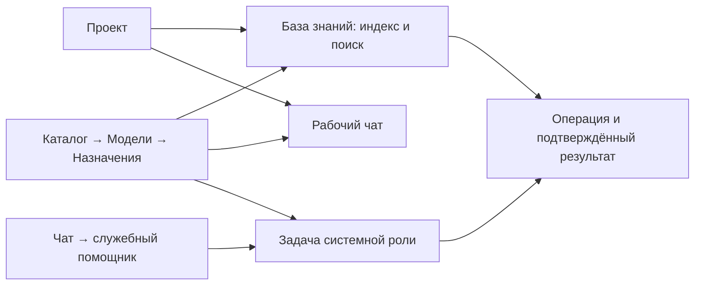

# Интерфейс Нейроцентра: одна рабочая цепочка

24 октября 2026. Дизайн следующего развития продукта; документ не объявляет предложенные экраны реализованными. Основа: три пользовательских снимка, стабильные снимки настоящих компонентов на изолированном стенде и текущие исходники. Все разделы в живом браузере не проверены.

Нужный результат: пользователь проходит **проект → компьютер → модель → индекс → ответ агента** в Нейроцентре. На каждом шаге видны состояние, главное действие и результат. Настройка модели имеет одно место, служебный агент доступен через настоящий диалог, отдельный frontend OpenCodeRAG удалён после переноса его нужных функций. Ядро индексации остаётся.

## Журнал проверки форм — 25 октября 2026

Журнал ведётся по пользовательским действиям. «Осмотрено» означает просмотр конкретного состояния или исходников; «исправлено» — изменение в рабочей ветке; «проверено» — указанную проверку; «применено» — отдельное подтверждение main и работающего приложения. Эти отметки не заменяют друг друга. Исторические проверки ниже не считаются повторной проверкой текущей версии.

| Форма / действие | Что уже осмотрено | Найдено / следующее действие | Исправлено | Проверено | Применено |
| --- | --- | --- | --- | --- | --- |
| Проектный чат: выбор диалога и отправка сообщения |Прежний живой интерфейс 545×789; новая компоновка на стенде настоящих компонентов 390×640 и 1200×620, включая пустой чат, приватный диалог, ошибку, чтение и выключенные флаги; работающий main 545×789| Список диалогов вынесен в колонку, история ограничена окном, настройки раскрываются. Исправлены ложный конфликт после своего сохранения и вытеснение кнопки при потерянном ACK; повторная визуальная проверка пройдена | Ветка `feature/project-chat-layout-20261025`; принятая адаптация для main |Feature: 209/209 в 19 наборах. Main-кандидат: 207/207 в 18 наборах, строгие типы, сборка и браузер. Проверены Escape, черновик и повтор с тем же ключом; кнопка восстановления внутри обоих viewport Реальный CUA: история 436 px, composer 155,5 px, низ отправки 773 px; пустой черновик, без POST.| Подтверждены remote/primary main `58b26de` и работающая компоновка; отправка в live не проверялась |
| Личный чат: выбор проекта / модели и список диалогов | Живой браузер 545×789: начальное состояние, список и сохранённый диалог с пятью агентами; исходники workspace и composer | Эталон компоновки для проектного чата. Свёрнутые настройки и ввод доступны вместе с историей. Ошибки и большое увеличение текста в этом проходе ещё не осмотрены | В текущем проходе не менялось | Осмотр браузером без отправки запросов; снимок `personal-live-reference.png` в локальном каталоге приёмки | Отдельного изменения нет |
| Служебный чат: запрос роли, контекст и разрешения инструментов | Только исходники служебного чата и контекста RAG | Отделить отправку обычного запроса от согласия на инструменты; проверить восстановление и ранее сохранённые задания | Разработка в отдельных ветках | Браузерная приёмка и совместимость старых заданий ещё не завершены | В живом интерфейсе ещё не подтверждено |
| Каталог → Агенты: обзор | Видна текущая страница за окном чата | Формы создания и редактирования агентов ещё не осмотрены | Нет | Нет | Нет |
| Создание проекта | Исходники `CreateProjectModal.tsx`; браузер не проверен | Одно обязательное имя, дополнительные поля свёрнуты, ошибка оставляет форму открытой. Проверить пустое имя, отказ сохранения и клавиатуру | Не менялось | Только осмотр исходников | Отдельного изменения нет |
| Редактирование проекта | Исходники обзора и поиск потребителей `updateProject` | API существует, форма редактирования в UI не найдена. Зафиксирована отсутствующая возможность; решение о её добавлении отдельно | Нет | Нет формы для проверки | Нет |
| Общая папка и привязка проекта | Исходники `LocalProjectsFolder` и `WorkspaceBindingWizard` | Есть этапы проверки и подтверждения, действие в пустом состоянии, повтор неизвестного результата исходным ключом. Проверить реальный отказ моста | Не менялось | Только осмотр исходников | Отдельного изменения нет |
| Добавление / редактирование модели | Исходники `ModelEditModal` | Подписаны этапы API, ручной идентификатор, параметры и размерность; введённое сохраняется при отказе. Проверить основной путь и ошибки в браузере | Не менялось | Только осмотр исходников | Отдельного изменения нет |
| API-подключение модели | Исходники `RemoteConnectionModal`; отказ обновления после принятой проверки воспроизведён тестом | Подтверждённый запуск больше не объявляется незапущенным. «Обновить каталог» восстанавливает список без повторных сохранения и запроса к модели; явное изменение полей начинает новую проверку | Main `58b26de` | Регресс сначала подтвердил два вызова вместо одного, затем прошёл в итоговых 209. Ввод сохраняется; браузерный сценарий ещё не пройден | Исходники применены в main/live; отдельный браузерный сценарий ещё предстоит |
| Codex: компьютер и вход | Исходники `DeviceCodexConnectionModal` и настоящий DOM AntD в тесте | После отказа повторной проверки прежний успех помечается как неподтверждённый; ошибка отделена от прежнего результата | Main `58b26de` | RED → GREEN в составе итоговых 209; браузерный сценарий ещё не пройден | Исходники применены в main/live; отдельный браузерный сценарий ещё предстоит |
| Импорт моделей из OpenCode | Исходники `OpenCodeImportModal` и сценарные тесты | Без компьютеров есть переход к подключению. Истёкший снимок объясняет запрет импорта и предлагает повторное чтение того же источника | Main `58b26de` | Оба случая RED → GREEN в составе итоговых 209; браузерный сценарий ещё не пройден | Исходники применены в main/live; отдельный браузерный сценарий ещё предстоит |
| Назначение модели / embedding | Исходники `ModelCatalog`, `ModelCard`, `EmbeddingTarget` | Предусмотрены причины блокировки и переходы к подготовке. Проверить смену проекта, конфликт назначения и возвращение после настройки | Не менялось | Только осмотр исходников | Отдельного изменения нет |

Для каждой формы проверяются: понятное следующее действие, подписи полей и обязательность, безопасные значения по умолчанию, причина недоступности действия, сохранение ввода при ошибке, интервалы вокруг сообщений, доступ с клавиатуры и фокус, узкое и низкое окно. Подробности раскрываются по необходимости. Необязательная зависимость не должна перекрывать остальные действия.

Локальные свидетельства этого прохода находятся в рабочей папке `module-reliability/neurocenter/.run/project-chat-layout-20261025`: `tests-20261025-134319-c0760dc` — воспроизведение ложного конфликта (5 PASS / 1 FAIL); `tests-20261025-134725-fa81142` — итоговые 155 PASS; `types-20261025-134454-b0f6d15` и `test-types-20261025-134628-a51ecd9` — успешная строгая проверка типов. В каждом каталоге сохранены исходный вывод и квитанция. Ранний запуск с неверным путём конфигурации и первая неуспешная проверка типов тестовых harness сохранены отдельно; они не считаются успешными проверками.

После дополнительных исправлений: `tests-20261025-140853-5783096` — 209 PASS / 0 FAIL / 0 SKIP, `types-20261025-141110-4699578` и `test-types-20261025-141310-1c3c31e` — строгие типы. Это проверки перечисленных форм и чатов, а не измерение общего покрытия. На браузерном стенде используются синтетические данные и выключены реальные API/модели; он подтверждает компоновку, а не серверную или native-приёмку. Ранний файл `mobile-acklost-before.txt` содержит только AX-diff «нет изменений»: исходная геометрия взята из фактического CUA-вывода, снимок сохранён отдельно; этот текстовый файл не служит геометрическим доказательством.

Повторная браузерная проверка ACK: `mobile-acklost-fixed-full.txt` содержит полный AX и метрики окна 390×640 — кнопка заканчивается на 624 px, история занимает 178,5 px, горизонтальной прокрутки нет. `desktop-acklost-fixed-full.txt` подтверждает кнопку на 594 px внутри 1200×620. В `acklost-fixed-recovered-full.txt` обе попытки используют один ключ и оставляют одно сообщение; запросов к модели нет. Снимок — `project-mobile-acklost-fixed.png`; остановка и очистка стенда подтверждены в `browser-20261025-141523-8202af2/receipt.json`. Первоначальная квитанция остановки с кодом 143 сохранена как FALSE; следующий оператор явно учитывает запрошенную остановку Vite с этим кодом и проверяет очистку, не переписывая прежний результат.

Адаптация для main использует его существующий boolean API режима чата. 15 из 16 frontend-файлов совпадают с принятым feature-срезом; меняется только обвязка TEAM в `ChatOverlay`, без переноса служебного чата. В локальном `.run/main-ui-20261025`: `tests-20261025-143628-1542d68` — 207 PASS / 0 FAIL / 0 SKIP в 18 файлах (двух служебных entrypoint-тестов в main ещё нет); `types-20261025-143502-6aa9d38`, `test-types-20261025-143828-8f90d94` и `build-20261025-143949-2585512` подтверждают типы и сборку. Настоящие main-компоненты отдельно проверены браузером: `main-mobile-ack-full.txt`, `main-desktop-ack-full.txt`, `main-recovered-full.txt`; кнопка восстановления остаётся на 624/594 px внутри соответствующих окон, две попытки сохраняют один ключ и одно сообщение. Стенд синтетический, реальные API/модели выключены; это ещё не live-приёмка.

Очередь осмотра: создание и редактирование проекта → привязка папки → подключение и назначение модели → установка MCP / инструментов → настройка агента → индексирование, поиск и восстановление RAG → подключение компьютера и моста → доступ участников → обслуживание и квоты → вход и восстановление после ошибки подключения. Для каждой группы отдельно отмечаются пустое состояние, основной путь и отказ зависимости.

Применение UI и guard подтверждено отдельно: `.run/main-ui-20261025/live-applied-v1.json` в рабочем каталоге module-reliability, SHA-256 `1b108f0db53f8be46c2742bb885a85af77f8a94ebd0f5d49b292969645991ce5`. Primary main — `58b26de`, Catalog PID 5300 / generation `1f5eb3b6-62ec-4ce4-845a-973011725b24`; Catalog `/ready` и зависимости Gateway готовы. Живой CUA-осмотр ограничен открытием/закрытием TEAM и чтением истории; снимок `live-project-chat.png`. Реальный запрос модели, новая установка моста и все цепочки пилота этим не подтверждены.

## Граница пилота

Пилот включает все восемь пользовательских цепочек [стабильного MVP](stable-mvp-2026-10-22.md), в том числе контексты, системные роли и агентный режим. Самообучение — следующий целевой срез, с проверяемым применением и отзывом знаний. Одна работающая переписка не подтверждает готовность всего пилота.

| Цепочка | Наблюдаемый результат приёмки | Что ещё требуется |
| --- | --- | --- |
| Служебный чат и системные роли | Сохранённый диалог запускает доступную роль; координатор делегирует, результаты и операции переживают закрытие окна и обновление | Live-приёмка; совместимость старых принятых role runs; approved learning пока не включён в контекст системных ролей |
| Проект и контекст | Два проекта с разными контрольными файлами не смешиваются в личном чате, TEAM, системных ролях и OpenCode; ответ содержит проверяемый источник | TEAM пока не получает RAG/файлы/MCP; конфигурация OpenCode ещё требует полезного вызова |
| Компьютер и мост | Установка из доставленного архива, подключение и обновление сохраняют настройки; offline/отмена/потерянный ACK не блокируют независимые чаты | Реальная установка принятой версии и native-проверки; guard повторной проверки прав применён к живому Catalog; новая установка моста ещё предстоит |
| Каталог и инструменты | Назначенный инструмент обнаружен и полезно вызван через выбранный server/device runtime, с версией и проектом в результате | Сквозной вызов MCP; закрытие новых вызовов после отзыва назначения |
| Модели | Назначенные chat/embedding-модели действительно используются нужными потребителями; восстановление UI не дублирует inference | Приёмка из обычного интерфейса после применения версии; проверки компьютера и реального ответа модели различаются |
| Агентный режим | Одно сообщение запускает план, специалистов, критику и итог; отказ одного исполнителя сохраняет остальные результаты | Дискуссии уже существуют, но их runner запрещает tools; универсальность инструментов всех потребителей ещё не завершена |
| RAG и самообучение | Index/search/sync/restore; кварк → опыт → гипотеза → одобрение → полезное применение → Memory; отзыв убирает управляемое знание | Поиск и просмотр файлов ещё не перенесены в UI Нейроцентра. Quirk import и односторонняя проекция одобренных знаний в Memory существуют; сквозная приёмка всей цепочки ещё не завершена |
| Поставка и упаковщик | Поддерживаемый исходник превращается в пакет, появляется в каталоге и реально устанавливается/обновляется; отказ сохраняет прежнюю версию | Консультация роли не считается выполненной сборкой; требуется фактическая поставка и установка |

Core ABI RAG уже частично отделён от Web UI (`ragCore`, `hosted-rag-core-v1`). Наличие старого launcher не означает, что вся управляемая индексация обязательно требует `localUi`; оставшиеся поисковые и файловые сценарии нужно перенести отдельно. Уведомление вкладки разрабатывается отдельным срезом: подтверждённые сообщения/состояния известных задач, без вывода об успехе по уменьшению счётчика операций.

## Что показали снимки

| Свидетельство | Подтверждённое наблюдение | Решение |
| --- | --- | --- |
| Пользовательский чат, `cbecc3c6…` | Над перепиской постоянно показаны выбор проекта/модели, режим и длинный перечень участников. Значительная часть окна занята управлением. | Сводка «проект · режим · модель», раскрытие настроек по запросу; участники — короткая строка и подробности. История и ввод остаются основной областью. |
| Пользовательская ошибка RAG, `a9ed7945…` | Сообщение о неподтверждённом происхождении векторов предлагает `index_project` или отдельный интерфейс OpenCodeRAG. Пользователь не получает непосредственного действия в Нейроцентре. | Показать причину и действие «Перестроить индекс» в текущем проекте. Проверку происхождения сохранить; устранить необходимость перехода в другую программу. |
| Пользовательский вход, `ba0b426f…` | Ошибка подключения вплотную примыкает к кнопке входа. | Локальный вертикальный блок сообщения и кнопки с интервалом 16 px. Никакого глобального отступа всем `.ant-alert`. |
| Стабильный desktop до/после, 1200×620 | На стенде история выросла с 90 до 240,7 px; нижняя граница блока ввода переместилась с 678,9 за пределами viewport до 594 px внутри него. | Сохранить компактную компоновку и независимую прокрутку истории. Это свидетельство конкретного компонента, не аудит всего продукта. |
| Стабильный mobile после, 390×640 | История 190,8 px; ввод и кнопка находятся внутри viewport, нижняя граница блока ввода 620 px. | Настройки сворачиваются, список диалогов открывается отдельно. Основное действие не требует прокрутки всей модалки. |
| Фактический `rag-before.png` | Первый экран вкладки базы знаний занят развёрнутой настройкой модели и места подключения; состояние индекса не видно в показанной области. | Наверху — индекс и следующее действие; модель и компьютер — компактная сводка с переходом к настройке. |

Числа относятся к синтетическим данным стенда настоящих React-компонентов. Ранние пустые/переходные desktop-снимки и устаревшие измерения не используются. Причина расхождения CSS старой формы входа со снимком не установлена.

## Навигация и место действий

| Место | Что пользователь здесь делает | Что здесь показывается кратко |
| --- | --- | --- |
| **Проекты** | Открывает проект, связывает его с папкой компьютера, создаёт проект при наличии права. | Доступность компьютера, папка, состояние знаний, активные операции. Технический ID — в деталях. |
| **Проект → База знаний** | Индексирует, ищет, выбирает папки и наблюдает синхронизацию. | Модель, компьютер, подтверждённое поколение индекса, серверная копия. |
| **Каталог → Модели → Назначения** | Подключает источники моделей, назначает модели проектам и конкретным целям. Это единственное место редактирования назначений. | Проверка подключения и совместимость с выбранной целью. |
| **Каталог → Инструменты / Агенты** | Выбирает инструменты, управляет определениями агентов и установками. | Какая модель назначена; ссылка «Изменить назначение» в центр моделей. |
| **Чат** | Выбирает рабочий диалог или служебного помощника. | Проект, область, модель и состояние текущего ответа; детали раскрываются. |
| **Операции** | Читает состояние конкретной операции, разрешённую отмену и восстановление. | Счётчик активных действий; общий процент не выдаётся за прогресс выбранного проекта. |
| **Настройки / Обслуживание / Помощь** | Меняет источники; управляет хранением и восстановлением; находит инструкцию с возвратом к исходной задаче. | Текущее значение и ближайшее действие, затем подробности. |

Настройки глобального масштаба и проекта явно различимы. Переход к назначению модели сохраняет проект, цель и ссылку возврата. Рабочие экраны показывают действующее назначение и открывают его в центре; копии редакторов моделей в чате, RAG и форме системной роли постепенно убираются. Удаление проекта и другие опасные действия находятся во вторичном меню/настройках проекта, а не конкурируют с основным действием вкладки знаний.

## Общий визуальный язык

Используются текущие Ant Design, React и стили фич. Перерисовка темы и смена библиотеки не требуются. Стиль спокойный: один акцентный цвет для основного действия, нейтральные поверхности, тонкие разделители. Красный обозначает ошибку или опасное действие; он не заменяет объяснение состояния.

Внутри связанной группы интервал 8 px, между сообщением и действием — 16 px, между самостоятельными разделами — 24 px. В карточке достаточно 20–24 px на большом экране и 16 px на узком. Локальный stack/`Space` задаёт интервалы один раз; одновременно добавлять внешние отступы каждому дочернему Alert не нужно. В настройках источников уже применяется вертикальный `Space`, у ошибок проектов/каталога и уведомлений обслуживания есть собственные интервалы — массовый CSS-патч им не нужен.

Основной текст — около 14 px с читаемым межстрочным интервалом; заголовок страницы 24–28 px, раздела 16–18 px. Подписи 12–13 px остаются вторичными. Компактность достигается сокращением повторов и сворачиванием настроек, а не уменьшением текста до плохо читаемого размера.

Страница начинается с названия, короткой строки состояния и одного главного действия. Длинная справка, pins, пути, сырые ответы и журналы находятся в «Подробностях». Кнопка с неочевидной недоступностью получает объяснение рядом. Текст «Не удалось получить состояние» отличается от состояния «Не настроено».

## Все назначения моделей — в одном центре

Сейчас список разрешённых проекту моделей и выбор модели для конкретной задачи — разные операции. `POST/DELETE /api/projects/:id/models` меняет доступность модели проекту; это не запуск хостинга и не выбор модели RAG. Личный диалог, агент комнаты, анализ обучения и запуск системной роли имеют собственные контракты. Сводить их к одному одинаковому dropdown нельзя.

Центр открывается на выбранном проекте через существующий каталог `/store?tab=models&p=<project>`; вкладки «Назначения» и «Все модели» разделяют использование и реестр. Строка назначения содержит «Назначение / Модель / Где работает / Состояние / Изменить». Три группы:

| Группа | Строки назначений и их смысл |
| --- | --- |
| **Диалоги и агенты** | Разрешённые проекту модели; предлагаемая модель новых личных диалогов; базовая модель комнаты; переопределения отдельных агентов; модель нового анализа обучения. У каждой строки указано, для каких новых действий она применяется. |
| **Системные роли** | Координатор, AI-админ, Автоконфигуратор, Индексатор: назначение по роли и доступной глобальной/проектной области. Сохранённые назначения здесь — предлагаемая новая возможность; сейчас модель выбирается при каждом запуске формы. |
| **Индекс проекта (RAG)** | Модель embedding, размерность, сервер/компьютер применения и последствия смены для индекса. Рядом — действие подготовки переиндексации, а не обычное сохранение dropdown. |

Карточка назначения показывает название модели, источник, состояние проверки и фактическую область применения. Совместимые модели доступны для выбора; несовместимая видна с конкретной причиной. Известные внешние `provider/model` OpenCode и наследование его default не угадываются по похожему названию каталога: центр показывает их происхождение и сохраняет существующие параметры.

Изменение default относится к новым диалогам/запускам. Существующие диалоги и выполняющиеся операции сохраняют закреплённую модель и pin. Переопределение конкретной комнаты/агента видно в том же центре с указанием объекта; оно не превращается в скрытую глобальную настройку. При конфликте revision черновик остаётся, рядом показываются актуальное значение и действие перечитывания.

Выбрать одну из разрешённых моделей для нового диалога — параметр использования: такой выбор может оставаться в чате. Создание подключения, назначение по цели и изменение общего default находятся только в центре. В первом срезе он собирает существующие редакторы и планы, не заводя второе состояние тех же сущностей. Отсутствующие сейчас chat default и назначения системных ролей требуют отдельного небольшого серверного контракта с глобальной/проектной областью, revision, requestKey и текущими правами; одним переносом dropdown они не появятся. Координатор сейчас использует одну модель parent run для планирования, делегатов и синтеза: разные модели его подзадач требуют отдельного runtime-контракта и не обещаются этим экраном.

Для RAG действует существующий план `create → preview → start` с requestKey, modelPin, digest, ревизией и точной компьютерной целью. Backend отклоняет прямой `PATCH embedding` с ненулевым `modelId`; PATCH служит очистке выбора. Центральный экран обязан сохранить этот контракт. Сохранение назначения не подтверждает ответ провайдера, установку пакета или готовность индекса.

## Системная роль как настоящий служебный чат

**Сейчас:** `Каталог → Агенты → SystemRoles → SystemRoleModal` открывает форму выбранной задачи, контекста, модели и истории запусков. Это полезный workflow, но не служебный чат. Отдельного frontend `SystemRoleChat` и его маршрута нет. Backend-контекст `system-role-chat.context.ts` и source-проверки сами по себе не создают доступный диалог. Системный агент также не является пользовательской ролью доступа.

**Предлагается:** в общем входе «Чат» есть режим «Служебный помощник». Пользователь выбирает существующего системного агента, область и пишет задачу обычным сообщением. В шапке достаточно «AI-админ · проект А · модель …». Настройка назначения модели открывается в едином центре, а не дублируется в форме сообщения.

В истории сохраняются реплики пользователя, измеренные факты, ответ, предложенные изменения и ссылки на реальные операции. Контекст показан компактными приложениями: выбранный проект, проверяемая установка, доступные измерения, явно добавленный текст. Передача новых данных модели и бюджет видны у отправки. Открытие диалога, чтение истории и обновление состояния не вызывают модель.

Кнопка отправки создаёт один явный запуск с показанным контекстом и закреплённой моделью. Подготовка контекста остаётся бесплатным шагом существующего контракта; пользователь не должен заново заполнять длинную техническую форму перед каждой репликой. При потере ACK интерфейс проверяет тот же intent. Сообщение пользователя не превращается автоматически в применение предложенного изменения.

Если нужен эффект, под ответом находится конкретная карточка владельца: «Подготовить подключение», «Перестроить индекс», «Применить показанное изменение». Она показывает цель и последствия; выполнение остаётся у действующего сервиса/моста с текущими правами и проверками версии. Частичное применение отображается по квитанциям, неизвестный исход — как неизвестный. Откат предлагается только для действительно поддержанного и подтверждённого изменения.

Приёмка этого среза требует сохраняемого диалога и связи его реплики с реальным запуском роли, повторного открытия после reload и восстановления потерянного ответа. Для нескольких ходов нужен явный журнал dialog/turn и правила включения прежних ответов в разрешённый контекст. Существующий run сам по себе этого не обеспечивает. Промежуточный workspace можно строить на текущем API запусков; пока нет durable-диалога, он называется «Запуск системного агента». Визуально оформить прежнюю модалку пузырями сообщений недостаточно.

## База знаний: ядро OpenCodeRAG, интерфейс Нейроцентра

Целевое состояние определено: отдельные frontend, Web UI-сервер и launcher OpenCodeRAG удалены. Остаются parser/chunker, embedding pipeline, LanceDB, manifest/profile, файловые ограничения и безопасное переключение индекса. Все пользовательские действия, поиск и наблюдение выполняются в Нейроцентре; Socket.io доставляет обновления состояния.

### Первый экран проекта

Сверху — компактная панель: **«Индекс подтверждён / не создан / происхождение не подтверждено / строится / требуется действие»**, имя компьютера и папки, время последнего подтверждения. Основная кнопка — «Индексировать проект» или «Обновить индекс». Модель и место применения показаны строкой со ссылкой на центр назначений. Серверная копия имеет отдельное состояние и время синхронизации.

Ниже расположены «Поиск», «Файлы и папки», «Настройки индекса», «История». Поиск занимает основную область готовой базы. Результат содержит файл, фрагмент, область поиска и подтверждённое поколение/время; открытие файла соблюдает границы проекта. Выбор «Серверная копия / На компьютере» показывается, когда соответствующий путь реально поддержан; недоступная область объясняет следующий шаг. Публичный браузерный поиск и локальный transport нельзя объявлять готовыми по наличию внутреннего search endpoint. Серверный поиск переиспользует цепочку текущего проектного контекста и модели → embedding → sealed RAG generation, уже используемую контекстом чата; браузер не выбирает произвольный вектор/поколение и не обращается напрямую к приватному localhost-сервису.

Папки, исключения и типы файлов редактируются нормальными полями с понятной сводкой охвата. Технический JSON остаётся дополнительной диагностикой. Смена фильтров объясняет последствия полного прохода; описание изображений — отдельная видимая возможность. Смена модели/размерности и перестроение используют существующую подготовку кандидата: прежняя копия работает до проверки и переключения новой.

### Прогресс без выдуманного процента

Сейчас managed reindex сообщает крупные этапы: проверка подключения около 20%, начало построения 30%, проверенный новый индекс 85%, затем синхронизация. Поэтому долгое отображение 30% само по себе не означает зависание. Текущий UI не получает из этой границы непрерывное число обработанных файлов; анимировать рост до 84% по таймеру было бы ложной точностью.

Ядро должно отдавать события этапа и фактические счётчики: найдено файлов, обработано/всего, получено фрагментов, завершено embedding-запросов, текущий безопасный относительный путь, время последнего события. При неизвестном общем объёме — indeterminate-индикатор и счётчик выполненного. Процент допустим внутри этапа, когда известен его знаменатель. Отдельно видны «Сканирование → Построение → Проверка → Переключение → Синхронизация»; 100% означает подтверждённый итог, а не завершение скачивания или сохранение настройки.

Сейчас `bridge:changed` сообщает об изменении, после чего UI получает авторизованный снимок через GET. Этот путь сохраняется: Socket.io-сообщения привязываются к проекту, устройству, binding/instance и operation/run; новая последовательность прогресса принимается только от текущего владельца задания и по возрастанию sequence. События не содержат приватных путей, текстов документов, токенов и grants. Сведения о текущем относительном файле, если нужны пользователю, читаются в разрешённом снимке.

Серверный снимок остаётся авторитетным: после reconnect клиент перечитывает его, отбрасывает старые/чужие события и продолжает наблюдение. Перезапуск вкладки или разрыв socket не создаёт новый job. Последнее известное состояние сохраняется с пометкой времени; отсутствие новых событий отличается от потери связи.

### Повтор, остановка и восстановление

Подтверждённое окончание разрешает новый запуск с новым согласием и requestKey. Неизвестный ACK проверяется прежним ключом; старый успешный receipt не подменяет исход нового запуска. Активное задание блокирует дубликат для той же цели. Папка или pin изменились — ввод сохраняется, но прежний план становится stale.

Для queued-задания доступна существующая отмена в «Операциях». Отмену уже работающего `connect-rag-model` текущий контракт не поддерживает: кнопки «Остановить» до реализации реального протокола нет. Ошибка до переключения кандидата сохраняет прежний индекс. Если проверенное локальное переключение уже совершено, а затем упали синхронизация или ACK, новый локальный индекс и профиль сохраняются: UI показывает «Локальный индекс переключён; серверная синхронизация или общий итог не подтверждены» и сверяет квитанцию. Обещать откат или показывать «Ничего не изменилось» в таком исходе нельзя.

«Происхождение не подтверждено» предлагает управляемое перестроение в этом проекте. Нельзя разрешать синхронизацию непроверенного индекса ради удаления ошибки. Для сбоя получения данных показываются последняя проверенная сводка, время и «Повторить получение состояния»; сообщение `Failed to fetch` не остаётся единственным объяснением. Пустой, успешно проверенный индекс с нулём фрагментов — допустимый результат: UI предлагает добавить поддерживаемые файлы и обновить индекс, не рисует несуществующие данные.

### Перенос и удаление отдельного frontend

Сначала в ядре выделяются структурированные status/search/config/index/progress-контракты, доступные через действующий авторизованный мост. Сейчас managed reindex, backend допуска задания и startup probe зависят от `localUi`/UI capability: простое удаление web-файлов сломает допустимый запуск. Нужен явный фиксированный descriptor ядра, независимый от UI, с прежними проверками package/manifest, одобрения, модели, binding и instance. Сохраняются MCP/plugin hooks, `search_semantic`, `index_project`, `get_index_status`, manifest/profile, CAS/locks, защита batching и фильтр текстового корпуса при выключенном vision.

Затем Нейроцентр получает поиск, папки/фильтры, запуск, результат и восстановление; проверяются полная цепочка и reload/reconnect. Новая неизменяемая версия поставки исключает отдельный Web UI, его сервер/токенный launcher, сборку и только действительно UI-зависимости после проверки import closure ядра. Существующие пакеты и пользовательские cache-файлы не переписываются. История старых UI-заданий и закрытие уже принадлежащего мосту старого UI-процесса сохраняются; новый launcher больше не предлагается.

До приёмки переноса нельзя удалить единственный работающий путь к ещё не перенесённой функции; временное наличие старого bundle не является целевой архитектурой. Полный перенос eval/quirks/session-management в первый срез не включается автоматически: отдельно определяется, какие пользовательские задачи остаются нужны и кто ими владеет.

## Порядок развития и проверяемый результат

Приоритет — завершённая рабочая цепочка, затем расширение возможностей. Параллельная косметическая переработка всех страниц не закрывает отсутствие ответа агента или поиска по готовому индексу.

| Срез | Что меняется для пользователя | Как отличить готовое от макета |
| --- | --- | --- |
| **1. Проект → компьютер → индекс** | В проекте видны состояние, индексирование, повтор, ошибка и следующий шаг. Существующее действие индексирования уже добавлено в текущую рабочую пачку. | Реальная цель сохраняется, нет дубликата после lost ACK; отказ до переключения сохраняет прежний индекс. После локального commit UI отдельно подтверждает серверную копию и общий итог. |
| **2. Один центр моделей** | Все назначения и исключения доступны в одном месте; рабочие экраны показывают сводку и возвратную ссылку. | Изменение применяется нужному consumer с его pin/revision/планом; старые диалоги и операции не меняются скрыто. Новые defaults действительно сохраняются. |
| **3. Ядро RAG + Socket.io + единый UI** | Поиск, папки, настройки и подробный ход работы находятся в Нейроцентре; отдельный frontend удалён. | Полная индексация → поиск → синхронизация → reload/reconnect работает через реальные контракты; сбой до переключения сохраняет исходную копию, после переключения UI отражает принятый локальный результат. |
| **4. Настоящий служебный чат** | Пользователь задаёт задачу системной роли и получает проверяемый ответ/действие в сохранённой переписке. | После reload видны реплики и операции; модель действительно вызвана явно, повтор ACK не дублирует платный запрос, применённые изменения подтверждает владелец. |

Устойчивость входит в каждый срез: empty/error/offline, смена проекта/роли/модели, отзыв доступа и частичный результат проверяются вместе с основным путём. Новые функции подключаются через реестр фичафлагов; отключение сохраняет разрешённые историю, отмену и восстановление, а права проверяются отдельно.

На обычном, низком и узком viewport главное действие и текст ошибки доступны без горизонтальной прокрутки страницы. История чата прокручивается отдельно, фокус остаётся понятным, поля имеют доступные имена, диалоги закрываются штатной клавиатурой. Проверка ширины 390 px не заменяет тест большого масштаба текста и реального устройства.

## Что подтверждено в текущей пачке, а что ещё предстоит

Подтверждены локальные сценарии явного первого/повторного индексирования и проверки lost ACK (50 тестов до добавленного отдельного anchor-регресса), два существующих теста формы входа и стабильная геометрия конкретных chat-компонентов на стенде. Для native reindex получен отдельный результат 14/14: два новых сценария запускают настоящий adapted CLI/upstream pipeline/LanceDB и private CAS; успешный проход создаёт metadata, а synthetic 422 сохраняет старые байты. Resolver поставки и loopback embedding HTTP в этих тестах контролируемые — это не приёмка архива, внешнего inference или всего живого продукта.

Отдельная сохранённая квитанция реального `connect-rag-model` подтверждает одну конкретную связку: `succeeded`, индекс `ready`, 22 фрагмента, 1024 координаты, revision 4, `serverSynced:true`. Отпечаток снимка из квитанции совпал с активным серверным снимком, подпись подключения — с сохранённым профилем. Это результат данной операции, а не подтверждение всех проектов, будущего core-only пакета или новых realtime-счётчиков. При подготовке документа перечитана только квитанция, без повторного открытия пользовательской базы и вызова модели.

Это не подтверждает готовность центра назначений, служебного чата, Socket.io-прогресса native pipeline или удаления Web UI. Они описаны как следующие реализации. Живой интерфейс, тесты, native OS, внешний провайдер и публикация имеют отдельные свидетельства.

## Исходники и локальные свидетельства

- Навигация и интервалы: `frontend/src/modules/Core/Core.tsx`, `Core.less`, `common/styles/app.less`; вход — `features/UserBlock/LoginScreen.tsx/.less`.
- Назначения: `modules/Store/CatalogTabs.tsx`, `features/ModelCatalog/api.ts`, `features/ModelChat/ChatOverlay.tsx`, `features/ProjectChat/ProjectChatParticipants.tsx`, `features/AgentCatalog/AgentDefinitionFields.tsx`, `features/ProjectLearning/LearningAnalysisModal.tsx`.
- Embedding: `features/ProjectEmbedding/{ProjectEmbedding,ProjectEmbeddingConnection}.tsx`, `reindex.ts`; сервер — `services/catalog-service/src/models/project-embedding.service.ts`. Ненулевой выбор выполняется планом.
- Системные роли: `features/SystemRoles/{SystemRoles,SystemRoleModal,RoleRunContent}.tsx`, `api.ts`; backend-контекст — `services/catalog-service/src/system-role-chat/system-role-chat.context.ts`. Дополнительный дизайн ответственности: [system-agent-roles-design-2026-10-24.md](system-agent-roles-design-2026-10-24.md).
- Native граница: `mcp/neurocenter-asset-sync/src/features/rag-hosted/reindex.ts`, `src/bridge/worker.ts`, `src/features/rag-index/readiness.ts`; сборка кандидата — `scripts/catalog-plugins/recipes/adapters/rag-reindex.mjs`.
- Локальная приёмка: feature `.run/project-index-ui-20261024/final-receipt.json`, `.run/login-spacing-20261024/receipt.json`, `.run/rag-metadata-native-20261024/run-2/{receipt.json,raw.json,raw.log}`. Статус финальной интегрированной пачки устанавливает её отдельная квитанция.
- Квитанция реальной связки в primary: `.run/local-embedding-20261024/native-connect-success-8b4556b3/receipt.json`, SHA-256 `c780f1e0781b5ac2fe69e0df2fa74f800f671cd7fe324cfb7286ccd588889553`.
- Узкий source-план переноса RAG: feature `.run/rag-core-port-plan-20261024/plan.json`, SHA-256 `b2307f8ce1463bcb9e5556569545ae06c165df3789f7f6b22f93c8078d50ee23`; это проектирование, не исполненная миграция.
- Пользовательские снимки — локальные clipboard-файлы `codex-clipboard-cbecc3c6-90c4-4721-b6e8-88bf5071ee8a.png`, `codex-clipboard-a9ed7945-3e28-4e9d-8eac-da39fae36e21.png`, `codex-clipboard-ba0b426f-bbd4-4e07-8c7f-c2348d7ca2f5.png`; они не включены в репозиторий. Их содержимое здесь не перепечатывается.
- Стабильные снимки в primary checkout: `.run/interface-density-20261024/chat-desktop-before-stable.png`, `chat-desktop-after-stable.png`, `chat-mobile-after-stable.png`; дополнительно `rag-before.png`. Локальные пути не являются опубликованными ресурсами.
