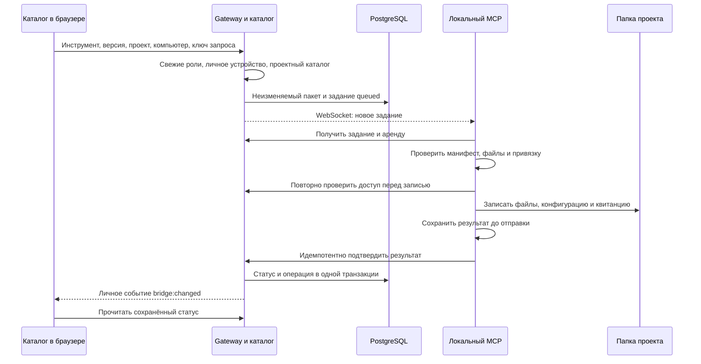

> Историческое описание этапа 0.6.0, сохранённое для контекста протокола. Текущая версия моста — 0.9.3; действующие пути и ограничения описаны в [текущей реализации](current-implementation.md), [матрице сценариев](publication-scenarios.md) и [инструкции общего сборщика](../scripts/catalog-plugins/README.md). Старые названия кнопок и результаты ниже не принимают новый архив. Запись и сверка файлов не подтверждают запуск в OpenCode.

# Установка в один клик и живые статусы

Срез реализации от 17 октября 2026 года. Основной пользовательский интерфейс — каталог на площадке; установку и работу с локальной LanceDB выполняет `neurocenter-asset-sync` на компьютере пользователя. Этап и границы того прохода: [история папок и сверка установленного](installation-inventory-2026-10-17.md). [Аудит безопасности](security-audit-2026-10-17.md) и [плейтест](playtest-2026-10-17.md) сохраняют результаты предшествующих проходов.

Кандидат этого среза — MCP **0.6.0 / протокол 2**. После [аудита установки](one-click-installation-audit-2026-10-17.md) старые `install_asset` и `install_plugin_bundle` удалены; результат сохраняется на компьютере до доставки серверу. Возможности клиента проверяются по отдельным capabilities, неподходящий клиент получает предложение обновиться. Этапы надёжного подтверждения и комплектов описаны в [доработке установки](installation-hardening-2026-10-17.md) и [историческом отчёте MCP 0.5.0](dependency-sets-2026-10-17.md). Уже установленный на Mac пользователя клиент автоматически не заменялся.

## Первый запуск

1. Откройте «Начало работы». При необходимости установите OpenCode командой `install_opencode.sh` или `install_opencode.ps1` с этой площадки.
2. Выполните команду подключения MCP: `install.sh` для macOS/Linux либо `install.ps1` для Windows. Новый установщик скачивает готовый архив со встроенным Node.js 24 и зависимостями с этой площадки, проверяет SHA256 и платформу. Отдельные Node/npm и доступ к npm-реестру пользователю не нужны. Ранее подтверждена нативная среда **macOS ARM64**; приёмка кандидата 0.6.0 фиксируется в [отчёте того этапа](installation-inventory-2026-10-17.md). Для отсутствующей платформы выдаётся ошибка без замены прежнего клиента. Windows/Linux требуют собственных сборок и приёмки. Установщик пытается открыть страницу подтверждения автоматически; ручной код остаётся запасным способом.
3. Скрипт зарегистрирует MCP в глобальном JSON/JSONC OpenCode и выдаст одноразовую ссылку. Откройте её в своей сессии Нейроцентра, сравните имя и отпечаток компьютера, подтвердите подключение. Код действует 10 минут.
4. На странице «Проекты» выберите нужный MCP и нажмите «Выбрать папку через MCP». Системный диалог откроется на выбранном компьютере. На Linux нужен zenity или kdialog и графическая сессия.
5. Свяжите подкаталог с серверным проектом. Имена могут отличаться. В проекте появится `.opencode/neurocenter.json` с адресом площадки и постоянным ID.
6. Админ проекта выбирает инструменты из общего каталога в проектный. После этого разработчик устанавливает разрешённый инструмент одной кнопкой «Установить через MCP».

Уже зарегистрированный MCP можно подключить инструментом `connect_neurocenter`. Повтор использует действующий ID; явный `reconnect: true` позволяет подтвердить другую назначенную роль. Истёкший ключ продлевается с доказательством прежнего подключения и входом того же владельца: ID и история сохраняются. При потере локального ключа или отзыве устройства автоматического присвоения истории нет. `neurocenter_bridge_status` показывает версию, возможности и локальное состояние без секрета. После регистрации перезапустите OpenCode. Worker также запускается после подтверждения ссылки и обслуживает задания независимо от открытого чата.

При нескольких подключённых компьютерах интерфейс предлагает выбрать компьютер. Статус активности основан на heartbeat за последние 40 секунд; недавнее выключение может отобразиться с этой задержкой. Ожидающие задания сохраняются при закрытой вкладке и отключённом MCP. На странице проектов можно отозвать подключение.

## Что происходит после нажатия

Задание закрепляет точный пакет, его хэш и отпечаток привязки конкретной папки. Повтор с тем же ключом не создаёт вторую установку; другой payload с тем же ключом даёт 409. Две вкладки с разными ключами объединяют одинаковую ожидающую установку; другая версия или действие получает конфликт. На устройстве допускается 100 незавершённых заданий; ожидающее больше суток отменяется явно. Все незавершённые записи видны независимо от последних 100 записей истории. Worker последовательно выполняет задания одного устройства, проверяет пути и SHA-256, отказывается от симлинков и от перезаписи чужих либо изменённых вручную файлов. Квитанции находятся в `.opencode/neurocenter/receipts`.

Конфигурация OpenCode изменяется через JSONC-редактор с сохранением комментариев и других подключений. Поддерживаются скилл с SKILL.md и ресурсами, текстовый пакет локального Node.js MCP с собственной точкой входа, удалённый MCP и готовый текстовый пакет плагина. Произвольная внешняя stdio-команда без закреплённых файлов не допускается к установке. Плагины подключаются через `file:` URL точки входа. Секреты задаются ссылками `{env:NAME}` и остаются в окружении пользователя.

Успех означает запись файлов и конфигурации: интерфейс явно показывает «Файлы установлены; запуск ещё не проверен». Проверка запуска произвольного MCP/плагина и авторизация внешнего сервиса не входят в этот статус. Зависимости MCP/плагинов задаются точными ID, версией и SHA; весь замкнутый комплект проходит общее одобрение и записывается одной транзакцией с реестром владельцев. Неоднозначные legacy-имена не разрешаются через текущую версию. Зависимости npm/pip автоматически не собираются и не устанавливаются.

## Удаление с компьютера

В каталоге выбранного проекта есть блок «Установки на выбранном компьютере». Он показывает историю успешно выполненных установок владельца подключения, включая инструменты, убранные из проектного или общего каталога. Ключ истории включает привязку папки: A → B → A сохраняет обе копии, а удаление в A не скрывает B. У прежних записей без binding ID папка не доказана; они видны без автоматического удаления или сверки. Это история команд; перед удалением MCP заново проверяет реальные файлы.

Кнопка «Удалить с компьютера» доступна разработчику проекта и администраторам в пределах их назначений. В подтверждении зафиксированы компьютер, папка, инструмент и версия. Сервер использует сохранённый исходный пакет и его манифест; устаревший запрос получает конфликт. Исключение инструмента из каталога не препятствует удалению установленного пакета. Для проекта, уже удалённого с сервера, автоматическая очистка локальной установки пока не поддерживается.

Удаляются только файлы из квитанции и соответствующее подключение OpenCode. Чужие файлы, комментарии JSONC, модель и другие MCP/плагины сохраняются. Ручное изменение управляемого файла или подключения MCP останавливает удаление до записи. Уже отсутствующие файлы не мешают убрать квитанцию. Инструмент остаётся в каталоге команды, если его отдельно не исключил администратор.

Установка и удаление используют общий локальный lock и журнал изменений. Резервные копии хранятся в личной папке MCP `file-changes/<хэш папки>/history` с правами 0600; путь появляется в результате удаления. В репозиторий проекта копии конфигурации не попадают. После прерывания процесса следующая операция откатывает незавершённую запись до повторной проверки. Если после обрыва пользователь изменил файл, автоматический откат останавливается и сообщает путь резервной копии. Не удаляйте журнал, пока не сверили изменения. Обрыв непосредственно во время захвата оставленного lock может потребовать ручной проверки `recovery.lock`; чужой живой процесс автоматически не разблокируется.

Отключённый MCP получает задание после подключения; до начала удаления задание можно отменить. OpenCode перечитает подключение при следующем запуске. Остановка уже работающего внешнего процесса не входит в это действие.

## Сверка известной установки и API привязки

`POST /api/device-jobs` с `kind: "uninstall"` или `kind: "inspect-installation"` требует `deviceId`, `projectId`, `assetKind`, `assetId`, `expectedManifest`, **`expectedBindingId`** и новый UUID `requestKey`. Отпечаток берётся из выбранной строки установки. Сервер сравнивает его с текущей привязкой компьютера до выбора сохранённого пакета; одинаковые версия и SHA в другой папке не разрешают действие устаревшей вкладки. Для `install` поле пока необязательно на уровне API, интерфейс передаёт его; повтор любого из этих действий сохраняет исходную привязку. Удаление и сверка не используют fallback к bindingless-истории.

Наблюдатель может отправить `inspect-installation` для собственного подключения и доступного проекта; установка и удаление требуют уровня разработчика. Проверка требует отдельного `installation-inspection-v1`, независимо от `install-set-v1`. Сервер выдаёт точный пакет последней успешной установки данной папки. Сканер сверяет байты, квитанцию, реестр и управляемую конфигурацию с этим эталоном; изменение одновременно файла и локального digest не меняет серверный эталон.

Сканер только читает: не импортирует пакет, не запускает команды, не обращается в сеть, не ремонтирует журнал и не создаёт служебные файлы проекта. Занятый проект возвращает `busy`. Результат содержит обезличенные `synced/modified/missing/unknown`, дату, допустимые коды причин и `readiness: unverified`; конфигурация, секреты и абсолютные пути не передаются. Последняя корректная сверка остаётся в списке после сотни последующих событий. Более новая установка того же SHA сбрасывает старую сверку этой папки.

У worker остаётся отдельное восстановление прежних прерванных установок **до получения нового задания**. Оно может завершить или откатить уже известную транзакцию; гарантия отсутствия записи относится к самому сканеру и ветке сверки, а не ко всему запуску worker. При замене клона по прежнему realpath привязка пока не получает новую идентичность экземпляра — это отдельная оставшаяся доработка.

## Синхронизация знаний

Во вкладке базы знаний проекта доступны «Скачать в проект через MCP» и «Синхронизировать с сервером». Требуется роль разработчика внутри проекта и подходящая роль самого подключения MCP. Локальное хранилище должно находиться внутри привязанного проекта.

Скачивание идёт страницами из отдельной проектной PostgreSQL в локальную LanceDB. Явная Arrow-схема поддерживает пустые необязательные поля и известную размерность nullable-вектора. Удаление отсутствующих локальных строк выполняется только после полного непустого источника. Обратная синхронизация сначала отправляет новые строки, затем удаления; неполный скан и слишком большая дельта возвращают план, а не ложный успех. Для большого плана используется MCP-инструмент с явными параметрами лимитов.

Это синхронизация строк, а не атомарная замена снимка всей базы. При ошибке завершённые порции могут остаться записанными; повтор продолжает сверку. Изоляция одновременного редактирования индекса и протокол immutable-снимков больших баз остаются отдельной задачей.

## WebSocket и права

Gateway аутентифицирует browser-сессию и MCP отдельно. `section:changed` сообщает только названия изменённых разделов; содержимое и права перечитываются через обычный API. Обновляются проекты, каталог, знания, участники, обслуживание, аудит, очередь и открытые подробности операций. Редакторы и формы назначений сохраняют ввод и предупреждают о конфликте.

Личные `bridge:changed` доставляются комнате владельца; `bridge:work` — только нужному MCP. Токен устройства хранится локально с правами 0600, в PostgreSQL хранится хэш. Он ограничен каналом заданий и разрешёнными чтением/синхронизацией через gateway; управление пользователями и общим каталогом через этот ключ запрещено. Срок ключа — 30 дней. Роли проверяются при запросе, получении задания и перед записью.

После reconnect интерфейс перечитывает данные. Устройства, задания и история установок загружаются независимо: отказ одного списка не скрывает успешно прочитанный компьютер. Недоступная общая папка отображается отдельной ошибкой и не блокирует выбор нового пути через MCP. Истёкшая аренда начатого задания переводит его в `reconciling`: повторная установка того же инструмента заблокирована до сверки. Новый worker восстанавливает собственный журнал и повторно отправляет сохранённый результат без записи файлов. Отказ до записи подтверждается отдельно от отката. Ручная правка после прерывания требует сверки резервной копии. Отменять можно задания, которые worker ещё не начал.

Обновление worker приостанавливает выдачу новых заданий и ждёт окончания активной операции; чужие процессы не останавливаются. Старые журналы без метаданных задания, повреждённые файлы подтверждения и результаты от отозванного подключения могут требовать ручной сверки. История не является непрерывной инвентаризацией файлов.

Текущий live-сервер рассчитан на один gateway. Для нескольких экземпляров потребуется общий Socket.IO adapter. Реальный корпоративный SSO, Windows/Linux native-диалоги и длительная нагрузка большого числа компьютеров требуют отдельных стендовых проверок.

## Подтверждение

`node scripts/test/bridge-live.mjs` проверяет на временном проекте реальный HTTP, PostgreSQL, WebSocket, локальный worker, запись MCP/плагина/SKILL.md и обмен с нативной LanceDB. Отчёт — `.run/bridge-live-smoke.json`. `node scripts/test/bridge-uninstall.mjs` проверяет удаление трёх форматов, исключение из каталогов, офлайн-очередь, отмену, отказ наблюдателю, чужой проект, ручные изменения и личные WS-статусы. Отчёт — `.run/bridge-uninstall-smoke.json`. Unit-проверки восстановления после настоящего SIGKILL, путей, прав до записи, ручных изменений, JSONC и nullable-схемы находятся в `mcp/neurocenter-asset-sync/test`.

Форматы подключений сверены с [официальным описанием плагинов OpenCode](https://opencode.ai/docs/plugins/) и [исходниками установленной версии 1.14.48](https://github.com/anomalyco/opencode/blob/v1.14.48/packages/opencode/src/plugin/index.ts). Схема API LanceDB проверена по установленному SDK 0.29.0.
