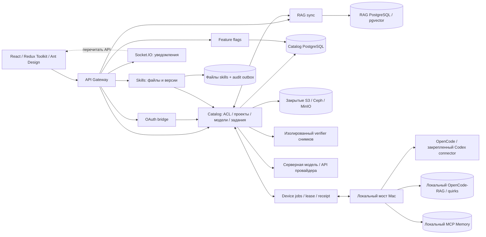

# Аудит модулей и связей — 24 октября 2026

Проверен `main`, исходная точка `802a4463466398e86750a34541c543f967620aca`. Три независимых среза: UI/чаты/модели; серверные операции и доступ; RAG/самообучение/Memory. Это аудит существующего поведения. Найденные ниже дефекты ещё не исправлены; отдельно отмечены уже выполненные исправления и реальные проверки.

## Вывод

Основные связи реализованы через явные владельцы данных, версии, request keys и долговечные задания. Однако согласованность отдельных модулей не подтверждает работоспособность всей цепочки. Найдены девять замечаний: четыре P1 и пять P2. Главные — несогласованный срок чата, зависимость запуска Catalog от S3 вложений, разрыв политики отзыва допуска RAG и потеря журнала владения Memory после штатного переноса/возобновления папки. Остальные относятся к операциям, административному retry и локальной диагностике зависимостей.

На работающей локальной площадке отдельно обнаружена остановленная общая БД: `/health` продолжал возвращать 200, а `/ready` Catalog/RAG/Flags/Auth возвращал 503. PostgreSQL восстановлен, пересборка и обновление семи серверных пакетов завершились. Это наблюдение локальной macOS-площадки; production-Compose имеет другие проверки и restart policy.

## Карта владельцев и контрактов

| Граница | Владелец состояния и нормальный контракт | Отказ и продолжение |
| --- | --- | --- |
| UI → Gateway → Catalog | Gateway подтверждает сессию/роль; Catalog проверяет текущий проект, модель и права. Клиент держит draft и поколение запроса | Owner/generation и remount защищают от позднего ответа другого пользователя/проекта; ошибка не должна стирать draft |
| Личный чат → ModelRuntime | Catalog хранит историю, turn/request ID, revision и model pin в PG; runtime отвечает за транспорт модели | Отмена проходит до провайдера; повтор явный. Сроки трёх слоёв расходятся: A1 |
| Командный чат → worker | Короткий durable ACK, затем PG очередь, lease/generation и отдельный runner | Готовые ответы сохраняются; истёкший запуск становится failed без автоматического платного повтора. Идентичность retry расходится: A6 |
| Агенты → компьютер | Каталог хранит версию конфигурации; локальный мост применяет закреплённое задание к точному instance/binding | «Сохранено» отделено от «Применено на компьютере»; смена папки требует новой проверки |
| Codex import → device inference | Локальная авторизация остаётся на Mac. Сервер хранит частные connection/call, публичная очередь — идентификаторы и pin | Context/dispatch/ACK ограждены lease, ACL, source и one-send CAS. При неизвестной отправке нет автоматического повторного вызова |
| Catalog → RAG DB | Catalog владеет выбором embedding, generation и intent; RAG владеет фактическими chunks и receipt | Неопределённый ACK держит barrier, повтор использует те же байты/ID. Свежие права перед новой отправкой потеряны: A3 |
| RAG quirks → learning | Полный JSONL читается локально, preflight предшествует вставкам. Catalog хранит reported experience с provenance | Неизменённая запись идемпотентна; изменённая — новая версия; автоматического одобрения нет |
| Approved learning → MCP Memory | Catalog — источник одобренных знаний; мост владеет только своей проекцией и журналом точных наблюдений | Частный intent/checkpoint/ACK; ручные наблюдения и связи сохраняются. Перенос binding ломает нахождение ownership: A4 |
| Skills → Catalog | Skills владеет файлами, Catalog — ссылками зависимостей и аудитом; reservation до файловой публикации, audit outbox после | Потерянный ACK повторяется идемпотентно; pending audit отражается в readiness |
| PG → S3 | Метаданные/intent в PG, точные объектные версии и контрольные суммы в закрытом S3 | Вложение активируется после PUT/read-back; tombstone/outbox убирает orphan. Старт всего Catalog связан с доступностью вложений: A2 |
| Снимок → verifier → продвижение | Catalog владеет manifest/CAS/ACL; изолированный verifier читает закреплённые байты и SDK | Lease и manifest hash ограждают завершение; подпись и продвижение только после проверки. Внешняя DR/все платформы этим аудитом не подтверждены |
| Socket.IO → UI | События инвалидируют представление; авторитетное состояние остаётся в API/PG | Reconnect вызывает refresh; приватные чатовые комнаты восстанавливаются polling |

## Подтверждённые замечания

### A1 · P1 · Gateway прерывает ещё допустимый раунд чата

**Граница:** браузер → Gateway → Catalog → модель.

В `services/api-gateway/src/proxy/model-inference-forward.ts:21` срок равен 610 000 мс; `services/catalog-service/src/model-chat/chat.service.ts:308` допускает 900 000 мс, а `frontend/src/features/ModelChat/api.ts:27` и `:30` ждут 920 000 мс. Групповой/исследовательский раунд или несколько последовательных сжатий истории, занявшие 610–900 секунд, получают преждевременный обрыв upstream; Catalog воспринимает закрытие как отмену. Пользователь получает ошибку при допустимом времени обработки.

**Доказательство:** полная цепочка исходников; длительный runtime-сценарий не запускался. Ближайший тест — `services/api-gateway/test/model-inference-forward.test.ts`; нет проверки согласованности срока с Catalog и клиентом.

**Исправление и приёмка:** общий серверный контракт deadline с отдельным запасом на доставку; fake clock и реальный proxy/HTTP boundary подтверждают ответ после 610 секунд, отмену браузером и остановку по общему предельному сроку. Сохранить отдельный разумный лимит для прямого model API.

### A2 · P1 · Настроенный S3 вложений блокирует запуск всего Catalog

**Граница:** необязательный файловый сценарий → lifecycle общего сервиса.

`services/catalog-service/src/model-chat/chat.service.ts:47` безусловно ожидает `storage.initialize()`. В `chat-attachment-storage.ts:21`–`:27` это S3 initialization, перенос прежних вложений и сборщик. Сбой сети/бакета/переноса отклоняет lifecycle до `services/catalog-service/src/main.ts:34` (`app.listen`). При старте или перезапуске Catalog не открывает HTTP-порт, поэтому проекты, модели, задания, чаты и обучение недоступны, даже если вложения сейчас не используются или чат выключен флагом. Отсутствующая конфигурация деградирует мягко. Отказ S3 после успешного старта этой цепочкой не охвачен.

**Доказательство:** исходники; `services/catalog-service/test/chat-storage-lifecycle.test.ts:120` проверяет сохранность исходных байтов при S3-отказе, но вызывает повторную инициализацию вручную и не проверяет bootstrap всего приложения. Умышленного отключения пользовательского S3 в этом аудите не было.

**Исправление и приёмка:** ограничить отказ файловым сценарием и его readiness; управляемое повторное восстановление. Не ослаблять проверку закрытого бакета и целостности. Тест запуска реального Nest-модуля с недоступным S3 должен подтвердить доступность проектов/текстового чата, понятный отказ загрузки и последующее восстановление без потери transfer.

### A3 · P1 · RAG recovery может впервые записать пакет после отзыва прав автора

**Граница:** admission пользователя → durable intent → Catalog timer → RAG write authorization.

Первичный `ProjectRagCoordinator.sync` проверяет пользователя, но `project_rag_sync_intents` не хранит actor/роль (`services/catalog-service/src/models/model-job-schema.ts:14`). Recovery выбирает pending/uncertain и вызывает `finish` (`project-rag-coordinator.ts:28`–`:31`), тот снова отправляет `write` (`:92`). Ответ на внутренний `write-authorize` проверяет intent/hash/context (`:45`–`:53`), но не актуальные права автора. RAG после такого подтверждения проверяет отсутствие готового receipt и выполняет первую мутацию (`services/rag-sync-service/src/rag/rag.service.ts:113`–`:121`).

**Триггер:** сохранить intent, не доставить его в RAG; отозвать доступ автора; восстановить RAG при неизменном embedding context. Фоновая новая отправка разрешена сохранённым intent независимо от отзыва. Это отличается от безопасного чтения receipt уже совершённого COMMIT.

**Доказательство:** исходники; реальный revoke/failure тест не выполнялся. Наличие durable intent само по себе обеспечивает идемпотентность, но не свежую авторизацию новой записи. Код называет intent grant; если требуется необратимый допуск до отзыва, это должно стать явным согласованным контрактом. Сейчас POST ждёт `finish` и при недоставке возвращает отказ/неопределённость, а мост считает пакет подтверждённым только по успешному receipt (`mcp/neurocenter-asset-sync/src/tools/sync-rag-db.ts:104`). Существующие `rag-sync-feature-replay.test.ts:72` проверяют поздний COMMIT/ACK и флаг, но не отзыв ACL до первой доставки.

**Исправление и приёмка:** закрепить инициатора и политику допуска в версионированном intent. Сначала восстанавливать точный уже завершённый receipt; перед ещё не выполненной мутацией проверять актуальные права/допуск. Проверить три порядка: revoke до первой доставки; revoke после COMMIT с потерянным ACK; неизменённые права и идемпотентный повтор. Не терять неопределённый результат и не отправлять изменённый пакет под прежним ID.

### A4 · P1 · После resume/transfer Memory теряет журнал владения своей проекцией

**Граница:** workspace identity → локальный private journal → постоянные имена Memory.

Штатные `transfer`/`resume` сохраняют instance ID, но обновляют `bindingNonce` (`mcp/neurocenter-asset-sync/src/bridge/workspace-instance.ts:231`–`:232`). Ключ ownership-журнала содержит `bindingId` (`src/features/project-learning-memory-sync/receipts.ts:9`), тогда как namespace и entity names зависят от site/project/key (`services/shared/project-learning-memory-sync.cjs:35`–`:37`). Миграции журнала в этой цепочке нет.

После успешной проекции и штатного переноса/возобновления новый binding открывает пустой журнал. Граф прежний: pending create сталкивается с существующим entity (`projection.ts:92`). Cleanup также не знает старых owned observations, поэтому снятие одобрения не удалит прежнюю проекцию. Для resume достаточно переключить проектную папку A → B → A.

**Доказательство:** исходники и существующие отдельные тесты смены binding/журнала; совмещённый runtime-тест отсутствует. Новый флаг `project_learning_memory` остаётся OFF.

**Исправление и приёмка:** передавать владение журналом в рамках подтверждённой миграции той же установки/instance с проверкой manifest и CAS. Простое удаление binding из ключа без такого протокола небезопасно. Проверить настоящую последовательность sync → transfer/resume → noop → изменение знания → revoke cleanup; чужие наблюдения/связи должны сохраниться.

### A5 · P2 · Журнал операций скрывает отмену, которую поддерживает исполнитель

`services/catalog-service/src/operations/operation-actions.service.ts:56` разрешает отмену bridge-задания только в `queued`. `services/catalog-service/src/devices/device-jobs.ts:545`–`:551` поддерживает отдельную отмену Codex и остановку `sync-learning-memory`/`import-learning-quirks` в running/reconciling. Фронт дублирует запрет running bridge в `frontend/src/modules/Operations/operationActions.ts:17`. Поэтому общий журнал запрещает действие, доступное непосредственному API исполнителя; текст про невозможность отмены записи файлов не соответствует этим видам заданий.

**Доказательство:** исходники, без runtime-dispatch. Ближайшие тесты — `operation-actions-database.test.ts`, `operation-actions-tool-build.test.ts` и learning/codex cancellation tests.

**Исправление и приёмка:** capabilities должны использовать политику фактического исполнителя с текущими правами, состоянием и CAS. Матрица queued/running/reconciling/terminal должна совпасть в обоих API; не расширять отмену остальных файловых заданий.

### A6 · P2 · Повтор чужого сообщения проверяется под администратором, исполняется под прежним автором

`services/catalog-service/src/project-chat/project-chat.service.ts:153` разрешает администратору управлять чужим сообщением. При retry модель проверяется по текущему request администратора (`:127`), ответ ставится в очередь. Но claim восстанавливает actor из исходного `author_email/author_role` (`project-chat.repository.ts:86`); runner повторно проверяет именно его (`project-chat.runner.ts:65`). После удаления/понижения исходного автора получается «Повторить → принято → failed».

**Доказательство:** исходники; runtime-повтор с отзывом роли не выполнялся. Действующие проверки runner предотвращают исполнение под отозванными правами; дефект — противоречивый admission и бесполезный ACK, а не обход ACL.

**Исправление и приёмка:** либо отказ до постановки с объяснением исходной идентичности, либо отдельно спроектированный новый запуск текущим администратором. Не заменять автора старой записи молча. Проверить удалённого, пониженного и действующего автора, собственный retry и сохранение готовых ответов.

### A7 · P2 · В локальном dev окружении живые HTTP-процессы маскируют остановку общей БД

В наблюдении около 20:48 UTC PostgreSQL был `Exited (0)`, тогда как семь локальных HTTP-сервисов отвечали и принадлежали этому checkout. Catalog/RAG/Flags `/ready` возвращали 503; Auth отражал отказ Catalog. В `docker-compose.yml:216` у dev PostgreSQL нет restart policy, а healthchecks Catalog (`:154`), Gateway (`:103`), Auth (`:63`), Skills (`:209`) и RAG (`:264`) проверяют `/health`. Source-watch `scripts/workspace/dev-watch-runtime.mjs:37` также ожидает liveness. Точную причину предыдущей остановки PostgreSQL этот аудит не устанавливает; состояние после Docker restart наблюдалось фактически.

**Восстановление выполнено:** PostgreSQL healthy; source watch завершил обновление семи серверных пакетов в 20:50:37 UTC. Повторный MCP probe подтвердил принадлежность всех семи процессов; четыре безопасных passive readiness вернулись к true. Skills/Gateway readiness намеренно не вызывались этим инструментом, так как их цепочка создаёт временный файл проверки storage.

**Граница вывода:** production использует `restart: unless-stopped` и `/ready` (`compose.production.yml:2`, `:160`), поэтому dev-наблюдение не доказывает такой же production-дефект.

**Приёмка доработки:** безопасный dev dependency/readiness check, явное объяснение БД в UI/CLI и проверка восстановления после Docker restart. Restart policy не должна отменять намеренный stop пользователя.

### A8 · P2 · UI журнала не признаёт исполнитель системных агентов

Backend возвращает `executor: 'system-role'` и разрешает отмену собственного queued/running/awaiting_review запуска (`services/catalog-service/src/operations/operation-actions.service.ts:41`), а execute вызывает фактический `SystemRoleService.cancel`. Клиентская политика `frontend/src/modules/Operations/operationActions.ts:10` признаёт только bridge/rag-reindex/tool-build. Поэтому `OperationActionButtons.tsx:32` отключает действие, несмотря на серверное `actions.cancel.supported=true`.

**Доказательство:** исходники. В `frontend/test/operation-actions.test.ts` нет system-role. **Приёмка:** собственный активный запуск, чужой запуск и терминальное состояние; frontend не должен молча отбрасывать актуальный серверный контракт.

### A9 · P2 · Конкурентные команды операций могут исчерпать собственный PG pool

`OperationActionsService.dispatch` занимает session client и ждёт advisory lock (`services/catalog-service/src/operations/operation-actions.service.ts:102`), затем внутри snapshot делает запросы через тот же `models.pool` (`:49`). Production pool имеет max=5 (`services/catalog-service/src/models/models.service.ts:17`). Возможен порядок: пять dispatch удерживают пять клиентов; один держит lock и ждёт ещё один клиент для snapshot, четыре ждут тот же lock. До connection timeout команды не могут продвинуться; вместе с ними страдают другие операции моделей.

**Доказательство:** причинная зависимость по исходникам; управляемый конкурентный runtime-сценарий не запускался. `operation-actions-database.test.ts:40` использует max=12, а конкурентный случай — только два запроса, поэтому граница production pool не покрыта.

**Исправление и приёмка:** передавать уже взятый client в SQL-проверки под session lock и исключить вложенный checkout, сохранив свежую авторизацию. Проверка с барьером на пяти checkout и дополнительным запросом через тот же pool должна завершаться без истощения; потеря ACK по-прежнему не должна повторно запускать команду.

## Подтверждённые исправления и текущие интеграционные ворота

- `802a446`: публикация теперь принимает и валидирует точные producer descriptors `learningMemory` и `learningQuirks`. До правки три правильных prepared-пакета отклонялись как неизвестный extra; фактический RED 3 failures, затем 190/190 выбранных проверок и Catalog typecheck. Это исправление завершено, A4 от него независимо.
- `3bbd192`: необработанный EOF у выданного pg.Client больше не должен завершать процесс. Семь real-socket child-process проверок прошли; изолированный исходный вариант имел три подтверждённых падения. Конкретный первоначально упавший borrower не идентифицирован.
- `cfdfbdb`: общие scan guards, candidate identity и публичная Codex receipt projection выделены без изменения протокола. Повтор выбранных bridge/Catalog/Gateway/UI проверок прошёл.
- Мост обновлён на этой macOS darwin-arm64 до build `74556c6b136eda6bcd3afa2a095160a2c7ee6abff7793dd33bbdae646f5a5f7e`, source `802a446`. Все 15 сравнений до/после, включая байты настроек, credentials, workspace, device identity, владельца worker и свежий серверный heartbeat, прошли.
- Полная установка итогового архива прошла 6/6: Gateway installer; disposable HOME с пробелом/кириллицей и без системных Node/npm/curl; сохранение ручного JSONC/режима/disabled registration; повтор; отказ по неправильному SHA до замены; загрузка Codex executor/parser; bundled native OpenCode с реальным tool/stream flow на локальном HTTP fixture. Внешний Codex inference и реальные веса Ollama этим не проверены.
- **Codex:** на площадке ещё нет успешно опубликованного единственного закреплённого connector. Реальный import корректно остановился на этом условии. Чат/агент/native OpenCode с реальным Codex-ответом пока не приняты; scan и readiness не подменяют ответ модели.
- **Quirks/Memory:** оба новых флага OFF. Пакеты RAG pack.12 и Memory pack.2 ещё требуют публикации/установки и реального прогона. Включение Memory до исправления A4 не принято.
- **Квоты:** `docs/project-quotas-design-2026-10-24.md` задаёт владельца policy/reservation, границу RAG DB и unknown usage; новые численные проектные бюджеты ещё не реализованы и не включены. Технические пределы протоколов не равны пользовательскому бюджету проекта.

## Свидетельства и границы покрытия

| Проверка | Подтверждённое | Не подтверждает |
| --- | --- | --- |
| Текущий аудит исходников | Цепочки владельцев, точные несовпадения A1–A6/A8–A9 | Runtime воспроизведение этих восьми сценариев |
| Выбранная интеграционная серия до publication fix | Bridge 126, Catalog 192, Gateway 58, UI 69; четыре typecheck; Catalog build | Всё приложение, 100% coverage, последующий новый сценарий переноса Memory |
| Publication regression после правки | 190/190 выбранных тестов; Catalog typecheck | Реальную публикацию/установку Memory и RAG |
| Полная archive acceptance | 6/6 на настоящем macOS ARM64 и итоговом archive closure | Другие ОС/архитектуры, настоящий OAuth inference, модельные веса |
| Профиль установленного моста | 15/15 равенств, новый owned worker, свежий heartbeat | Успех любого отдельного задания |
| MCP passive health после восстановления | Семь owned HTTP-процессов; четыре безопасных readiness; частичная frontend compilation | Gateway/Skills readiness, полный пользовательский сценарий, нагрузку |

Локальные raw receipts находятся в `.run/continuation-20261024/`: `integrated/receipt.json`, `publication-marker-verified-{red,green}.json`, `postgres-recovery-acceptance/`, `installed-learning-{before,after}.json`, `applied-codex-bridge-final-learning.json`, `archive-acceptance-j0N9mK/receipt.json`, `integration-watch-resumed.json`. Эти файлы игнорируются Git и не содержат открытых credential/config значений. Не суммировать пересекающиеся наборы тестов как уникальное покрытие.

## Очередь исправлений и проверки целого сценария

1. A3: fresh authorization новой RAG-записи, отдельно от восстановления уже совершённого результата.
2. A1 и A2: единый deadline чата и изоляция отказа файлового storage от запуска Catalog.
3. A4: перенос ownership Memory вместе с подтверждённой миграцией workspace; затем настоящая публикация пакетов, quirks import и Memory sync/cleanup.
4. A5/A8/A9 и A6: одна политика отмены исполнителя, отсутствие вложенного checkout под lock и явная идентичность административного retry.
5. Довести готовый Codex connector → scan → import → проверка реального ответа → личный/командный чат → агент → native OpenCode. Сохранить отдельное доказательство каждого участка.
6. A7 и проверка составных отказов: Docker restart; PG down/up; bridge offline/reconnect; потеря dispatch/ACK; revoke между admission и мутацией.

## Читаемость и документация

В выбранном tracked production source inventory (`frontend/src`, `services`, `mcp/.../src`, TS/TSX/CJS без test-каталогов) 1434 файла, семь длиннее 500 строк. Два — frozen schema-contract; их механическое дробление не исправляет пользовательский сценарий. Остальные: `catalog.controller.ts` 649, `catalog.service.ts` 586, `device-jobs.ts` 565, `catalog-db.ts` 538, `package-build.service.ts` 535. Срезы извлекать по владельцу операции, начиная с общей политики cancel/dispatch, не переписывая весь Catalog. Корневой клиентский store фактически Redux Toolkit (`frontend/src/store.ts`); пожелание Zustand из общего стека не является свидетельством его использования и само по себе не требует миграции.

`docs/architecture.md` содержит архитектурный замысел, который местами отличается от текущего развёртывания: там два приложения API/Worker и Markdown в S3, тогда как действуют несколько Nest-сервисов, файловый skills-service и отдельные object-storage контракты. Использовать карту выше как проверенный снимок текущих связей; архитектурный замысел обновлять отдельно с явной отметкой реализованного.
