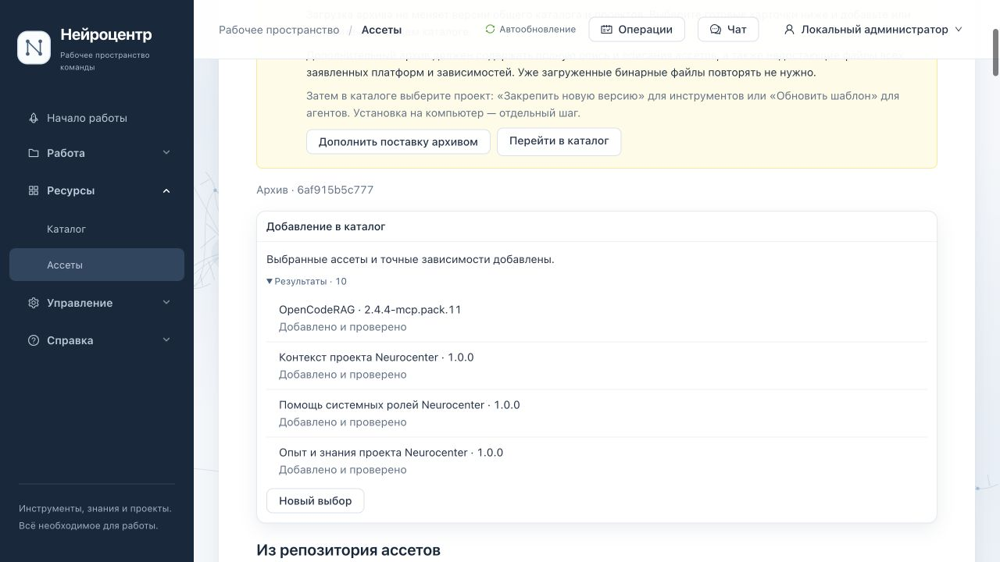
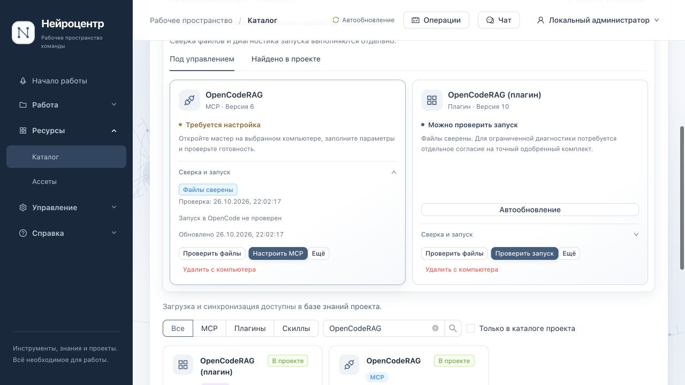
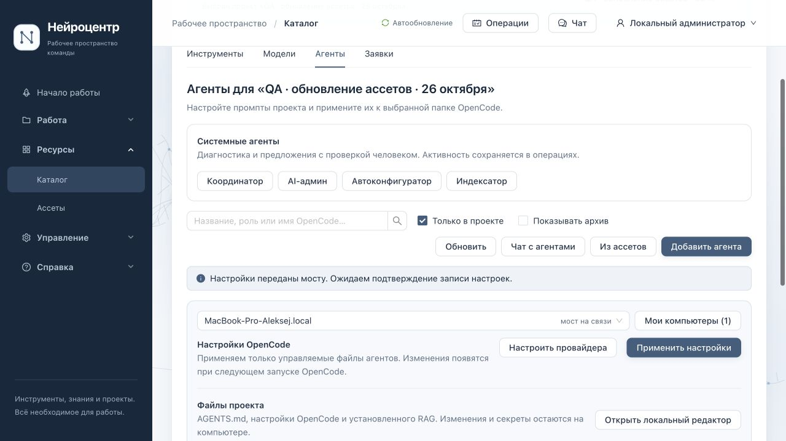
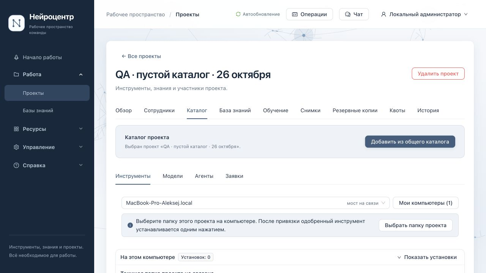

# Обновление ассетов из архива через интерфейс — 26 октября 2026

## Область проверки

По просьбе пользователя сценарий пройден локально через настоящий интерфейс: старая опись → загрузка подготовленного архива → обновление общего каталога → явное обновление закреплений проекта → установка через работающий мост. Использованы Ant Design UI на `localhost:5173`, реальные локальные сервисы и macOS arm64. Запросы к модели, переиндексация и запуск OpenCode не выполнялись.

Основной QA-проект: `prj-f38c49cc-92ea-4469-b0a3-f7873cfd2777`, «QA · обновление ассетов · 26 октября». Папка создана отдельно: `Documents/neurocenter-asset-update-qa-20261026`. Пустое состояние проверено в отдельном проекте `prj-35878e39-9420-40cd-a830-b46b691e3376`, без привязки папки и установок. Проект A и папка bank не использовались для записей.

Frontend временно запускался из проверяемого worktree на разрешённом origin 5173. Попытка отдельного origin 5174 получила штатный отказ CSRF; защита не обходилась. Backend оставался в сохранённом поколении `6e5bf7db-8ca0-4f48-a9b8-8670e5161eb5`; это не проверка всех последних backend-изменений main.

## Найденные проблемы интерфейса и исправления

- После приёма архива не было достаточно ясного следующего шага. Теперь видны готовность файлов, необходимость дополнить частичную поставку и последовательность: общий каталог → закрепление проекта → установка на компьютер.
- Старые локальные упаковки располагались выше обновлённой внешней описи. Опись теперь показана первой; локальные карточки остаются отдельным разделом.
- Обновления требовали ручного поиска среди всех ассетов. «Выбрать готовые обновления» выбирает только готовые, доступные, неархивные обновления. Кнопка ничего не публикует до отдельного подтверждённого действия добавления. Порция ограничена существующим серверным лимитом 50; для остальных показано продолжение.
- В пустом проектном каталоге инструкция предлагала выбирать инструменты, но перехода к общему каталогу не было. Добавлена ссылка «Добавить из общего каталога»: сохраняет ID проекта, очищает прежний поиск, учитывает права просмотра и изменения.
- В форме архива показаны имя и размер выбранного файла; объяснено различие между исходниками одного инструмента для упаковщика и подготовленной поставкой ассетов.

Изменения используют существующие feature flags и разрешения; новые API, форматы архивов и правила доверия не вводились.

## Архив и фактический результат

Старая опись: `ac387096140a592539b345e0e82d6838f2614ff1`. Новая: `e1255b4e522a0b38e471d5624cc63f5f13442649`; SHA-256 index: `c16495fb5b0c2151612fa6f83ba8ad2de31e575ffc8c843d85009631fcf19ce7`.

Подготовлены 56 файлов metadata и 23 blob для 31 ассета запрошенных типов: 5 MCP, 5 плагинов, 16 навыков, 5 агентов. Все размеры и SHA-256 сверены до загрузки и в серверном кэше после неё. Из-за ограниченного места поставка загружена через UI частями: сначала darwin-arm64 TAR, затем пять дополнений с полной описью и недостающими файлами остальных платформ. Итог — файлы готовы у 32 из 34 карточек всей описи; две незагруженные позиции — модели, не входящие в этот сценарий. Все 31 запрошенный ассет готовы. Архивный режим использует имеющиеся файлы без сетевой дозагрузки.

| Проверка | Наблюдаемый результат |
| --- | --- |
| Частичная поставка | Готовые карточки доступны, незагруженные платформенные файлы явно перечислены; можно дополнить архив |
| Неверный TAR | Ошибка показана, выбранный файл и прежняя проверенная опись сохранены; замена файла и следующий импорт успешны |
| Только загрузка архива | Общие карточки и закрепления проекта остаются прежними до явного обновления |
| Импорт обновлений | MCP + плагин + 5 агентов + 3 точные зависимости навыков: 10 результатов «Добавлено и проверено» |
| Конфликт прежней локальной упаковки | UI показывает замену; после подтверждения сохранён native ID плагина и история, дубликат не создан |
| Плагин | `2.4.4-plugin.pack.9 → pack.11`, редакция `9 → 10`; обновлён через мост, файлы сверены |
| MCP | `2.4.4-mcp.pack.9 → pack.11`, редакция `5 → 6`; сначала установлена старая версия, затем обновлена, файлы сверены |
| Агент | Все пять общих шаблонов `1 → 2`; QA «Ревьюер» явно обновлён, описание проекта сохранено, новый prompt принят, файл записан мостом |
| Навыки | Три новых навыка добавлены, закреплены и установлены в QA-папку; SHA файлов совпали с манифестами |
| Повтор импорта Ревьюера | Четыре позиции (агент и три навыка) `unchanged`; агент остался v2, навыки v1, дублей и лишних native-версий нет |
| Перезагрузка страницы | Опись, результат импорта, выбранные версии и установленные карточки восстанавливаются |
| Пустой каталог и поиск без результатов | Переход к общему каталогу сохраняет выбранный проект и убирает прежний фильтр |
| Сохранность другого проекта | READ ONLY: проект A сохранил pin плагина 9 и прежний SHA манифеста |

У 13 ранее существовавших навыков содержимое и версии между двумя описями совпадают побайтно. `neurocenter-packaging` остался 1.1.0, остальные 12 — 1.0.0. Новые `neurocenter-project-context`, `neurocenter-project-learning`, `neurocenter-system-assistance` имеют 1.0.0. Поэтому переход версии существовавшего навыка этой поставкой не проверен; подтверждены добавление и отсутствие ложного предложения обновления.

Ручное `instructions: ["README.md"]` в `opencode.json` сохранилось после всех установок. Плагин ссылается на новый runtime SHA `0e9b4fd1e1a6b286b488f32dfe8b4a338fc564d33aec68fdac80c714d2c5099f`; MCP использует одобренный манифест `c1b75436dc744d7e4c649091a93e5e7ee4a424c5f8055b4a60551de15d7fa000`. Файлы трёх навыков и `.opencode/agents/nc-reviewer.md` присутствуют в QA-папке.

MCP показывает «Требуется настройка»: адрес и модель эмбеддингов намеренно не задавались. Это подтверждение установки и сверки файлов, не успешного поиска, inference или запуска в OpenCode. UI явно сохраняет это различие.

## Проверки кода и очередей

- RED: прежний UI не прошёл проверки размера архива, следующего шага и выбора обновлений. Отдельный RED воспроизвёл выбор 51 позиции при лимите 50.
- GREEN: **87/87** в шести наборах: `asset-sources-editor`, `asset-archive-modal`, `asset-archive-upload`, `local-asset-cards`, `store-source-failure-isolation`, `asset-import-audit`.
- `tsc --noEmit` и production Vite build — exit 0, Node 24.22.0. Сборка направлена в собственную `.run`, live dist не заменялся. Предупреждение Vite о chunks >500 kB остаётся.
- Независимое ревью изменений — PASS после ограничения порции и уточнения частичной поставки.
- Отдельная PostgreSQL-сверка в READ ONLY: пять agent heads v2/history[1,2], три skill versions v1; два проверенных импорта SUCCEEDED. Все QA bridge-задачи завершены успешно; активных QA задач в проверенных очередях bridge, roles, learning, model calls, project chat и operations нет.

Это локальные тесты, desktop UI и установленный macOS-комплект. Linux с фотографий, остальные ОС, запуск Qwen, CI и production этим проходом не приняты. Весь проект и весь бэклог не объявляются проверенными.

## Свидетельства

Локальный каталог: `.run/ui-asset-archive-update-20261026/`. В нём `ui-green.log`, `final-checks/receipt.json`, `archive-server-cache-verification.json`, `skill-version-content-comparison.json`, `native-project-files.json`, `read-only-final-state.json` и скриншоты 01–09. Собственные временные TAR part02–05 после проверки серверного кэша удалены; квитанции помечены `artifactPresent=false`, `serverCacheVerified=true`. Host TAR и part01 сохранены. Освобождено 1 176 236 448 байт; серверный кэш не удалялся.

## Следующие проверки

При чтении кода отмечены два отдельных кандидата, не воспроизведённые этим браузерным проходом: восстановление выбора после окончательного отказа POST импорта до создания задания; совпадение preview/publish pin при переименовании исходного инструмента. Нужны причинные тесты до исправления. Неизвестное подтверждение уже принятого импорта нельзя приравнивать к безопасному сбросу request key.
